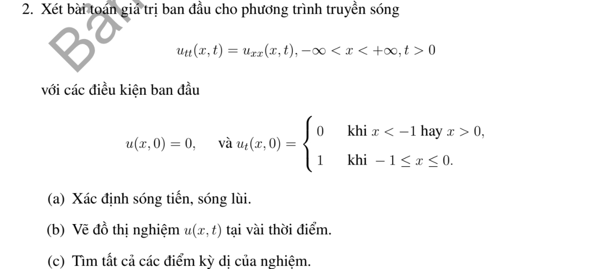
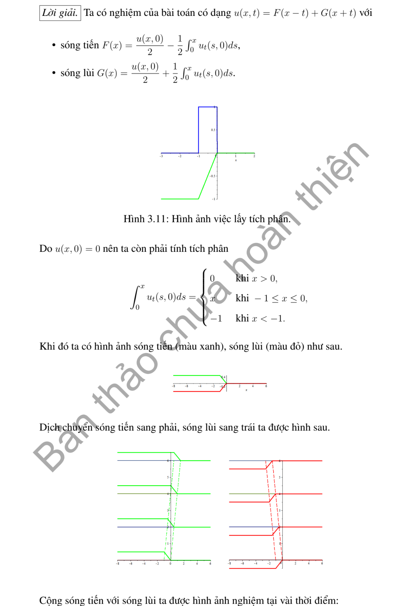
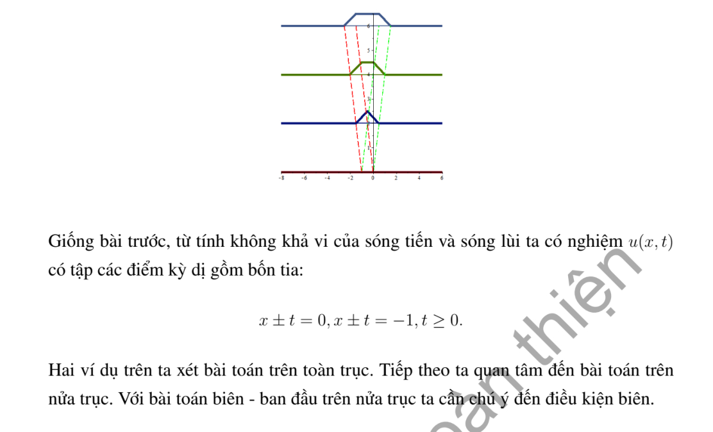

# Ví dụ 2 — Mục 3.2.2

**Mã:** `VD_3_2_2_02` · **Trang sách:** 108–110

[← Mục lục](../MUC_LUC.md) · [Bản PDF của bài](VD_3_2_2_02.pdf)

## Đề bài và phần trình bày có sẵn trong sách

## Kiến thức và trình tự giải

**Bước 1 — Liệt kê các khoảng của dữ liệu.** Ghi đủ điểm đầu, điểm cuối hỗ trợ, điểm gãy và bước nhảy của $f,g$. Nếu có biên, phản xạ chẵn hoặc lẻ trước khi tích phân; trên đoạn hữu hạn tiếp tục phản xạ đến một chu kỳ hoàn chỉnh.

**Bước 2 — Tính nguyên hàm liên tục.** Lấy $H'=\widetilde g$ trên từng khoảng và chọn hằng số để hai vết của $H$ bằng nhau. Viết $[s]_p^q=\min(q,\max(p,s))$ hoặc $(s)_+=\max(s,0)$ khi cần gộp nhiều nhánh. Một nguyên hàm liên tục tránh tạo ra bước nhảy giả trong nghiệm.

**Bước 3 — Xác định sóng phải và sóng trái.** Đặt $A(s)=\widetilde f(s)/2-H(s)/(2a)$, $B(s)=\widetilde f(s)/2+H(s)/(2a)$; khi đó $u=A(x-at)+B(x+at)$. Với từng $t$ được yêu cầu, dịch đồ thị $A$ sang phải $at$ và $B$ sang trái $at$, rồi cộng tung độ. Các đường $x-at=b$ và $x+at=b$ chia mặt phẳng thành các miền có công thức đơn giản.

**Bước 4 — Xét liên tục, đạo hàm và giao của các mặt sóng.** Nếu $f$ có bước nhảy, $u$ thường có bước nhảy; nếu $f$ liên tục và $g$ bị chặn thì $u$ liên tục. Tại thời điểm cố định,

$$
u_x=\frac{\widetilde f'(x-at)+\widetilde f'(x+at)}2+\frac{\widetilde g(x+at)-\widetilde g(x-at)}{2a}.
$$

Tính giới hạn trái/phải của biểu thức này tại từng vị trí ứng viên. Có thể có triệt tiêu khi hai đường gặp nhau, nên không chỉ liệt kê đường rồi khẳng định mọi đạo hàm đều mất. Với tính $C^1$ theo cả $x,t$, còn kiểm tra $u_t$. Với $C^2$, xét tiếp các góc của $g$ và đạo hàm cấp hai của $f$.

**Bước 5 — Tính thời điểm đến, giới hạn và ngưỡng.** Sóng ở $(x,t)$ chỉ nhận dữ liệu trong $[x-at,x+at]$. Giải bất đẳng thức giao hỗ trợ để tìm thời điểm đến và đi qua. Nếu $H$ hằng ngoài đoạn hỗ trợ, dùng các giá trị hằng này để tính giới hạn khi $t\to\infty$. Nếu hỏi áp suất cực đại, viết hàm từng khoảng thời gian và so sánh cực trị, bước nhảy cùng hai giá trị một phía.

## Lời giải áp dụng cho bài

**Bước 1. Tích phân vận tốc.** $f=0$, $g=\chi_{[-1,0]}$, $a=1$. Chọn

$$
H(s)=\begin{cases}0&s\le-1,\\s+1&-1<s<0,\\1&s\ge0.\end{cases}
$$

Hai hằng số đuôi đã nối liên tục với nhánh giữa.

**Bước 2. Tách và ghép sóng.** $A=-H/2$, $B=H/2$, nên $u=(H(x+t)-H(x-t))/2$. Tương đương

$$
u=\tfrac12\big[\min(x+t,0)-\max(x-t,-1)\big]_+.
$$

Biểu thức trong ngoặc là độ dài giao của khoảng ảnh hưởng với hỗ trợ vận tốc. Trên mỗi miền mà các min/max chọn cùng nhánh, $u$ là affine theo $x,t$.

**Bước 3. Miền gãy và giá trị lâu dài.** $H$ liên tục nên $u$ liên tục. $H'$ nhảy tại $-1,0$, phát sinh các đường $x\pm t=-1,0$ mất trơn cấp một. Với mỗi $x$ cố định, khi $t>\max(|x|,|x+1|)$, toàn đoạn $[-1,0]$ nằm trong khoảng ảnh hưởng, nên $u=1/2$. Kiểm tra tại $t=0$ có hiệu $H=0$ và $u_t=g$ tại các điểm liên tục của dữ liệu.

