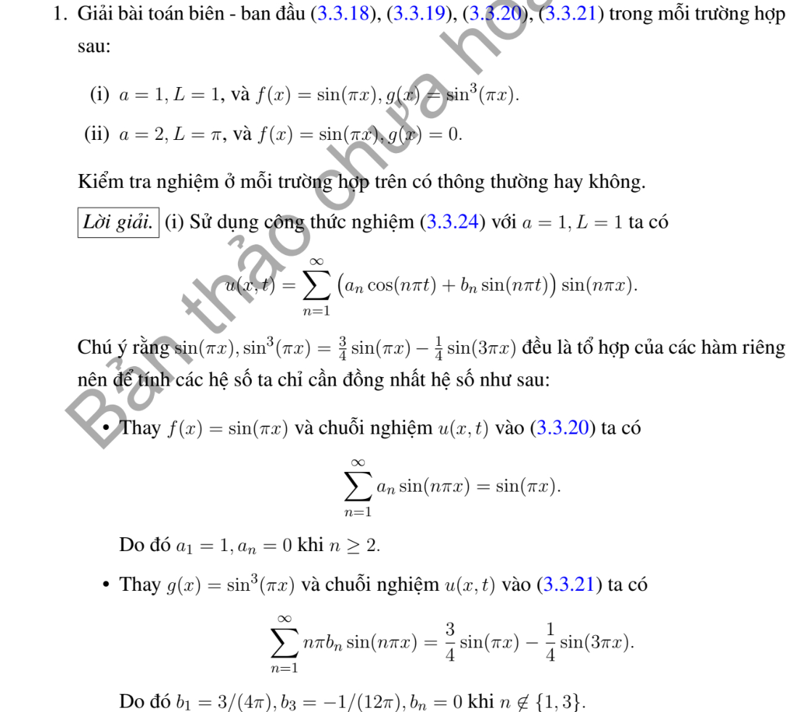
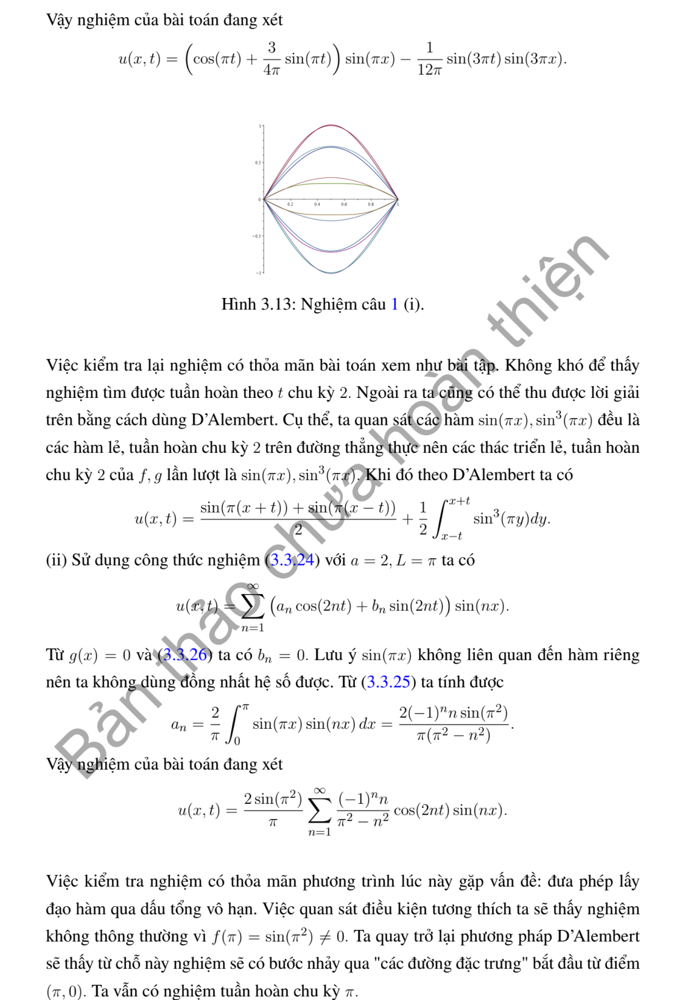
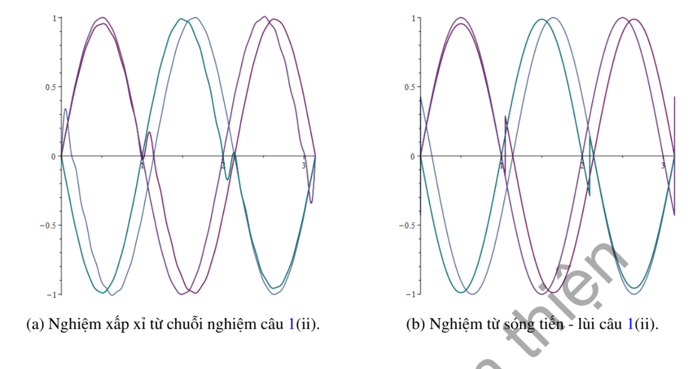

# Ví dụ 1 — Mục 3.3.2

**Mã:** `VD_3_3_2_01` · **Trang sách:** 137–139

[← Mục lục](../MUC_LUC.md) · [Bản PDF của bài](VD_3_3_2_01.pdf)

## Đề bài và phần trình bày có sẵn trong sách

## Kiến thức và trình tự giải

**Bước 1 — Tách biến và chọn bài toán trị riêng theo biên.** Đặt $u=X(x)T(t)$ trong $u_{tt}=a^2u_{xx}$, suy $X''+\lambda X=0$, $T''+a^2\lambda T=0$. Tích phân từng phần cho $\lambda\int X^2=\int (X')^2$ khi hạng biên bằng không; do đó $\lambda\ge0$. Giải cả trường hợp $\lambda=0$ trước khi xét $\lambda=k^2>0$.

**Bước 2 — Tìm hệ hàm riêng.** Trên $(0,L)$: Dirichlet hai đầu dùng $\sin(n\pi x/L)$, $n\ge1$; Neumann hai đầu dùng $1$ và $\cos(n\pi x/L)$; Dirichlet–Neumann dùng $\sin((n+1/2)\pi x/L)$, $n\ge0$; Neumann–Dirichlet dùng cos của các tần số nửa nguyên ấy. Chuẩn bình phương của mode khác không là $L/2$, của mode hằng là $L$.

**Bước 3 — Chiếu cả hai dữ liệu.** Với mode khác không đặt

$$
A_n=\frac2L\int_0^L fX_n\,dx,\quad B_n=\frac2L\int_0^L gX_n\,dx,\quad \omega_n=ak_n.
$$

Tích phân từng khoảng nếu dữ liệu chia đoạn; dùng tích phân từng phần hoặc công thức tích–tổng khi là đa thức/lượng giác. Hệ số $B_n$ là hệ số của vận tốc, nên hệ số đứng trước $\sin\omega_nt$ phải là $B_n/\omega_n$.

**Bước 4 — Ghép nghiệm và xét mode hằng.**

$$
u=\sum_n\left(A_n\cos\omega_nt+\frac{B_n}{\omega_n}\sin\omega_nt\right)X_n.
$$

Với Neumann hai đầu, thêm $A_0+B_0t$, trong đó $A_0=L^{-1}\int f$, $B_0=L^{-1}\int g$. Với tần số bị thay đổi bởi hạng $u$ hoặc cản $u_t$, giải lại ODE của từng mode; không dùng nguyên tần số $ak_n$.

**Bước 5 — Kiểm tra biên, dữ liệu và hội tụ.** Mỗi mode thỏa biên; tại $t=0$ hai chuỗi cho khai triển của $f,g$. Nếu dữ liệu không tương thích ở góc, giải theo nghĩa năng lượng hoặc từng miền và nêu đường mất tính trơn; không đạo hàm một chuỗi yếu tùy ý. Chu kỳ được suy từ tất cả mode có hệ số khác không, kể cả mode hằng; hai tần số có tỷ số vô tỷ ngăn một chu kỳ chung.

**Chi tiết tính tích phân hệ số.** Với $k=n\pi/L$, hai nguyên hàm thường dùng là

$$
\int x\sin kx\,dx=-x\cos kx/k+\sin kx/k^2,\qquad
\int x\cos kx\,dx=x\sin kx/k+\cos kx/k^2.
$$

Với đa thức $P$, ghi cả hai lần tích phân:

$$
\int_0^L P\sin kx\,dx
=\left[-P\cos kx/k\right]_0^L+
\left[P'\sin kx/k^2\right]_0^L-
\frac1{k^2}\int_0^L P''\sin kx\,dx.
$$

Chỉ bỏ hạng biên sau khi thế $0,L$ và điều kiện thực sự của $P$. Nếu dữ liệu chia đoạn, áp dụng công thức trên từng đoạn, rồi cộng các hạng tại điểm chia. Cuối cùng nhân nghịch đảo chuẩn của hàm riêng; nếu hệ số là của vận tốc, chia thêm tần số khi ghép nghiệm. Với mẫu số bằng $0$ trong tích–tổng, quay lại tích phân gốc để tính riêng.

## Lời giải áp dụng cho bài

**Bước 1. Chọn sine theo biên cố định.** Trên $(0,L)$, $X_n=\sin(n\pi x/L)$, $\omega_n=an\pi/L$. Hệ số của li độ là $A_n$, của vận tốc là $B_n$; nghiệm mode là $(A_n\cos\omega_nt+B_n\sin\omega_nt/\omega_n)X_n$.

**Bước 2. Câu (i).** $a=L=1$, $f=\sin\pi x$, $g=\sin^3\pi x=(3\sin\pi x-\sin3\pi x)/4$. Trực giao cho $A_1=1$, $B_1=3/4$, $B_3=-1/4$, các hệ số khác bằng $0$. Do đó

$$
u=\sin\pi x\cos\pi t+\frac3{4\pi}\sin\pi x\sin\pi t-\frac1{12\pi}\sin3\pi x\sin3\pi t.
$$

Đạo hàm thời gian tại $0$ khôi phục $g$; từng mode thỏa PDE và biên. Nghiệm $C^\infty$, chu kỳ cơ bản $2$.

**Bước 3. Câu (ii).** $a=2$, $L=\pi$, dữ liệu trong sách là $f(x)=\sin(\pi x)$, không phải $\sin x$. Dùng $2\sin\pi x\sin nx=\cos((\pi-n)x)-\cos((\pi+n)x)$:

$$
A_n=\frac2\pi\int_0^\pi\sin(\pi x)\sin nx\,dx
=\frac{2(-1)^nn\sin(\pi^2)}{\pi(\pi^2-n^2)},\qquad B_n=0.
$$

Không có mẫu số bằng không vì $n$ nguyên. Nghiệm là $u=\sum_{n\ge1}A_n\cos2nt\sin nx$, chu kỳ $\pi$.

**Bước 4. Nêu mức trơn đúng.** $f(\pi)=\sin(\pi^2)\ne0$, trái biên $u(\pi,t)=0$. Do đó câu (ii) không có nghiệm liên tục đến góc $(\pi,0)$ với mọi dữ liệu nguyên văn. Chuỗi xác định nghiệm theo nghĩa $L^2$/ từng miền; bước nhảy của mở rộng lẻ phát sinh mặt sóng từ đầu phải. Câu (i) không có vấn đề tương thích ấy.

**Chi tiết tích phân câu (ii).** Từ tích–tổng,

$$
A_n=\frac1\pi\left[\frac{\sin((\pi-n)x)}{\pi-n}-\frac{\sin((\pi+n)x)}{\pi+n}\right]_0^\pi.
$$

Vì $\sin(\pi^2-n\pi)=\sin(\pi^2+n\pi)=(-1)^n\sin\pi^2$,

$$
A_n=\frac{(-1)^n\sin\pi^2}{\pi}\left(\frac1{\pi-n}-\frac1{\pi+n}\right)
=\frac{2(-1)^nn\sin\pi^2}{\pi(\pi^2-n^2)}.
$$

