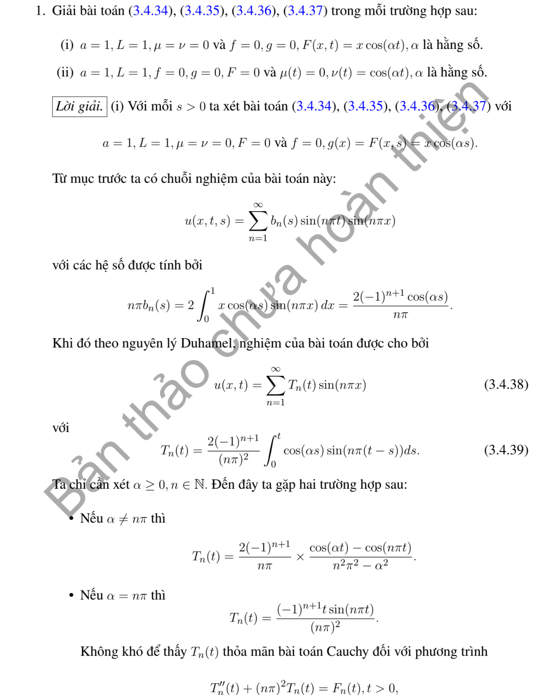
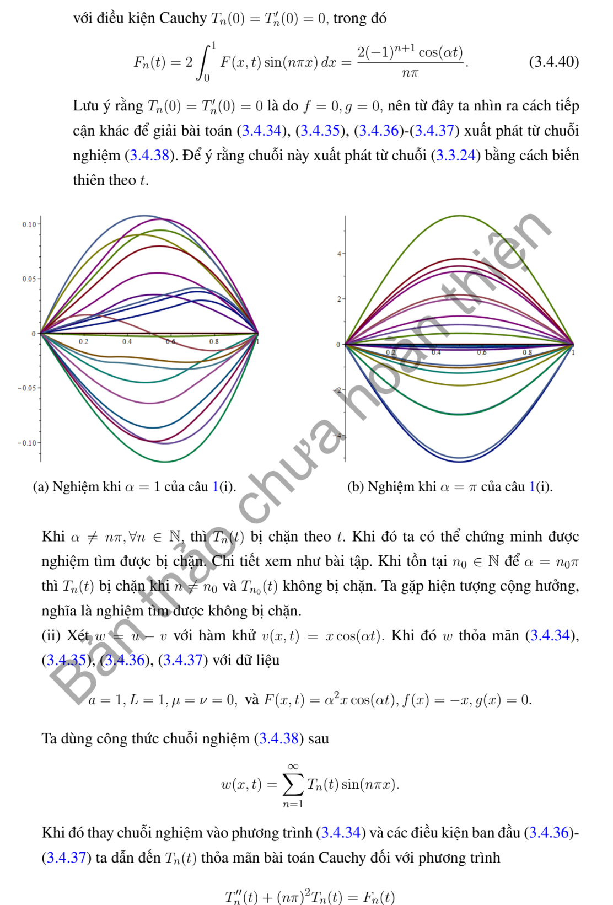
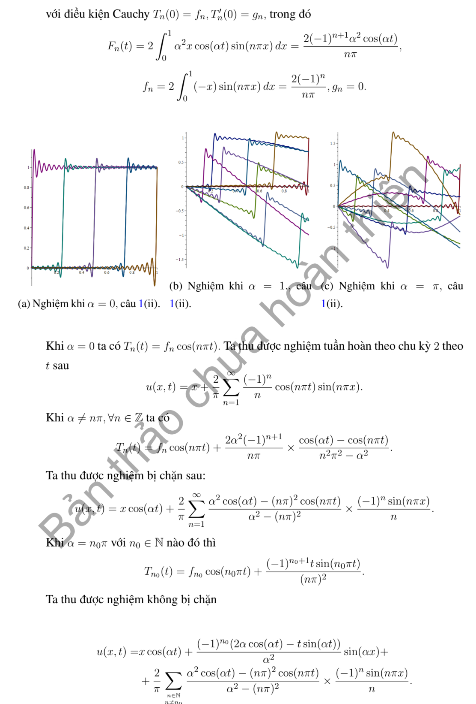

# Ví dụ 1 — Mục 3.4.2

**Mã:** `VD_3_4_2_01` · **Trang sách:** 147–150

[← Mục lục](../MUC_LUC.md) · [Bản PDF của bài](VD_3_4_2_01.pdf)

## Đề bài và phần trình bày có sẵn trong sách

## Kiến thức và trình tự giải

**Bước 1 — Đưa điều kiện biên về thuần nhất.** Với $u(0,t)=\mu(t)$, $u(L,t)=\nu(t)$, đặt $b=(1-x/L)\mu+(x/L)\nu$. Với Neumann hai đầu đặt $b=\mu x+(\nu-\mu)x^2/(2L)$. Với Dirichlet–Neumann đặt $b=\mu+x\nu$. Viết $u=b+w$; khi đó $w$ có biên thuần nhất, nguồn $Q=F+a^2b_{xx}-b_{tt}$ và dữ liệu $f-b(x,0)$, $g-b_t(x,0)$.

**Bước 2 — Chiếu nguồn và dữ liệu lên cùng hệ hàm riêng.** Tính $Q_n(t)=\int QX_n/\int X_n^2$, $A_n$, $B_n$. Không bỏ các dữ liệu mới phát sinh từ hàm nâng biên; chúng có thể khác không ngay khi dữ liệu gốc bằng không.

**Bước 3 — Giải ODE có nguồn cho từng mode.**

$$
y_n''+\omega_n^2y_n=Q_n(t),\qquad
y_n=A_n\cos\omega_nt+\frac{B_n}{\omega_n}\sin\omega_nt+\frac1{\omega_n}\int_0^t\sin(\omega_n(t-s))Q_n(s)ds.
$$

Với mode hằng Neumann, thay công thức bằng $y_0=A_0+B_0t+\int_0^t(t-s)Q_0(s)ds$.

**Bước 4 — Xử lý cộng hưởng trước khi chia.** Nguồn $\cos\alpha t$ có đáp ứng dữ liệu không là $(\cos\alpha t-\cos\omega t)/(\omega^2-\alpha^2)$; tại $\alpha=\omega$ lấy $t\sin\omega t/(2\omega)$. Nguồn $\sin\alpha t$ có đáp ứng $(\sin\alpha t-(\alpha/\omega)\sin\omega t)/(\omega^2-\alpha^2)$; tại cộng hưởng là $\sin\omega t/(2\omega^2)-t\cos\omega t/(2\omega)$. Không thế vào phân số $0/0$.

**Bước 5 — Cộng lại hàm nâng và kiểm tra duy nhất.** Thế $u=b+\sum y_nX_n$ vào PDE và mọi dữ liệu. Với hiệu hai nghiệm, nguồn và biên bằng không; nhân phương trình với $w_t$, tích phân từng phần để có $E'=0$, $E(0)=0$, suy $w=0$. Các góc không tương thích phải được ghi riêng.

**Chi tiết xác nhận tích phân nguồn.** Với $D(t)=\omega^{-1}\int_0^t\sin(\omega(t-s))Q(s)ds$, lần đạo hàm đầu cho $D'=\int_0^t\cos(\omega(t-s))Q(s)ds$, vì $\sin0=0$. Lần sau cho $D''=Q(t)-\omega\int_0^t\sin(\omega(t-s))Q(s)ds=Q-\omega^2D$. Do $D(0)=D'(0)=0$, tích phân này thêm đúng nguồn mà giữ nguyên hai dữ liệu đầu.

## Lời giải áp dụng cho bài

**Bước 1. Hệ sine và đáp ứng nguồn cos.** $a=L=1$, $X_n=\sin(n\pi x)$, $\omega_n=n\pi$. Khai triển $x$ có hệ số $c_n=2\int_0^1x\sin(n\pi x)dx=2(-1)^{n+1}/(n\pi)$. Đặt

$$
C_\omega(\alpha,t)=\frac{\cos\alpha t-\cos\omega t}{\omega^2-\alpha^2},\qquad
C_\omega(\omega,t)=\frac{t\sin\omega t}{2\omega}.
$$

Đây là nghiệm $C''+\omega^2C=\cos\alpha t$, $C(0)=C'(0)=0$; nhánh cộng hưởng lấy giới hạn hoặc tích phân Duhamel.

**Bước 2. Câu (i), biên không và nguồn $x\cos\alpha t$.** Dữ liệu đầu không, nên $y_n=c_nC_{\omega_n}$ và $u=\sum_{n\ge1}c_nC_{n\pi}\sin(n\pi x)$. Nếu $\alpha=m\pi$, chỉ mode $m$ dùng nhánh cộng hưởng, không chia $0$.

**Bước 3. Câu (ii), nguồn không và biên phải $\cos\alpha t$.** Lấy $b=x\cos\alpha t$, $w=u-b$. Khi đó $Q=\alpha^2x\cos\alpha t$, $w(x,0)=-x$, $w_t(x,0)=0$. Suy

$$
u=x\cos\alpha t+\sum_{n\ge1}c_n[-\cos(n\pi t)+\alpha^2C_{n\pi}(\alpha,t)]\sin(n\pi x).
$$

**Bước 4. Kiểm tra và góc.** Hàm nâng cho đúng biên, ODE cho nguồn của $w$ rồi triệt tiêu với $b_{tt}$. Tại $t=0$ khai triển $-x$ bù li độ của $b$ trong miền. Nhưng ở $(1,0)$, biên phải bằng $1$ trái li độ đầu $0$, nên câu (ii) không có nghiệm liên tục trên toàn bao đóng. Câu (i) có nguồn không khớp gia tốc biên tại góc phải nếu đòi $C^2$ đến góc; chuỗi vẫn giải trong miền với cách hiểu thích hợp.

**Chi tiết hệ số nguồn và đáp ứng.** Tích phân từng phần:

$$
c_n=2\left[-\frac{x\cos(n\pi x)}{n\pi}+
\frac{\sin(n\pi x)}{n^2\pi^2}\right]_0^1
=-\frac{2(-1)^n}{n\pi}.
$$

Với $\alpha^2\ne\omega^2$, thử $C_p=A\cos\alpha t$: $(\omega^2-\alpha^2)A=1$. Tổng $C=A\cos\alpha t+B\cos\omega t+D\sin\omega t$ có dữ liệu không khi $B=-A,D=0$. Với $\alpha=\omega$, thử $C=bt\sin\omega t$; đạo hàm hai lần cho $C''+\omega^2C=2b\omega\cos\omega t$, nên $b=1/(2\omega)$. Trong câu (ii), $b_{xx}=0$, $b_{tt}=-\alpha^2x\cos\alpha t$; vì $u_{tt}-u_{xx}=0$, phần $w$ có nguồn $-b_{tt}=\alpha^2x\cos\alpha t$ và dữ liệu $w_0=-x,w_{t,0}=0$.

