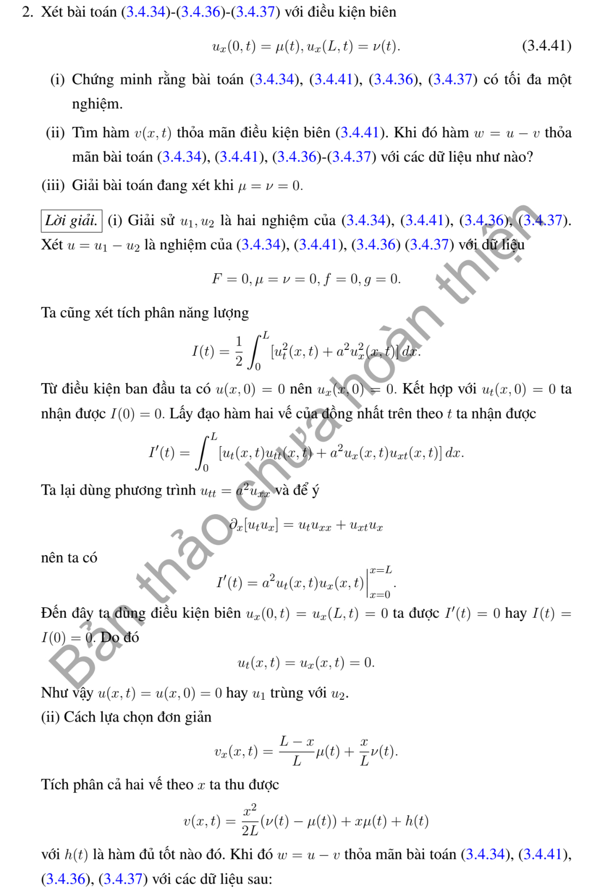
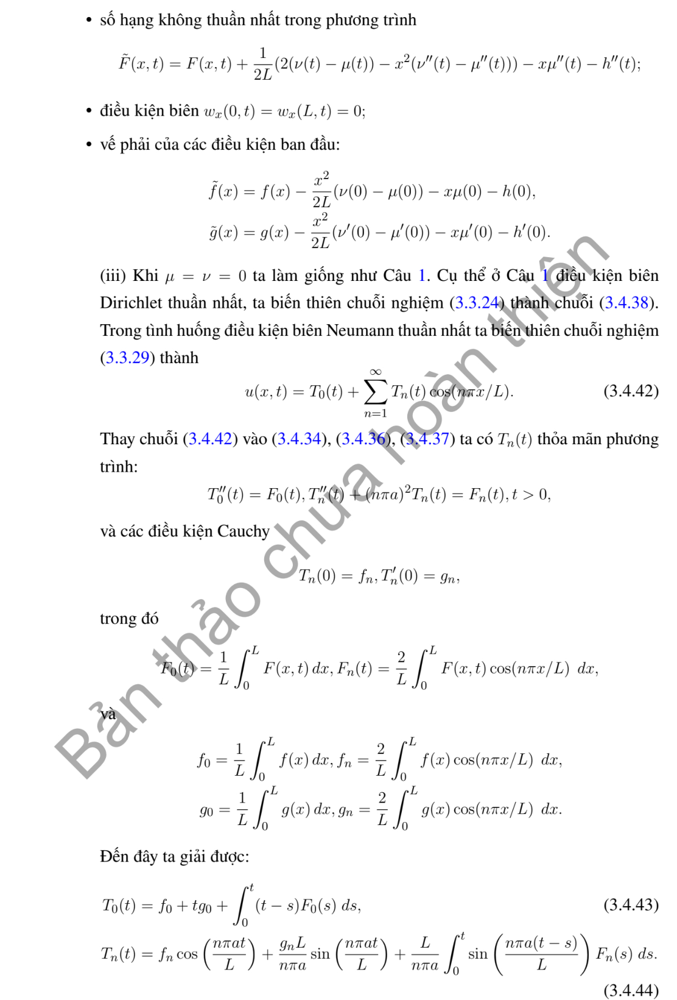

# Ví dụ 2 — Mục 3.4.2

**Mã:** `VD_3_4_2_02` · **Trang sách:** 150–152

[← Mục lục](../MUC_LUC.md) · [Bản PDF của bài](VD_3_4_2_02.pdf)

## Đề bài và phần trình bày có sẵn trong sách

## Kiến thức và trình tự giải

**Bước 1 — Đưa điều kiện biên về thuần nhất.** Với $u(0,t)=\mu(t)$, $u(L,t)=\nu(t)$, đặt $b=(1-x/L)\mu+(x/L)\nu$. Với Neumann hai đầu đặt $b=\mu x+(\nu-\mu)x^2/(2L)$. Với Dirichlet–Neumann đặt $b=\mu+x\nu$. Viết $u=b+w$; khi đó $w$ có biên thuần nhất, nguồn $Q=F+a^2b_{xx}-b_{tt}$ và dữ liệu $f-b(x,0)$, $g-b_t(x,0)$.

**Bước 2 — Chiếu nguồn và dữ liệu lên cùng hệ hàm riêng.** Tính $Q_n(t)=\int QX_n/\int X_n^2$, $A_n$, $B_n$. Không bỏ các dữ liệu mới phát sinh từ hàm nâng biên; chúng có thể khác không ngay khi dữ liệu gốc bằng không.

**Bước 3 — Giải ODE có nguồn cho từng mode.**

$$
y_n''+\omega_n^2y_n=Q_n(t),\qquad
y_n=A_n\cos\omega_nt+\frac{B_n}{\omega_n}\sin\omega_nt+\frac1{\omega_n}\int_0^t\sin(\omega_n(t-s))Q_n(s)ds.
$$

Với mode hằng Neumann, thay công thức bằng $y_0=A_0+B_0t+\int_0^t(t-s)Q_0(s)ds$.

**Bước 4 — Xử lý cộng hưởng trước khi chia.** Nguồn $\cos\alpha t$ có đáp ứng dữ liệu không là $(\cos\alpha t-\cos\omega t)/(\omega^2-\alpha^2)$; tại $\alpha=\omega$ lấy $t\sin\omega t/(2\omega)$. Nguồn $\sin\alpha t$ có đáp ứng $(\sin\alpha t-(\alpha/\omega)\sin\omega t)/(\omega^2-\alpha^2)$; tại cộng hưởng là $\sin\omega t/(2\omega^2)-t\cos\omega t/(2\omega)$. Không thế vào phân số $0/0$.

**Bước 5 — Cộng lại hàm nâng và kiểm tra duy nhất.** Thế $u=b+\sum y_nX_n$ vào PDE và mọi dữ liệu. Với hiệu hai nghiệm, nguồn và biên bằng không; nhân phương trình với $w_t$, tích phân từng phần để có $E'=0$, $E(0)=0$, suy $w=0$. Các góc không tương thích phải được ghi riêng.

**Chi tiết xác nhận tích phân nguồn.** Với $D(t)=\omega^{-1}\int_0^t\sin(\omega(t-s))Q(s)ds$, lần đạo hàm đầu cho $D'=\int_0^t\cos(\omega(t-s))Q(s)ds$, vì $\sin0=0$. Lần sau cho $D''=Q(t)-\omega\int_0^t\sin(\omega(t-s))Q(s)ds=Q-\omega^2D$. Do $D(0)=D'(0)=0$, tích phân này thêm đúng nguồn mà giữ nguyên hai dữ liệu đầu.

## Lời giải áp dụng cho bài

**Bước 1. Tính duy nhất.** Với hiệu $v$ của hai nghiệm cùng dữ liệu và biên Neumann, $v_{tt}=a^2v_{xx}$, $v_x(0,t)=v_x(L,t)=0$. Đạo hàm $E=\frac12\int(v_t^2+a^2v_x^2)$ cho $E'=a^2[v_tv_x]_0^L=0$. $E(0)=0$ suy $v_t=v_x=0$; li độ đầu bằng $0$ xác định hằng số là $0$.

**Bước 2. Nâng biên tổng quát.** Với $u_x(0,t)=\mu(t)$, $u_x(L,t)=\nu(t)$, chọn $b=\mu x+(\nu-\mu)x^2/(2L)$, vì $b_x(0)=\mu$, $b_x(L)=\nu$. Đặt $w=u-b$; nguồn mới là $Q=F+a^2(\nu-\mu)/L-b_{tt}$, hai dữ liệu mới là $f-b_0$, $g-b_{t,0}$.

**Bước 3. Tách mode.** Với $X_0=1$, $X_n=\cos(n\pi x/L)$, lấy hệ số $A_0,B_0,Q_0$ là trung bình và các hệ số $n\ge1$ là $2/L$ lần tích phân với $X_n$. Mode hằng giải $y_0''=Q_0$, nên $y_0=A_0+B_0t+\int_0^t(t-s)Q_0(s)ds$. Mode còn lại giải

$$
y_n=A_n\cos\omega_nt+\frac{B_n}{\omega_n}\sin\omega_nt+\frac1{\omega_n}\int_0^t\sin(\omega_n(t-s))Q_n(s)ds.
$$

**Bước 4. Trở lại nghiệm.** $u=b+y_0+\sum_{n\ge1}y_nX_n$. Kiểm tra $t=0$ sau khi cộng hàm nâng; kiểm tra từng đạo hàm biên. Công thức mode hằng khác các mode dao động, nên không áp dụng mẫu $1/\omega_0$. Nếu dữ liệu không tương thích $f'(0)=\mu(0)$, $g'(0)=\mu'(0)$ (và tương tự đầu phải), nêu rõ mức trơn và xét nghiệm yếu thay vì khẳng định cổ điển đến góc.

**Chi tiết tích phân từng phần trong đạo hàm năng lượng.** Đặt $E=\frac12\int_0^L(u_t^2+a^2u_x^2+\kappa u^2)dx$. Với $u_{tt}-a^2u_{xx}+\gamma u_t+\kappa u=F$,

$$
\begin{aligned}
E'&=\int_0^L(u_tu_{tt}+a^2u_xu_{xt}+\kappa uu_t)dx\\
&=\int_0^Lu_t(a^2u_{xx}-\gamma u_t-\kappa u+F)dx
+a^2\int_0^Lu_xu_{xt}dx+\kappa\int_0^Luu_tdx\\
&=a^2[u_tu_x]_0^L-a^2\int_0^Lu_{tx}u_xdx
+a^2\int_0^Lu_xu_{xt}dx-\gamma\int_0^Lu_t^2dx+\int_0^LFu_tdx\\
&=a^2[u_tu_x]_0^L-\gamma\int_0^Lu_t^2dx+\int_0^LFu_tdx.
\end{aligned}
$$

Hai hạng $\kappa uu_t$ triệt tiêu ngay khi thế PDE; hai tích phân $u_xu_{xt}$ triệt tiêu sau tích phân từng phần. Với biên Dirichlet thuần nhất, đạo hàm vết theo $t$ cho $u_t=0$; với biên Neumann thuần nhất, $u_x=0$. Nếu định nghĩa năng lượng không có $1/2$, nhân cả đẳng thức đạo hàm với $2$.

**Chi tiết đạo hàm đáp ứng mode nguồn.** Đặt $D_n(t)=\omega_n^{-1}\int_0^t\sin(\omega_n(t-s))Q_n(s)ds$. Vì $\sin0=0$,

$$
D_n'=\int_0^t\cos(\omega_n(t-s))Q_n(s)ds,\quad
D_n''=Q_n(t)-\omega_n\int_0^t\sin(\omega_n(t-s))Q_n(s)ds=Q_n-\omega_n^2D_n.
$$

Tại $0$, $D_n=D_n'=0$. Vì thế tích phân vừa cho đúng nguồn, vừa giữ nguyên cả hai dữ liệu ban đầu của các hạng thuần nhất. Với mode hằng, $D_0=\int_0^t(t-s)Q_0(s)ds$, $D_0'=\int_0^tQ_0(s)ds$, $D_0''=Q_0(t)$, không chia cho $\omega_0=0$.

