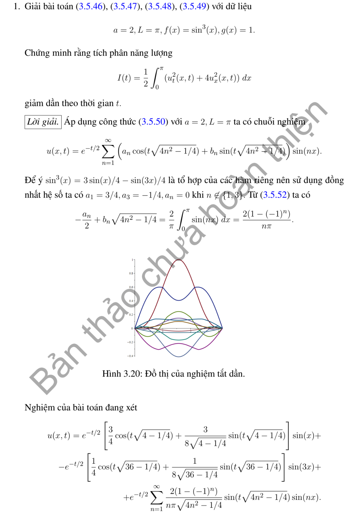
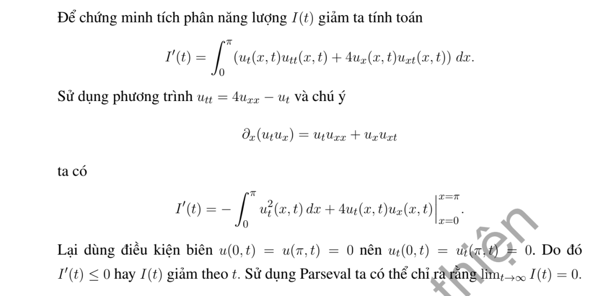

# Ví dụ 1 — Mục 3.5.2

**Mã:** `VD_3_5_2_01` · **Trang sách:** 154–155

[← Mục lục](../MUC_LUC.md) · [Bản PDF của bài](VD_3_5_2_01.pdf)

## Đề bài và phần trình bày có sẵn trong sách

## Kiến thức và trình tự giải

**Bước 1 — Chọn năng lượng theo toán tử.** Với sóng dùng $E=\frac12\int(u_t^2+a^2u_x^2)dx$. Với Klein–Gordon có thêm $u$, thêm $\frac12\int u^2dx$. Với dầm $u_{tt}=-a^2u_{xxxx}$ dùng $E=\frac12\int(u_t^2+a^2u_{xx}^2)dx$, không thay $u_{xx}$ bằng $u_x$.

**Bước 2 — Đạo hàm và tích phân từng phần.** Với $u_{tt}-a^2u_{xx}+\gamma u_t+\kappa u=F$, năng lượng có hạng $\kappa u^2$ cho

$$
E'=a^2[u_tu_x]_0^L-\gamma\int u_t^2dx+\int Fu_tdx.
$$

Với dầm, tích phân hai lần cho $E'=a^2[u_{tx}u_{xx}-u_tu_{xxx}]_0^L$. Viết riêng từng hạng biên rồi dùng điều kiện biên và đạo hàm theo thời gian của điều kiện đó để cho chúng bằng không.

**Bước 3 — Suy hệ quả.** Không cản, không nguồn thì $E$ bảo toàn. Có cản $\gamma>0$ thì $E'\le0$; nếu $E$ không có hệ số $1/2$, $E'=-2\gamma\int u_t^2\ge-2\gamma E$, suy $e^{-2\gamma t}E(0)\le E(t)\le E(0)$. Với hiệu hai nghiệm cùng dữ liệu, $E(0)=0$ nên có duy nhất.

**Bước 4 — Tách biến nếu phải tìm nghiệm cụ thể.** Sóng có cản $\gamma=1$ cho $T''+T'+a^2\lambda T=0$. Đặt $T=e^{-t/2}Y$, thu $Y''+(a^2\lambda-1/4)Y=0$, $Y(0)=A$, $Y'(0)=B+A/2$. Phân biệt dao động, nghiệm kép và hàm hyperbolic. Dầm cho $X''''=k^4X$, $T''+a^2k^4T=0$; dùng đủ bốn điều kiện biên để tìm phương trình của $kL$.

**Bước 5 — Kiểm tra hệ số và khẳng định của đề.** Năng lượng đầu chứa cả $g^2$ và các đạo hàm của $f$. Thử $f=0$, $g\ne0$ để phát hiện công thức bỏ vận tốc. Với dầm, nghiệm $k=0$ phải giải trực tiếp bằng đa thức bậc ba; nghiệm $0$ của phương trình lượng giác–hyperbolic có thể chỉ là nghiệm giả do cơ sở suy biến.

**Chi tiết phép triệt tiêu tích phân.** Đạo hàm động năng cho $\int u_tu_{tt}$; dùng PDE thay $u_{tt}$. Với sóng, $\int u_tu_{xx}=[u_tu_x]-\int u_{tx}u_x$, và tích phân cuối triệt tiêu đạo hàm thế năng $\int u_xu_{xt}$. Với dầm,

$$
\int u_tu_{xxxx}=[u_tu_{xxx}-u_{tx}u_{xx}]+\int u_{txx}u_{xx}.
$$

Tích phân cuối triệt tiêu đạo hàm $\frac12\int u_{xx}^2$ sau khi nhân hệ số và giữ đúng dấu PDE. Viết hạng biên trước, sau đó mới dùng điều kiện của từng đầu.

**Bước 1 — Tách biến và chọn bài toán trị riêng theo biên.** Đặt $u=X(x)T(t)$ trong $u_{tt}=a^2u_{xx}$, suy $X''+\lambda X=0$, $T''+a^2\lambda T=0$. Tích phân từng phần cho $\lambda\int X^2=\int (X')^2$ khi hạng biên bằng không; do đó $\lambda\ge0$. Giải cả trường hợp $\lambda=0$ trước khi xét $\lambda=k^2>0$.

**Bước 2 — Tìm hệ hàm riêng.** Trên $(0,L)$: Dirichlet hai đầu dùng $\sin(n\pi x/L)$, $n\ge1$; Neumann hai đầu dùng $1$ và $\cos(n\pi x/L)$; Dirichlet–Neumann dùng $\sin((n+1/2)\pi x/L)$, $n\ge0$; Neumann–Dirichlet dùng cos của các tần số nửa nguyên ấy. Chuẩn bình phương của mode khác không là $L/2$, của mode hằng là $L$.

**Bước 3 — Chiếu cả hai dữ liệu.** Với mode khác không đặt

$$
A_n=\frac2L\int_0^L fX_n\,dx,\quad B_n=\frac2L\int_0^L gX_n\,dx,\quad \omega_n=ak_n.
$$

Tích phân từng khoảng nếu dữ liệu chia đoạn; dùng tích phân từng phần hoặc công thức tích–tổng khi là đa thức/lượng giác. Hệ số $B_n$ là hệ số của vận tốc, nên hệ số đứng trước $\sin\omega_nt$ phải là $B_n/\omega_n$.

**Bước 4 — Ghép nghiệm và xét mode hằng.**

$$
u=\sum_n\left(A_n\cos\omega_nt+\frac{B_n}{\omega_n}\sin\omega_nt\right)X_n.
$$

Với Neumann hai đầu, thêm $A_0+B_0t$, trong đó $A_0=L^{-1}\int f$, $B_0=L^{-1}\int g$. Với tần số bị thay đổi bởi hạng $u$ hoặc cản $u_t$, giải lại ODE của từng mode; không dùng nguyên tần số $ak_n$.

**Bước 5 — Kiểm tra biên, dữ liệu và hội tụ.** Mỗi mode thỏa biên; tại $t=0$ hai chuỗi cho khai triển của $f,g$. Nếu dữ liệu không tương thích ở góc, giải theo nghĩa năng lượng hoặc từng miền và nêu đường mất tính trơn; không đạo hàm một chuỗi yếu tùy ý. Chu kỳ được suy từ tất cả mode có hệ số khác không, kể cả mode hằng; hai tần số có tỷ số vô tỷ ngăn một chu kỳ chung.

**Chi tiết tính tích phân hệ số.** Với $k=n\pi/L$, hai nguyên hàm thường dùng là

$$
\int x\sin kx\,dx=-x\cos kx/k+\sin kx/k^2,\qquad
\int x\cos kx\,dx=x\sin kx/k+\cos kx/k^2.
$$

Với đa thức $P$, ghi cả hai lần tích phân:

$$
\int_0^L P\sin kx\,dx
=\left[-P\cos kx/k\right]_0^L+
\left[P'\sin kx/k^2\right]_0^L-
\frac1{k^2}\int_0^L P''\sin kx\,dx.
$$

Chỉ bỏ hạng biên sau khi thế $0,L$ và điều kiện thực sự của $P$. Nếu dữ liệu chia đoạn, áp dụng công thức trên từng đoạn, rồi cộng các hạng tại điểm chia. Cuối cùng nhân nghịch đảo chuẩn của hàm riêng; nếu hệ số là của vận tốc, chia thêm tần số khi ghép nghiệm. Với mẫu số bằng $0$ trong tích–tổng, quay lại tích phân gốc để tính riêng.

## Lời giải áp dụng cho bài

**Bước 1. Năng lượng của sóng có cản.** PDE là $u_{tt}+u_t=4u_{xx}$, biên cố định trên $(0,\pi)$. Với $E=\frac12\int(u_t^2+4u_x^2)$, tích phân từng phần cho $E'=4[u_tu_x]_0^\pi-\int u_t^2=-\int u_t^2\le0$. Do vậy năng lượng giảm; hiệu hai nghiệm cùng dữ liệu có năng lượng đầu $0$, chứng minh duy nhất.

**Bước 2. Tách biến và bỏ cản bằng đổi ẩn.** Mode $\sin nx$ có $T_n''+T_n'+4n^2T_n=0$. Đặt $T_n=e^{-t/2}Y_n$, được $Y_n''+(4n^2-1/4)Y_n=0$, $Y_n(0)=A_n$, $Y_n'(0)=B_n+A_n/2$. Đặt $\omega_n=\sqrt{4n^2-1/4}$:

$$
T_n=e^{-t/2}[A_n\cos\omega_nt+(B_n+A_n/2)\sin\omega_nt/\omega_n].
$$

Hạng $A_n/2$ cần để bù đạo hàm của $e^{-t/2}$.

**Bước 3. Dữ liệu cụ thể.** $f=\sin^3x$ cho $A_1=3/4$, $A_3=-1/4$, các hệ số khác $0$. $g=1$ cho $B_n=2(1-(-1)^n)/(\pi n)$. Nghiệm $u=\sum_{n\ge1}T_n\sin nx$ với các hệ số này.

**Bước 4. Kiểm tra.** Tại $t=0$, $T_n=A_n$, $T_n'=B_n$, đúng cả hai dữ liệu. Biên đúng theo sine và ODE chứng minh PDE. Tuy nhiên $g(0)=g(\pi)=1$ trái biên cố định, nên công thức là nghiệm năng lượng, có mặt gãy từ góc; không có nghiệm $C^1$ trên toàn bao đóng. Đẳng thức năng lượng vẫn đúng trong lớp năng lượng bằng xấp xỉ dữ liệu.

**Chi tiết tích phân của dữ liệu hằng.** Với $k_n=n\pi/L$,

$$
\int_0^L\sin k_nx\,dx=\left[-\frac{\cos k_nx}{k_n}\right]_0^L=\frac{1-(-1)^n}{k_n}.
$$

Nhân $2/L$ cho hệ số của hằng $1$ là $2(1-(-1)^n)/(n\pi)$; hằng $-1$ đổi dấu. Khi chiếu vận tốc, còn chia $\omega_n$ trong hệ số $\sin\omega_nt$; khi chiếu li độ, hệ số $\cos\omega_nt$ giữ nguyên.

**Chi tiết tích phân từng phần trong đạo hàm năng lượng.** Đặt $E=\frac12\int_0^L(u_t^2+a^2u_x^2+\kappa u^2)dx$. Với $u_{tt}-a^2u_{xx}+\gamma u_t+\kappa u=F$,

$$
\begin{aligned}
E'&=\int_0^L(u_tu_{tt}+a^2u_xu_{xt}+\kappa uu_t)dx\\
&=\int_0^Lu_t(a^2u_{xx}-\gamma u_t-\kappa u+F)dx
+a^2\int_0^Lu_xu_{xt}dx+\kappa\int_0^Luu_tdx\\
&=a^2[u_tu_x]_0^L-a^2\int_0^Lu_{tx}u_xdx
+a^2\int_0^Lu_xu_{xt}dx-\gamma\int_0^Lu_t^2dx+\int_0^LFu_tdx\\
&=a^2[u_tu_x]_0^L-\gamma\int_0^Lu_t^2dx+\int_0^LFu_tdx.
\end{aligned}
$$

Hai hạng $\kappa uu_t$ triệt tiêu ngay khi thế PDE; hai tích phân $u_xu_{xt}$ triệt tiêu sau tích phân từng phần. Với biên Dirichlet thuần nhất, đạo hàm vết theo $t$ cho $u_t=0$; với biên Neumann thuần nhất, $u_x=0$. Nếu định nghĩa năng lượng không có $1/2$, nhân cả đẳng thức đạo hàm với $2$.

**Chi tiết đổi ẩn trong ODE có cản.** Với $T=e^{-t/2}Y$,

$$
T'=e^{-t/2}(Y'-Y/2),\quad T''=e^{-t/2}(Y''-Y'+Y/4).
$$

Do đó $T''+T'+\Omega^2T=e^{-t/2}[Y''+(\Omega^2-1/4)Y]$. Dữ liệu $T(0)=A,T'(0)=B$ trở thành $Y(0)=A,Y'(0)=B+A/2$. Nếu $\Omega=0$, giải trực tiếp $T''+T'=0$: đặt $Z=T'$, $Z=Be^{-t}$, rồi $T=A+B(1-e^{-t})$.

