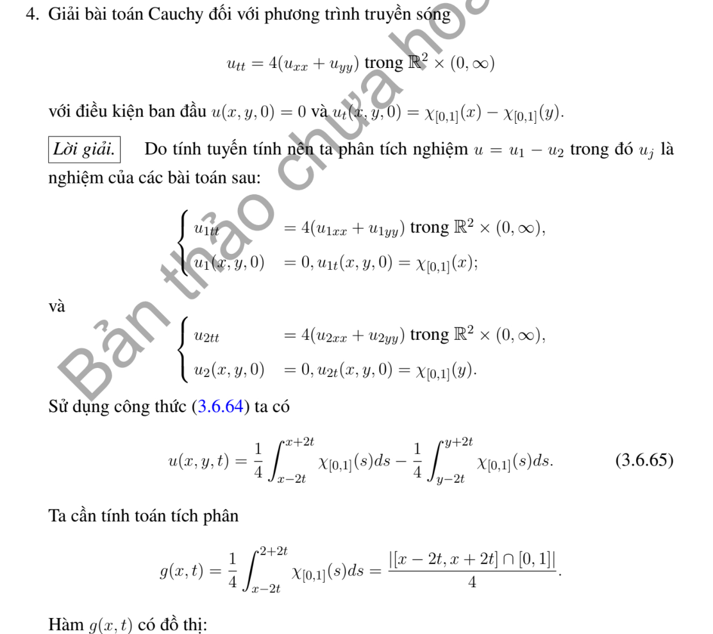
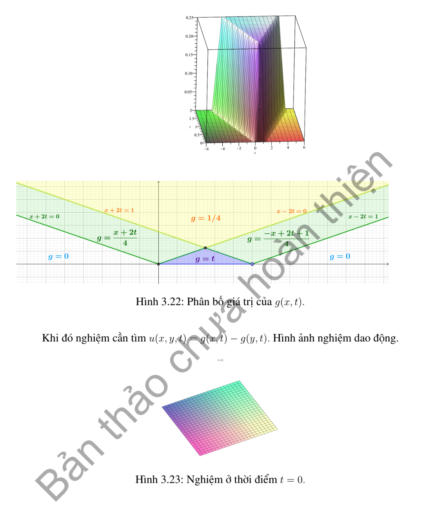

# Ví dụ 4 — Mục 3.6.2

**Mã:** `VD_3_6_2_04` · **Trang sách:** 172–173

[← Mục lục](../MUC_LUC.md) · [Bản PDF của bài](VD_3_6_2_04.pdf)

## Đề bài và phần trình bày có sẵn trong sách

## Kiến thức và trình tự giải

**Bước 1 — Chọn Kirchhoff (3D) hoặc Poisson (2D).** Với li độ đầu bằng không, vận tốc $\psi$, tốc độ $c$, đặt $\rho=ct$. Trong ba chiều,

$$
u(P,t)=\frac t{4\pi}\int_{S^2}\psi(P+\rho\omega)d\omega.
$$

Trong hai chiều,

$$
u(P,t)=\frac1{2\pi c}\int_{|Q-P|<ct}\frac{\psi(Q)}{\sqrt{c^2t^2-|Q-P|^2}}dQ.
$$

Với li độ $f$ khác không, thêm đạo hàm theo $t$ của chính biểu thức tương ứng khi thay $\psi$ bằng $f$. Với nguồn và dữ liệu đầu không, tích phân theo thời gian của nghiệm có vận tốc là nguồn tại từng thời điểm (Duhamel).

**Bước 2 — Tận dụng hình học và đối xứng.** Chỉ thị miền $D$ biến Kirchhoff thành $t$ nhân tỷ lệ diện tích mặt cầu nằm trong $D$. Chọn trục qua tâm miền và $P$, đặt $\mu=\cos\theta$, $d\omega=d\mu\,d\phi$. Nếu điều kiện không phụ thuộc $\phi$, tỷ lệ là $|E|/2$ với $E\subset[-1,1]$. Mỗi nửa không gian cho một bất đẳng thức tuyến tính theo $\mu$; quả cầu cho một ngưỡng chỏm. Miền hợp/rút bỏ cho tổng/hiệu nếu các phần không chồng diện tích.

**Bước 3 — Viết chính xác các khoảng hợp lệ.** Giải bất đẳng thức gốc, sau đó mới bình phương khi có căn. Chia $[-1,1]$ ở nghiệm phương trình biên, kiểm tra dấu ở trung điểm từng khoảng, loại nghiệm ngoại lai. Nếu còn góc phương vị, dùng độ dài tập $\cos\phi<v$ rồi còn một tích phân theo $\mu$. Với Poisson, tích phân theo một tọa độ cho hiệu arcsin; cắt các cận vào đĩa trước khi tính.

**Bước 4 — Tính nguồn bằng nguyên hàm thời gian.** Với quả cầu bán kính $R$ cách $P$ khoảng $r>0$, đặt

$$
K_R(r,t)=t\left[\frac{R^2-(r-ct)^2}{4rct}\right]_0^1,\quad J_R(r,t)=\int_0^tK_R(r,s)ds.
$$

Tách ba giai đoạn: cả mặt cầu nằm trong miền, giao một chỏm, không giao. Nguồn bật trên $[0,T]$ cho $J_R(r,t)-J_R(r,(t-T)_+)$. Trường hợp $r=0$ tính trực tiếp, tránh chia cho $r$.

**Bước 5 — Kiểm tra chuẩn hóa, mặt sóng và cực đại.** Nếu $\psi=1$ trên toàn không gian thì $u=t$, dùng để kiểm tra hệ số. Với dữ liệu bước nhảy, chỉ kết luận cổ điển ngoài các mặt sóng. Cực đại phải xét cả điểm chuyển nhánh và giá trị một phía; nêu rõ supremum nếu chỉ đạt theo giới hạn. Nếu dùng tích phân số, ghi tham số và cách kiểm tra hội tụ; đồ thị không tự chứng minh một cực đại toàn cục.

## Lời giải áp dụng cho bài

**Bước 1. Tách hai nguồn vận tốc.** $c=2$, $u_0=0$, $\psi=\chi_{[0,1]}(x)-\chi_{[0,1]}(y)$. Tuyến tính cho hiệu của một nghiệm chỉ phụ thuộc $x$ và một nghiệm chỉ phụ thuộc $y$.

**Bước 2. Tính độ dài giao.** Đặt $h(s)=[s]_0^1$, nguyên hàm của $\chi_{[0,1]}$. Theo Ví dụ 3,

$$
u=\frac14\{h(x+2t)-h(x-2t)-h(y+2t)+h(y-2t)\}.
$$

Mỗi hiệu $h$ bằng độ dài giao $[q-2t,q+2t]\cap[0,1]$ với $q=x$ hoặc $y$, nên có thể đọc mọi nhánh từ min/max.

**Bước 3. Kiểm tra và đối xứng.** Tại $t=0$, $u=0$; đạo hàm thời gian cho $\chi_{[0,1]}(x)-\chi_{[0,1]}(y)$. Hai phần thỏa PDE một chiều, nên tổng thỏa PDE hai chiều. Đổi $x,y$ đổi dấu, do đó $u(x,x,t)=0$. Khi cả hai khoảng ảnh hưởng đã bao trọn $[0,1]$, hai phần cùng bằng $1/4$ và triệt tiêu. Các mặt gãy là $x\pm2t=0,1$ và $y\pm2t=0,1$.

