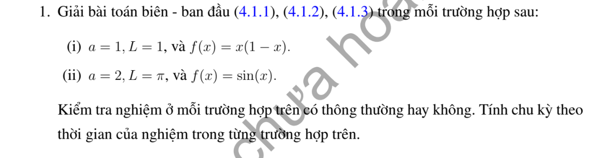
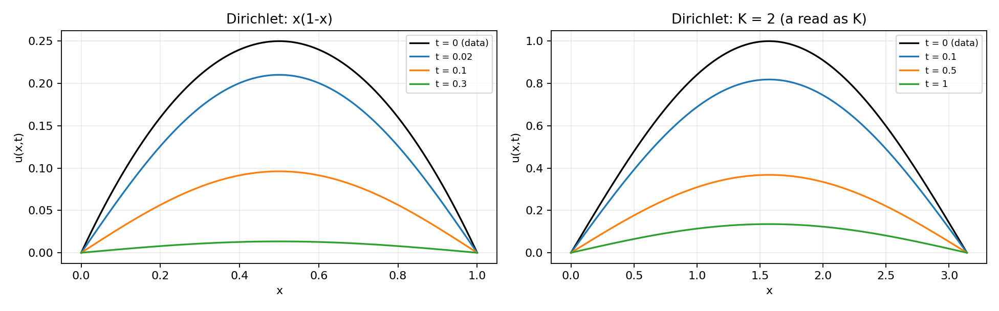

# Bài tập thực hành 1 — Mục 4.1.3

**Mã:** `BT_4_1_3_01` · **Trang sách:** 193–193

[← Mục lục](../MUC_LUC.md) · [Bản PDF của bài](BT_4_1_3_01.pdf)

## Đề bài

## Kiến thức và trình tự giải

**Bước 1 — Đọc hệ số và điều kiện biên.** Viết phương trình dưới dạng $u_t=Ku_{xx}$, $K>0$. Nếu đề ký hiệu tốc độ $a$ và viết $u_t=a^2u_{xx}$ thì thay $K=a^2$; không nhầm $a$ với $K$. Kiểm tra điều kiện đầu $f$ có khớp giá trị biên tại $t=0$ hay không. Sự không tương thích tại góc không ngăn nghiệm trơn với $t>0$, nhưng ngăn tính liên tục đến góc khi biên Dirichlet khác vết của $f$.

**Bước 2 — Tách biến và giải bài toán không gian.** Thế $u=XT$ vào PDE, chia cho $KXT$ để có $X''/X=T'/(KT)=-\lambda$. Do đó $X''+\lambda X=0$, $T'+K\lambda T=0$. Với $\lambda=k^2>0$, $X=A\cos kx+B\sin kx$; thay từng điều kiện biên để tìm $k$. Hai biên Dirichlet cho $X_n=\sin(n\pi x/L)$, $n\ge1$; hai biên Neumann cho $1$ và $\cos(n\pi x/L)$; biên Dirichlet–Neumann cho sine, biên Neumann–Dirichlet cho cosine, với $k_n=(n+1/2)\pi/L$, $n\ge0$. Trường hợp $\lambda=0$ phải giải riêng $X=A+Bx$; chỉ giữ mode hằng nếu biên cho phép.

**Bước 3 — Tính hệ số, không chỉ ghi tích phân.** Đặt $N_n=\int_0^L X_n^2dx$, $c_n=N_n^{-1}\int_0^L fX_n\,dx$. Với các mode sine/cosine chuẩn, $N_n=L/2$; mode hằng có $N_0=L$. Nếu $f$ là đa thức, tích phân từng phần đến hết; nếu $f$ chia đoạn, tách đúng cận; nếu $f$ lượng giác, dùng tích–tổng. Chẳng hạn với $k=n\pi/L$, $f(0)=f(L)=0$,

$$
\int_0^Lf\sin kx\,dx=\frac1k\int_0^Lf'\cos kx\,dx
=-\frac1{k^2}\int_0^Lf''\sin kx\,dx.
$$

Các hạng biên phải được tính trước khi bỏ. Khi tích–tổng tạo mẫu $k-m=0$, tính trực tiếp tích phân ở tần số đó.

**Bước 4 — Giải ODE và ghép nghiệm.** Nhân $T_n'+K\lambda_nT_n=0$ với $e^{K\lambda_nt}$, được $(e^{K\lambda_nt}T_n)'=0$. Vì $T_n(0)=c_n$,

$$
u(x,t)=\sum_n c_ne^{-K\lambda_nt}X_n(x).
$$

Thêm $c_0=L^{-1}\int_0^Lf$ cho Neumann hai đầu. Kiểm tra từng mode: $X_n''=-\lambda_nX_n$, nên đạo hàm theo $t$ và $K$ lần đạo hàm theo $x$ cấp hai bằng nhau.

**Bước 5 — Kiểm tra dữ liệu, hội tụ và thời gian dài.** Với $t\ge\varepsilon>0$, thừa số $e^{-K\lambda_nt}$ cho phép lấy đạo hàm chuỗi. Với dữ liệu có bước nhảy, giới hạn ban đầu tại bước nhảy là trung bình hai vết. Nếu $f\in L^1$, $|c_n|\le2\|f\|_1/L$ cho hệ chuẩn, nên tổng các mode dương tiến về không đều theo $x$. Neumann giữ trung bình; Dirichlet và biên hỗn hợp có giới hạn không. Một nghiệm giảm theo hàm mũ và khác không không thể tuần hoàn theo thời gian.

## Lời giải áp dụng cho bài

**Bước 1. Đọc hệ số trước khi tách biến.** Phương trình (4.1.1) của sách là $u_t=Ku_{xx}$, nhưng bài ghi $a$ mà không định nghĩa quan hệ giữa $a$ và $K$. Vì vậy giữ $K$ trong công thức tổng quát; ở đáp án số dưới đây đọc $a$ là lỗi ký hiệu thay cho $K$. Nếu một quy ước riêng là $K=a^2$, cần thay lại $K$ và ghi rõ, không tự suy từ đề. Hai biên Dirichlet cho $k_n=n\pi/L$, $X_n=\sin k_nx$ và

$$
u=\sum_{n\ge1}c_ne^{-Kk_n^2t}\sin k_nx,\qquad c_n=\frac2L\int_0^Lf(x)\sin k_nx\,dx.
$$

**Bước 2. Câu (i), đọc $K=L=1,f=x(1-x)$.** Đặt $k=n\pi$. Tích phân từng phần hai lần, dùng $f(0)=f(1)=0$, $f''=-2$:

$$
\begin{aligned}
\int_0^1f\sin kx\,dx
&=\frac1k\int_0^1f'\cos kx\,dx
=-\frac1{k^2}\int_0^1f''\sin kx\,dx\\
&=\frac2{k^2}\left[-\frac{\cos kx}k\right]_0^1
=\frac{2(1-(-1)^n)}{k^3}.
\end{aligned}
$$

Nhân với $2$ cho $c_n=4(1-(-1)^n)/(n^3\pi^3)$, tức $0$ khi $n$ chẵn, $8/(n^3\pi^3)$ khi $n$ lẻ:

$$
u=\sum_{\substack{n\ge1\\n\ {\rm lẻ}}}\frac8{n^3\pi^3}e^{-n^2\pi^2t}\sin n\pi x.
$$

**Bước 3. Câu (ii), $L=\pi,f=\sin x$.** Trực giao $\int_0^\pi\sin x\sin nx=\pi\delta_{n1}/2$ cho $c_1=1$, các hệ số khác $0$. Công thức không phụ thuộc cách hiểu ký hiệu là

$$
u=e^{-Kt}\sin x.
$$

Nếu $a=2$ là $K=2$, nghiệm là $e^{-2t}\sin x$. Nếu bổ sung quy ước $K=a^2=4$, nghiệm là $e^{-4t}\sin x$. Bản lời giải ngắn trước đây mặc định $K=a^2$; không có căn cứ cho sự mặc định đó trong (4.1.1).
**Bước 4. Kiểm tra và chu kỳ.** Hai nghiệm thỏa biên, PDE trên $t>0$ và trả lại $f$ liên tục lúc đầu. Câu (i) không trơn cấp hai đến góc theo mọi hướng vì $f''(0)=f''(1)=-2$, còn biên cố định có $u_t=0$; điều này không ngăn nghiệm thông thường trơn trong miền và liên tục trên bao đóng. Nếu có chu kỳ $T>0$, hệ số mode đầu sẽ thỏa $c_1e^{-Kk_1^2(t+T)}=c_1e^{-Kk_1^2t}$, suy $e^{-Kk_1^2T}=1$, vô lý với $K>0$. Cả hai nghiệm đều không tuần hoàn theo thời gian.

## Đồ thị minh họa

## Đối chiếu kết quả

Khi sử dụng kết quả, kiểm tra đồng thời phương trình, dữ liệu ban đầu/biên và miền được nêu trong lời giải. Các điều kiện về tính trơn, nghiệm thực, tồn tại hoặc duy nhất là một phần của kết luận; không bỏ chúng khi ghi đáp án.
