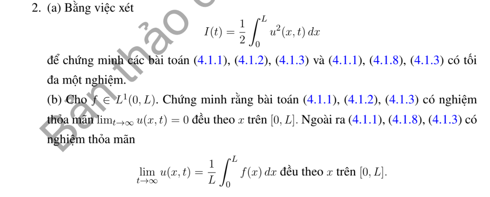

# Bài tập thực hành 2 — Mục 4.1.3

**Mã:** `BT_4_1_3_02` · **Trang sách:** 193–193

[← Mục lục](../MUC_LUC.md) · [Bản PDF của bài](BT_4_1_3_02.pdf)

## Đề bài

## Kiến thức và trình tự giải

**Bước 1 — Chọn đúng đại lượng.** Năng lượng bình phương là $I(t)=\frac12\int_0^Lu^2dx$. Để chứng minh duy nhất, áp dụng cho hiệu $w$ của hai nghiệm cùng dữ kiện; $w$ có dữ liệu đầu bằng không và biên thuần nhất. Tổng nhiệt $E=\int_0^Lu\,dx$ là đại lượng khác, dùng khi đề hỏi bảo toàn hoặc suy giảm tổng nhiệt.

**Bước 2 — Đạo hàm và tích phân từng phần.** Với $u_t=Ku_{xx}$,

$$
I'=\int_0^Luu_t\,dx
=K[uu_x]_0^L-K\int_0^Lu_x^2dx.
$$

Thay biên tại $L$ rồi trừ giá trị tại $0$. Dirichlet/Neumann thuần nhất làm hạng biên bằng không. Robin $u_x(0)=u(0)$ đóng góp $-u(0)^2$; Robin $u_x(L)=-u(L)$ đóng góp $-u(L)^2$. Biên tuần hoàn triệt tiêu hai đầu. Một điều kiện ghép khác phải được kiểm tra trực tiếp, vì hạng biên có thể dương.

**Bước 3 — Suy duy nhất và tính dương của trị riêng.** Nếu $I'\le0$ và $I(0)=0$ thì $0\le I(t)\le0$, nên $w=0$. Với $X''+\lambda X=0$, nhân với $X$ rồi tích phân:

$$
\lambda\int_0^LX^2dx=\int_0^L(X')^2dx-[XX']_0^L.
$$

Nếu vế phải không âm thì $\lambda\ge0$. Khi bằng không, buộc từng số hạng không âm bằng không và kiểm tra biên để quyết định có mode hằng hay chỉ nghiệm tầm thường.

**Bước 4 — Chứng minh trực giao.** Nhân hai phương trình riêng lần lượt với $X_m,X_n$, trừ rồi tích phân:

$$
(\lambda_n-\lambda_m)\int_0^LX_nX_mdx
=[X_nX_m'-X_n'X_m]_0^L.
$$

Biên tự liên hợp làm vế phải bằng không; $\lambda_n\ne\lambda_m$ suy trực giao. Với biên không tự liên hợp hoặc đạo hàm bậc ba, không tự động dùng công thức chiếu trực giao.

**Bước 5 — Khi có hạng phản ứng hoặc bậc đạo hàm khác.** Với Dirichlet và $u_t=Ku_{xx}+Au_x+Bu$, hạng $A\int uu_x=A[u^2]_0^L/2=0$, nên $I'=-K\int u_x^2+2BI\le2BI$; $e^{-2Bt}I$ không tăng, vẫn suy duy nhất. Với $u_t=Ku_{xxx}$, tích phân hai lần cho $I'=K[uu_{xx}-u_x^2/2]_0^L$. Với tổng nhiệt trong bài Neumann có $-ru$, $E'=K[u_x]_0^L-rE$; giải ODE này trước khi kết luận.

## Lời giải áp dụng cho bài

**(a) Duy nhất bằng năng lượng.** Lấy $w=u_1-u_2$. Khi đó $w_t=Kw_{xx}$, $w(x,0)=0$; hai biên Dirichlet hoặc Neumann thuần nhất cho $[ww_x]_0^L=0$. Vì

$$
I'=\int_0^Lww_tdx=K[ww_x]_0^L-K\int_0^Lw_x^2dx\le0,\qquad I(0)=0,
$$

nên $0\le I(t)\le0$, $w=0$. Nếu nghiệm chỉ trơn với $t>0$, tích phân từ $\varepsilon$ đến $t$ rồi cho $\varepsilon\downarrow0$ trong lớp có dữ liệu đầu liên tục/$L^2$ thích hợp.

**(b) Giới hạn đều với $f\in L^1$, không cần giả thiết $L^2$.**
Với Dirichlet, $|c_n|\le2\|f\|_1/L$. Đặt $\gamma=K\pi^2/L^2$, và dùng $n^2\ge1+3(n-1)$, $n\ge1$:

$$
\sup_{x\in[0,L]}|u(x,t)|
\le\frac{2\|f\|_1}L\sum_{n\ge1}e^{-\gamma n^2t}
\le\frac{2\|f\|_1}L\frac{e^{-\gamma t}}{1-e^{-3\gamma t}}
\longrightarrow0.
$$

Với Neumann, $c_0=L^{-1}\int_0^Lf$, và $|c_n|\le2\|f\|_1/L$ cho $n\ge1$. Cùng ước lượng cho

$$
\sup_x|u(x,t)-c_0|\le\frac{2\|f\|_1}L
\frac{e^{-\gamma t}}{1-e^{-3\gamma t}}\longrightarrow0.
$$

Đây là giới hạn đều được yêu cầu. Với dữ liệu $L^1$ bất kỳ, nghiệm lấy theo nhân nhiệt và trả lại dữ liệu trong $L^1$ khi $t\downarrow0$; không buộc phải liên tục đến mặt đầu.

## Đối chiếu kết quả

Khi sử dụng kết quả, kiểm tra đồng thời phương trình, dữ liệu ban đầu/biên và miền được nêu trong lời giải. Các điều kiện về tính trơn, nghiệm thực, tồn tại hoặc duy nhất là một phần của kết luận; không bỏ chúng khi ghi đáp án.
