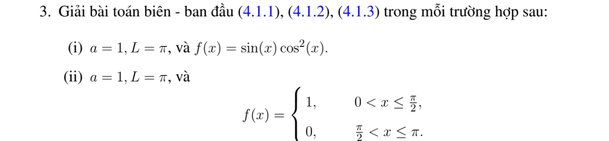

# Bài tập thực hành 3 — Mục 4.1.3

**Mã:** `BT_4_1_3_03` · **Trang sách:** 193–194

[← Mục lục](../MUC_LUC.md) · [Bản PDF của bài](BT_4_1_3_03.pdf)

## Đề bài

## Kiến thức và trình tự giải

**Bước 1 — Đọc hệ số và điều kiện biên.** Viết phương trình dưới dạng $u_t=Ku_{xx}$, $K>0$. Nếu đề ký hiệu tốc độ $a$ và viết $u_t=a^2u_{xx}$ thì thay $K=a^2$; không nhầm $a$ với $K$. Kiểm tra điều kiện đầu $f$ có khớp giá trị biên tại $t=0$ hay không. Sự không tương thích tại góc không ngăn nghiệm trơn với $t>0$, nhưng ngăn tính liên tục đến góc khi biên Dirichlet khác vết của $f$.

**Bước 2 — Tách biến và giải bài toán không gian.** Thế $u=XT$ vào PDE, chia cho $KXT$ để có $X''/X=T'/(KT)=-\lambda$. Do đó $X''+\lambda X=0$, $T'+K\lambda T=0$. Với $\lambda=k^2>0$, $X=A\cos kx+B\sin kx$; thay từng điều kiện biên để tìm $k$. Hai biên Dirichlet cho $X_n=\sin(n\pi x/L)$, $n\ge1$; hai biên Neumann cho $1$ và $\cos(n\pi x/L)$; biên Dirichlet–Neumann cho sine, biên Neumann–Dirichlet cho cosine, với $k_n=(n+1/2)\pi/L$, $n\ge0$. Trường hợp $\lambda=0$ phải giải riêng $X=A+Bx$; chỉ giữ mode hằng nếu biên cho phép.

**Bước 3 — Tính hệ số, không chỉ ghi tích phân.** Đặt $N_n=\int_0^L X_n^2dx$, $c_n=N_n^{-1}\int_0^L fX_n\,dx$. Với các mode sine/cosine chuẩn, $N_n=L/2$; mode hằng có $N_0=L$. Nếu $f$ là đa thức, tích phân từng phần đến hết; nếu $f$ chia đoạn, tách đúng cận; nếu $f$ lượng giác, dùng tích–tổng. Chẳng hạn với $k=n\pi/L$, $f(0)=f(L)=0$,

$$
\int_0^Lf\sin kx\,dx=\frac1k\int_0^Lf'\cos kx\,dx
=-\frac1{k^2}\int_0^Lf''\sin kx\,dx.
$$

Các hạng biên phải được tính trước khi bỏ. Khi tích–tổng tạo mẫu $k-m=0$, tính trực tiếp tích phân ở tần số đó.

**Bước 4 — Giải ODE và ghép nghiệm.** Nhân $T_n'+K\lambda_nT_n=0$ với $e^{K\lambda_nt}$, được $(e^{K\lambda_nt}T_n)'=0$. Vì $T_n(0)=c_n$,

$$
u(x,t)=\sum_n c_ne^{-K\lambda_nt}X_n(x).
$$

Thêm $c_0=L^{-1}\int_0^Lf$ cho Neumann hai đầu. Kiểm tra từng mode: $X_n''=-\lambda_nX_n$, nên đạo hàm theo $t$ và $K$ lần đạo hàm theo $x$ cấp hai bằng nhau.

**Bước 5 — Kiểm tra dữ liệu, hội tụ và thời gian dài.** Với $t\ge\varepsilon>0$, thừa số $e^{-K\lambda_nt}$ cho phép lấy đạo hàm chuỗi. Với dữ liệu có bước nhảy, giới hạn ban đầu tại bước nhảy là trung bình hai vết. Nếu $f\in L^1$, $|c_n|\le2\|f\|_1/L$ cho hệ chuẩn, nên tổng các mode dương tiến về không đều theo $x$. Neumann giữ trung bình; Dirichlet và biên hỗn hợp có giới hạn không. Một nghiệm giảm theo hàm mũ và khác không không thể tuần hoàn theo thời gian.

## Lời giải áp dụng cho bài

**Bước 1. Cơ sở sine.** Đề ghi $a=1$ trong khi (4.1.1) dùng $K$; lời giải đọc $a$ thay $K$, tức $K=1$. Nếu dùng một quy ước $K=a^2$, ở $a=1$ vẫn cho cùng hệ số $K=1$. $L=\pi$ cho $X_n=\sin nx$, tốc độ giảm $n^2$, $c_n=2\int_0^\pi f\sin nx/\pi$.
**Bước 2. Câu (i).** $\cos^2x=(1+\cos2x)/2$, $\sin x\cos2x=(\sin3x-\sin x)/2$, nên

$$
\sin x\cos^2x=\frac14(\sin x+\sin3x),\qquad
u=\frac14(e^{-t}\sin x+e^{-9t}\sin3x).
$$

Thế $t=0$ và hai đầu mút kiểm tra trực tiếp; đạo hàm mỗi mode cho đúng PDE.
**Bước 3. Câu (ii).** Vì $f=1$ trên $(0,\pi/2]$ và $0$ trên $(\pi/2,\pi]$,

$$
c_n=\frac2\pi\int_0^{\pi/2}\sin nx\,dx
=\frac2{\pi n}(1-\cos(n\pi/2)).
$$

Theo $n$ modulo $4$: $c_n=0$ khi $n=4j$, $4/(\pi n)$ khi $n=4j+2$, $2/(\pi n)$ khi $n$ lẻ. Do đó

$$
u=\sum_{n\ge1}\frac{2(1-\cos(n\pi/2))}{\pi n}e^{-n^2t}\sin nx.
$$

**Bước 4. Dữ liệu gián đoạn.** Với $t>0$, chuỗi trơn và biên $0$. Khi $t\downarrow0$, nghiệm tiến về $1$ trên $0<x<\pi/2$, về $0$ trên $\pi/2<x<\pi$, và về $1/2$ tại $\pi/2$. Giá trị đầu in bằng $1$ ở điểm nhảy không tạo một nghiệm liên tục tại điểm đó; nghiệm được hiểu theo nghĩa $L^p$ hoặc tại các điểm liên tục. Mọi mode đều giảm nên giới hạn lâu dài bằng $0$.

## Đối chiếu kết quả

Khi sử dụng kết quả, kiểm tra đồng thời phương trình, dữ liệu ban đầu/biên và miền được nêu trong lời giải. Các điều kiện về tính trơn, nghiệm thực, tồn tại hoặc duy nhất là một phần của kết luận; không bỏ chúng khi ghi đáp án.
