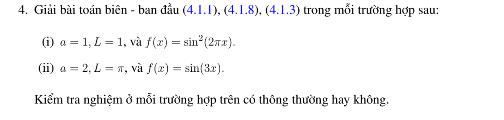

# Bài tập thực hành 4 — Mục 4.1.3

**Mã:** `BT_4_1_3_04` · **Trang sách:** 194–194

[← Mục lục](../MUC_LUC.md) · [Bản PDF của bài](BT_4_1_3_04.pdf)

## Đề bài

## Kiến thức và trình tự giải

**Bước 1 — Đọc hệ số và điều kiện biên.** Viết phương trình dưới dạng $u_t=Ku_{xx}$, $K>0$. Nếu đề ký hiệu tốc độ $a$ và viết $u_t=a^2u_{xx}$ thì thay $K=a^2$; không nhầm $a$ với $K$. Kiểm tra điều kiện đầu $f$ có khớp giá trị biên tại $t=0$ hay không. Sự không tương thích tại góc không ngăn nghiệm trơn với $t>0$, nhưng ngăn tính liên tục đến góc khi biên Dirichlet khác vết của $f$.

**Bước 2 — Tách biến và giải bài toán không gian.** Thế $u=XT$ vào PDE, chia cho $KXT$ để có $X''/X=T'/(KT)=-\lambda$. Do đó $X''+\lambda X=0$, $T'+K\lambda T=0$. Với $\lambda=k^2>0$, $X=A\cos kx+B\sin kx$; thay từng điều kiện biên để tìm $k$. Hai biên Dirichlet cho $X_n=\sin(n\pi x/L)$, $n\ge1$; hai biên Neumann cho $1$ và $\cos(n\pi x/L)$; biên Dirichlet–Neumann cho sine, biên Neumann–Dirichlet cho cosine, với $k_n=(n+1/2)\pi/L$, $n\ge0$. Trường hợp $\lambda=0$ phải giải riêng $X=A+Bx$; chỉ giữ mode hằng nếu biên cho phép.

**Bước 3 — Tính hệ số, không chỉ ghi tích phân.** Đặt $N_n=\int_0^L X_n^2dx$, $c_n=N_n^{-1}\int_0^L fX_n\,dx$. Với các mode sine/cosine chuẩn, $N_n=L/2$; mode hằng có $N_0=L$. Nếu $f$ là đa thức, tích phân từng phần đến hết; nếu $f$ chia đoạn, tách đúng cận; nếu $f$ lượng giác, dùng tích–tổng. Chẳng hạn với $k=n\pi/L$, $f(0)=f(L)=0$,

$$
\int_0^Lf\sin kx\,dx=\frac1k\int_0^Lf'\cos kx\,dx
=-\frac1{k^2}\int_0^Lf''\sin kx\,dx.
$$

Các hạng biên phải được tính trước khi bỏ. Khi tích–tổng tạo mẫu $k-m=0$, tính trực tiếp tích phân ở tần số đó.

**Bước 4 — Giải ODE và ghép nghiệm.** Nhân $T_n'+K\lambda_nT_n=0$ với $e^{K\lambda_nt}$, được $(e^{K\lambda_nt}T_n)'=0$. Vì $T_n(0)=c_n$,

$$
u(x,t)=\sum_n c_ne^{-K\lambda_nt}X_n(x).
$$

Thêm $c_0=L^{-1}\int_0^Lf$ cho Neumann hai đầu. Kiểm tra từng mode: $X_n''=-\lambda_nX_n$, nên đạo hàm theo $t$ và $K$ lần đạo hàm theo $x$ cấp hai bằng nhau.

**Bước 5 — Kiểm tra dữ liệu, hội tụ và thời gian dài.** Với $t\ge\varepsilon>0$, thừa số $e^{-K\lambda_nt}$ cho phép lấy đạo hàm chuỗi. Với dữ liệu có bước nhảy, giới hạn ban đầu tại bước nhảy là trung bình hai vết. Nếu $f\in L^1$, $|c_n|\le2\|f\|_1/L$ cho hệ chuẩn, nên tổng các mode dương tiến về không đều theo $x$. Neumann giữ trung bình; Dirichlet và biên hỗn hợp có giới hạn không. Một nghiệm giảm theo hàm mũ và khác không không thể tuần hoàn theo thời gian.

## Lời giải áp dụng cho bài

**Bước 1. Khai triển Neumann.** Phương trình (4.1.1) dùng $K$, nhưng bài cho $a$ mà không định nghĩa quan hệ. Giữ $K$ trong công thức tổng quát và đọc $a$ thay $K$ ở đáp án số; một quy ước $K=a^2$ sẽ cho tốc độ khác ở câu (ii). Ta có $u=c_0+\sum_{n\ge1}c_ne^{-K(n\pi/L)^2t}\cos(n\pi x/L)$, $c_0=L^{-1}\int f$, $c_n=2L^{-1}\int f\cos(n\pi x/L)$.
**Bước 2. Câu (i).** Đọc $K=L=1$, $\sin^2(2\pi x)=(1-\cos4\pi x)/2$. Do đó

$$
u=\frac12-\frac12e^{-16\pi^2t}\cos4\pi x.
$$

Biên đạo hàm đúng vì sine bằng $0$ ở $0,1$; tại $t=0$ trả lại $f$, và $u_t=u_{xx}=8\pi^2e^{-16\pi^2t}\cos4\pi x$. Nghiệm trơn đến mặt đầu và tiến đều về $1/2$.
**Bước 3. Câu (ii).** $L=\pi$, $f=\sin3x$. Trung bình là

$$
c_0=\frac1\pi[-\cos3x/3]_0^\pi=\frac2{3\pi}.
$$

Với $n\ne3$, tích–tổng cho

$$
\begin{aligned}
\int_0^\pi\sin3x\cos nx\,dx
&=\frac12\left[\frac{1-\cos((3+n)\pi)}{3+n}
+\frac{1-\cos((3-n)\pi)}{3-n}\right]\\
&=\frac{3(1+(-1)^n)}{9-n^2}.
\end{aligned}
$$

Khi $n=3$, tích phân bằng $[\sin^23x/6]_0^\pi=0$. Vậy

$$
u=\frac2{3\pi}+\sum_{\substack{n\ge2\\n\ {\rm chẵn}}}
\frac{12}{\pi(9-n^2)}e^{-Kn^2t}\cos nx.
$$

Nếu đọc $a=2$ thay $K$, mũ là $-2n^2t$; nếu bổ sung $K=a^2$, mũ là $-4n^2t$. Các hệ số không gian và trung bình không đổi. Giữ cả hai cách đọc để không mặc nhiên sửa định nghĩa hệ số của đề.
**Bước 4. Kiểm tra tính trơn.** Hệ số $O(n^{-2})$ cho hội tụ đều và liên tục đến mặt đầu; chuỗi đạo hàm trơn với $t>0$. $f'(0)=3$, $f'(\pi)=-3$ không bằng đạo hàm biên Neumann $0$, nên không trơn đến góc. Trong lớp thông thường của sách, trơn với $t>0$ và liên tục trên bao đóng vẫn được thỏa. Giới hạn đều bằng trung bình $2/(3\pi)$.

## Đối chiếu kết quả

Khi sử dụng kết quả, kiểm tra đồng thời phương trình, dữ liệu ban đầu/biên và miền được nêu trong lời giải. Các điều kiện về tính trơn, nghiệm thực, tồn tại hoặc duy nhất là một phần của kết luận; không bỏ chúng khi ghi đáp án.
