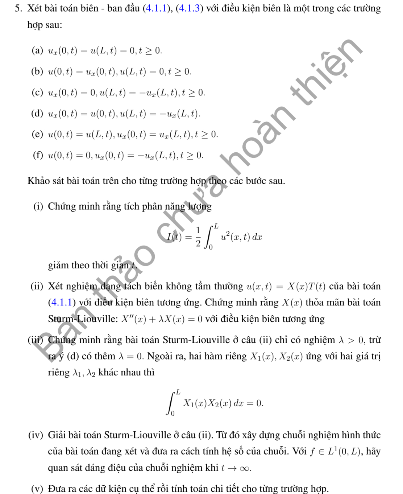

# Bài tập thực hành 5 — Mục 4.1.3

**Mã:** `BT_4_1_3_05` · **Trang sách:** 194–194

[← Mục lục](../MUC_LUC.md) · [Bản PDF của bài](BT_4_1_3_05.pdf)

## Đề bài

## Kiến thức và trình tự giải

**Bước 1 — Chọn đúng đại lượng.** Năng lượng bình phương là $I(t)=\frac12\int_0^Lu^2dx$. Để chứng minh duy nhất, áp dụng cho hiệu $w$ của hai nghiệm cùng dữ kiện; $w$ có dữ liệu đầu bằng không và biên thuần nhất. Tổng nhiệt $E=\int_0^Lu\,dx$ là đại lượng khác, dùng khi đề hỏi bảo toàn hoặc suy giảm tổng nhiệt.

**Bước 2 — Đạo hàm và tích phân từng phần.** Với $u_t=Ku_{xx}$,

$$
I'=\int_0^Luu_t\,dx
=K[uu_x]_0^L-K\int_0^Lu_x^2dx.
$$

Thay biên tại $L$ rồi trừ giá trị tại $0$. Dirichlet/Neumann thuần nhất làm hạng biên bằng không. Robin $u_x(0)=u(0)$ đóng góp $-u(0)^2$; Robin $u_x(L)=-u(L)$ đóng góp $-u(L)^2$. Biên tuần hoàn triệt tiêu hai đầu. Một điều kiện ghép khác phải được kiểm tra trực tiếp, vì hạng biên có thể dương.

**Bước 3 — Suy duy nhất và tính dương của trị riêng.** Nếu $I'\le0$ và $I(0)=0$ thì $0\le I(t)\le0$, nên $w=0$. Với $X''+\lambda X=0$, nhân với $X$ rồi tích phân:

$$
\lambda\int_0^LX^2dx=\int_0^L(X')^2dx-[XX']_0^L.
$$

Nếu vế phải không âm thì $\lambda\ge0$. Khi bằng không, buộc từng số hạng không âm bằng không và kiểm tra biên để quyết định có mode hằng hay chỉ nghiệm tầm thường.

**Bước 4 — Chứng minh trực giao.** Nhân hai phương trình riêng lần lượt với $X_m,X_n$, trừ rồi tích phân:

$$
(\lambda_n-\lambda_m)\int_0^LX_nX_mdx
=[X_nX_m'-X_n'X_m]_0^L.
$$

Biên tự liên hợp làm vế phải bằng không; $\lambda_n\ne\lambda_m$ suy trực giao. Với biên không tự liên hợp hoặc đạo hàm bậc ba, không tự động dùng công thức chiếu trực giao.

**Bước 5 — Khi có hạng phản ứng hoặc bậc đạo hàm khác.** Với Dirichlet và $u_t=Ku_{xx}+Au_x+Bu$, hạng $A\int uu_x=A[u^2]_0^L/2=0$, nên $I'=-K\int u_x^2+2BI\le2BI$; $e^{-2Bt}I$ không tăng, vẫn suy duy nhất. Với $u_t=Ku_{xxx}$, tích phân hai lần cho $I'=K[uu_{xx}-u_x^2/2]_0^L$. Với tổng nhiệt trong bài Neumann có $-ru$, $E'=K[u_x]_0^L-rE$; giải ODE này trước khi kết luận.

## Lời giải áp dụng cho bài

**Bước 1. Thay từng biên vào năng lượng.**

$$
I'=K\{u(L)u_x(L)-u(0)u_x(0)-\int_0^Lu_x^2dx\}.
$$

Ở (a), Neumann trái và Dirichlet phải cho hạng biên $0$. Ở (b), $u_x(0)=u(0),u(L)=0$ cho $-u(0)^2$. Ở (c), $u_x(0)=0,u_x(L)=-u(L)$ cho $-u(L)^2$. Ở (d), tổng hai đầu là $-u(0)^2-u(L)^2$. Ở (e), hai giá trị và hai đạo hàm bằng nhau nên triệt tiêu. Do đó (a)--(e) có $I'\le0$.

**Bước 2. Trị riêng và trực giao cho (a)--(e).**
Đặt $u=XT$: $X''+\lambda X=0$, $T'=-K\lambda T$. Nhân ODE với $X$ cho $\lambda\int X^2=\int(X')^2-[XX']_0^L$. Các hạng biên là các số không âm vừa tính. Với $\lambda=0$, $X$ hằng; (a)--(d) buộc hằng bằng $0$, còn (e) cho $X=1$. Vì vậy dòng đề nói (d) có trị riêng $0$ phải sửa thành (e). Đẳng thức $(\lambda_n-\lambda_m)\int X_nX_m=[X_nX_m'-X_n'X_m]_0^L$ có vế phải $0$ ở từng biên (a)--(e); suy trực giao khi hai trị riêng khác nhau.

**Bước 3. Giải đầy đủ các điều kiện trên $A,B$.**
Với $X=A\cos kx+B\sin kx$, $k>0$:

$$
\begin{aligned}
(a)&:\ B=0,\ \cos kL=0;\quad k_n=(n+1/2)\pi/L,\ X_n=\cos k_nx,\ n\ge0;\\
(b)&:\ A=kB,\ X=\cos kx+\sin kx/k;\quad k\cos kL+\sin kL=0;\\
(c)&:\ B=0,\ -k\sin kL+\cos kL=0;\quad X=\cos kx;\\
(d)&:\ A=kB,\quad (1-k^2)\sin kL+2k\cos kL=0;\\
(e)&:\ k_n=2n\pi/L,\quad 1,\cos k_nx,\sin k_nx.
\end{aligned}
$$

Ở (b),(c),(d) chỉ lấy các nghiệm $k>0$; $k=0$ sinh ra sau nhân mẫu ở (d) là nghiệm ngoại lai. Với $X=\cos kx$, $N=L/2+\sin2kL/(4k)$. Với $X=\cos kx+\sin kx/k$,

$$
N=\frac L2(1+k^{-2})+\frac{\sin2kL}{4k}(1-k^{-2})+\frac{\sin^2kL}{k^2}.
$$

Nghiệm (a)--(d) là $\sum (\int fX_n/N_n)e^{-Kk_n^2t}X_n$. Nghiệm (e) có thêm trung bình và hai hệ số $2\int f\cos/L$, $2\int f\sin/L$. Với $f\in L^1$, nhân nhiệt làm trơn dữ liệu và các mode dương suy giảm đều; (a)--(d) tiến về $0$, (e) tiến về $L^{-1}\int f$.

**Bước 4. Điều kiện (f) không có tính chất năng lượng mà đề yêu cầu.**
Ở đây $u(0)=0$, $u_x(0)=-u_x(L)$, nên hạng biên là $u(L)u_x(L)$, không xác định dấu. Phản ví dụ cụ thể: đặt $y=x/L$ và

$$
f(x)=y-3y(1-y)^{10}+y^{10}(y-1).
$$

Ta có $f(0)=0$, $f(L)=1$, $f'(0)=-2/L$, $f'(L)=2/L$, đúng biên (f). Với $p(y)=y(1-y)^{10}$, $\int_0^1(p')^2dy=10/399$, và $q(y)=y^{10}(y-1)$ có cùng chuẩn đạo hàm, $\int p'=\int q'=0$. Bất đẳng thức tam giác trong $L^2$ cho

$$
\int_0^L(f')^2dx\le\frac1L\left(1+16\frac{10}{399}\right)<\frac2L=f(L)f'(L).
$$

Vì vậy $I'(0)>0$ cho nghiệm có dữ liệu này, theo vết đạo hàm tại $0+$; không thể chứng minh năng lượng không tăng.

**Bước 5. Khai triển đúng cho (f) phải có hàm liên kết.**
$X(0)=0$ cho $X=\sin kx$, biên đạo hàm cho $\cos kL=-1$, tức $k_n=(2n+1)\pi/L$, $n\ge0$. Nhưng các sine này chỉ biểu diễn phần đối xứng quanh $L/2$. Đặt $Y_n=x\cos k_nx$; cả $X_n,Y_n$ đều thỏa (f) và $Y_n''=-k_n^2Y_n-2k_nX_n$. Tách dữ liệu

$$
d(x)=f(x)-f(L-x),\quad r(x)=f(x)-\frac xL d(x).
$$

$d$ phản đối xứng, $r$ đối xứng. Khai triển cosine lẻ và sine lẻ cho

$$
b_n=\frac2{L^2}\int_0^Ld(x)\cos k_nx\,dx,\qquad
a_n=\frac2L\int_0^Lr(x)\sin k_nx\,dx.
$$

Khi đó $f=\sum(a_nX_n+b_nY_n)$ trong $L^2$, vì $\sum b_nY_n=xd(x)/L$. Nghiệm là

$$
u=\sum_{n\ge0}e^{-Kk_n^2t}
\{(a_n-2Kk_nb_nt)\sin k_nx+b_nx\cos k_nx\}.
$$

Đạo hàm trực tiếp dùng đẳng thức của $Y_n''$ kiểm tra PDE, biên và dữ liệu. Với $f\in L^1$, các hệ số $a_n,b_n$ bị chặn bởi hằng nhân $\|f\|_1$; thừa số $(1+k_nt)e^{-Kk_n^2t}$ suy giảm đều, nên giới hạn vẫn bằng $0$, dù năng lượng không nhất thiết giảm ở mọi thời điểm.

**Bước 6. Chọn dữ kiện cụ thể và tính cho đủ sáu biên.**
Lấy $K=L=1$ ở tất cả các ví dụ sau. Ở (a), $k=\pi/2$, chọn $f=\cos(\pi x/2)$; $\int fX=N=1/2$, nên hệ số duy nhất bằng $1$ và $u=e^{-\pi^2t/4}\cos(\pi x/2)$.
Ở (b), chọn nghiệm dương đầu $k=2.0287578381$ của $k\cos k+\sin k=0$, $f=\cos kx+\sin kx/k$. Vì $f=X_1$, $\int fX_1/N_1=1$ và mọi hệ số khác bằng $0$ do trực giao, nên $u=e^{-k^2t}(\cos kx+\sin kx/k)$. Ở (c), chọn $k=0.8603335890$ của $k\sin k=\cos k$, $f=\cos kx$; cùng phép chiếu cho $u=e^{-k^2t}\cos kx$. Ở (d), chọn $k=1.3065423742$ của $(1-k^2)\sin k+2k\cos k=0$, $f=\cos kx+\sin kx/k$, nên $u=e^{-k^2t}f(x)$. Các số thập phân chỉ là xấp xỉ; công thức chính xác dùng nghiệm của phương trình tương ứng.
Ở (e), chọn $f=1+\cos2\pi x$. Các tích phân cho $c_0=\int f=1$, $c_1=2\int f\cos2\pi x=1$, các hệ số khác bằng $0$. Vậy $u=1+e^{-4\pi^2t}\cos2\pi x$.
Ở (f), chọn $f=x\cos\pi x$. $d(x)=\cos\pi x$, $r(x)=0$, nên $b_0=2\int_0^1\cos^2\pi x\,dx=1$, $a_n=0$, các $b_n$ khác bằng $0$. Do đó $u=e^{-\pi^2t}(x\cos\pi x-2\pi t\sin\pi x)$. Đây là phép tính hệ số cụ thể với hàm liên kết. Thế từng $f$ vào cặp biên và từng $u$ vào PDE kiểm tra đúng sáu bài đã chọn.

## Đối chiếu kết quả

Khi sử dụng kết quả, kiểm tra đồng thời phương trình, dữ liệu ban đầu/biên và miền được nêu trong lời giải. Các điều kiện về tính trơn, nghiệm thực, tồn tại hoặc duy nhất là một phần của kết luận; không bỏ chúng khi ghi đáp án.
