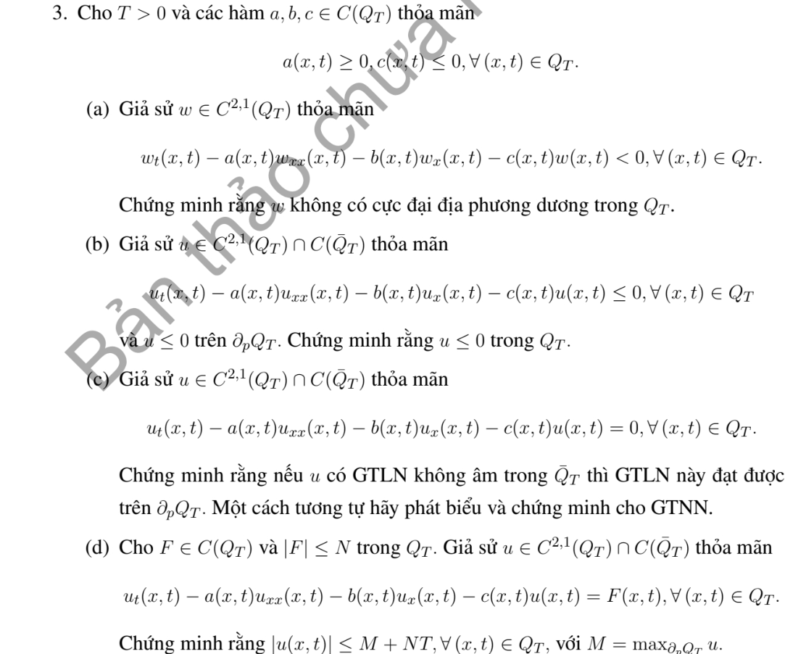

# Bài tập thực hành 3 — Mục 4.2.3

**Mã:** `BT_4_2_3_03` · **Trang sách:** 197–198

[← Mục lục](../MUC_LUC.md) · [Bản PDF của bài](BT_4_2_3_03.pdf)

## Đề bài

## Kiến thức và trình tự giải

**Bước 1 — Viết toán tử và biên parabol.** Đặt $P=\partial_t-a(x,t)\partial_{xx}-b(x,t)\partial_x-c(x,t)$ với $a\ge0$, $c\le0$. Biên parabol gồm mặt $t=0$ và các biên không gian; mặt $t=T$ vẫn thuộc miền được ước lượng. Với phương trình nhiệt, $a=K>0$, $b=c=0$.

**Bước 2 — Loại cực đại dương bằng dấu đạo hàm.** Tại cực đại dương nội miền, $w_x=0$, $w_{xx}\le0$, $w_t=0$; nếu cực đại trên mặt thời gian trên thì đạo hàm một phía cho $w_t\ge0$. Suy $Pw\ge0$, mâu thuẫn $Pw<0$. Với $Pw\le0$, xét $w_\varepsilon=w-\varepsilon e^{\gamma t}$, $\gamma>0$: $Pw_\varepsilon=Pw-\varepsilon(\gamma-c)e^{\gamma t}<0$. Chứng minh $w_\varepsilon\le0$ rồi cho $\varepsilon\downarrow0$.

**Bước 3 — So sánh hai hàm bằng hiệu.** Để chứng minh $v\le u\le V$, kiểm tra $Pv\le Pu\le PV$ và thứ tự của dữ liệu đầu, biên. Áp dụng bước 2 cho $v-u$ và $u-V$. Nếu có nguồn dương, hằng số không nhất thiết là nghiệm trên, nên phải tính $PV-Pu$; không dùng cực đại của dữ liệu để chặn một bài có nguồn mà chưa kiểm tra.

**Bước 4 — Xử lý Neumann, Robin và tuần hoàn.** Neumann thuần nhất có thể phản xạ chẵn qua đầu mút; điểm biên trở thành điểm trong. Robin viết theo pháp tuyến ngoài $\partial_\nu u+\sigma u=0$, $\sigma\ge0$. Tại cực đại dương không hằng, bổ đề Hopf cho $\partial_\nu u>0$, trái với $\partial_\nu u=-\sigma u\le0$. Với Robin phải thêm mức $0$ vào cận hằng nếu dữ liệu mang một dấu. Biên tuần hoàn ghép hai đầu thành đường tròn; không còn biên không gian.

**Bước 5 — Miền vô hạn và nguồn bị chặn.** Trên toàn trục/nửa trục, cần nghiệm bị chặn trên mỗi dải thời gian (hoặc điều kiện tăng trưởng đủ dùng). Dùng rào $\varepsilon((x-x_0)^2+2Kt)$ trên đoạn lớn, áp dụng cực đại trên miền hữu hạn rồi cho $\varepsilon\downarrow0$; cách này loại ảnh hưởng từ vô cực. Nếu $|Pu|\le N$ và $|u|\le M$ trên biên parabol, đặt $V=M+Nt$. Vì $PV=N-cV\ge N$, suy $|u|\le M+Nt\le M+NT$. $M$ ở đây là cận của $|u|$, không phải cực đại có dấu.

## Lời giải áp dụng cho bài

**Bước 1. Đặt $P=\partial_t-a\partial_{xx}-b\partial_x-c$, $a\ge0,c\le0$.**

**Ý (a).**  Nếu $w$ có cực đại địa phương dương ở một điểm trong, thì $w_x=0,w_{xx}\le0,w_t=0$, nên $Pw=-aw_{xx}-cw\ge0$, trái với $Pw<0$. Nếu điểm ở mặt thời gian trên thì $w_t\ge0$ một phía vẫn cho cùng mâu thuẫn.

**Ý (b).**  Đặt $v=u-\varepsilon e^t$. $Pv=Pu-\varepsilon(1-c)e^t<0$ và $v<0$ trên biên parabol. Nếu $v$ dương ở đâu, cực đại dương trên bao đóng phải ở trong hoặc mặt thời gian trên, trái với (a). Vì thế $u\le\varepsilon e^t$; cho $\varepsilon\downarrow0$ được $u\le0$.

**Ý (c).**  Đặt $C=\max(0,\max_{\partial_pQ_T}u)$. Vì $P(u-C)=cC\le0$ và $u-C\le0$ trên biên, (b) cho $u\le C$. Nếu cực đại toàn miền dương, cận này buộc cực đại bằng cực đại biên. Còn trường hợp cực đại bằng $0$, cần loại khả năng mọi giá trị biên đều âm.
Nếu $\max_{\partial_pQ_T}u=-\eta<0$, tính liên tục trên bao đóng cho một dải gần mặt đầu và hai biên không gian mà $u<-\eta/2$. Cắt bỏ các dải này để được hình trụ nhỏ hơn chứa điểm có $u=0$, với biên parabol $u\le-\eta/2$. Trên hình trụ nhỏ, $c$ có cận $|c|\le C_0$ vì liên tục trên tập compact nằm trong miền. Lấy $t_*$ là thời gian đầu của hình trụ đó và $V=-(\eta/2)e^{-C_0(t-t_*)}$. Khi đó $PV=(-C_0-c)V\ge0$, $u\le V$ trên biên. Áp dụng (b) cho $u-V$ được $u\le V<0$, mâu thuẫn điểm có $u=0$. Vậy cực đại không âm cũng đạt trên biên parabol. Đổi $u$ thành $-u$ cho phát biểu và chứng minh tương tự: cực tiểu không dương đạt trên biên.

**Ý (d).**  Sửa $M$ thành $M=\max_{\partial_pQ_T}|u|$. Đặt $V=M+Nt\ge0$. Khi đó $PV=N-cV\ge N\ge F$. Do $P(u-V)=F-PV\le0$ và $u-V\le0$ trên biên, suy $u\le V$. Với $-u$, nguồn là $-F\le N$, suy $-u\le V$. Vậy

$$
|u(x,t)|\le M+Nt\le M+NT.
$$

Nếu giữ $M=\max_{\partial_pQ_T}u$ có dấu như bản in, kết luận sai: chọn $a=1,b=c=0,F=0,u=-1$ thì $M=-1,N=0$, không thể có $1\le-1$.

## Đối chiếu kết quả

Khi sử dụng kết quả, kiểm tra đồng thời phương trình, dữ liệu ban đầu/biên và miền được nêu trong lời giải. Các điều kiện về tính trơn, nghiệm thực, tồn tại hoặc duy nhất là một phần của kết luận; không bỏ chúng khi ghi đáp án.
