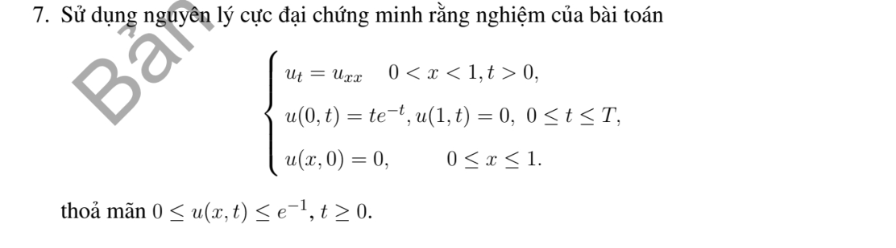

# Bài tập thực hành 7 — Mục 4.2.3

**Mã:** `BT_4_2_3_07` · **Trang sách:** 198–198

[← Mục lục](../MUC_LUC.md) · [Bản PDF của bài](BT_4_2_3_07.pdf)

## Đề bài

## Kiến thức và trình tự giải

**Bước 1 — Viết toán tử và biên parabol.** Đặt $P=\partial_t-a(x,t)\partial_{xx}-b(x,t)\partial_x-c(x,t)$ với $a\ge0$, $c\le0$. Biên parabol gồm mặt $t=0$ và các biên không gian; mặt $t=T$ vẫn thuộc miền được ước lượng. Với phương trình nhiệt, $a=K>0$, $b=c=0$.

**Bước 2 — Loại cực đại dương bằng dấu đạo hàm.** Tại cực đại dương nội miền, $w_x=0$, $w_{xx}\le0$, $w_t=0$; nếu cực đại trên mặt thời gian trên thì đạo hàm một phía cho $w_t\ge0$. Suy $Pw\ge0$, mâu thuẫn $Pw<0$. Với $Pw\le0$, xét $w_\varepsilon=w-\varepsilon e^{\gamma t}$, $\gamma>0$: $Pw_\varepsilon=Pw-\varepsilon(\gamma-c)e^{\gamma t}<0$. Chứng minh $w_\varepsilon\le0$ rồi cho $\varepsilon\downarrow0$.

**Bước 3 — So sánh hai hàm bằng hiệu.** Để chứng minh $v\le u\le V$, kiểm tra $Pv\le Pu\le PV$ và thứ tự của dữ liệu đầu, biên. Áp dụng bước 2 cho $v-u$ và $u-V$. Nếu có nguồn dương, hằng số không nhất thiết là nghiệm trên, nên phải tính $PV-Pu$; không dùng cực đại của dữ liệu để chặn một bài có nguồn mà chưa kiểm tra.

**Bước 4 — Xử lý Neumann, Robin và tuần hoàn.** Neumann thuần nhất có thể phản xạ chẵn qua đầu mút; điểm biên trở thành điểm trong. Robin viết theo pháp tuyến ngoài $\partial_\nu u+\sigma u=0$, $\sigma\ge0$. Tại cực đại dương không hằng, bổ đề Hopf cho $\partial_\nu u>0$, trái với $\partial_\nu u=-\sigma u\le0$. Với Robin phải thêm mức $0$ vào cận hằng nếu dữ liệu mang một dấu. Biên tuần hoàn ghép hai đầu thành đường tròn; không còn biên không gian.

**Bước 5 — Miền vô hạn và nguồn bị chặn.** Trên toàn trục/nửa trục, cần nghiệm bị chặn trên mỗi dải thời gian (hoặc điều kiện tăng trưởng đủ dùng). Dùng rào $\varepsilon((x-x_0)^2+2Kt)$ trên đoạn lớn, áp dụng cực đại trên miền hữu hạn rồi cho $\varepsilon\downarrow0$; cách này loại ảnh hưởng từ vô cực. Nếu $|Pu|\le N$ và $|u|\le M$ trên biên parabol, đặt $V=M+Nt$. Vì $PV=N-cV\ge N$, suy $|u|\le M+Nt\le M+NT$. $M$ ở đây là cận của $|u|$, không phải cực đại có dấu.

## Lời giải áp dụng cho bài

**Bước 1. Tìm cận dữ liệu biên.** Đặt $h(t)=te^{-t}$. $h'(t)=e^{-t}(1-t)$, nên tăng trên $[0,1]$, giảm sau $1$, $h(1)=e^{-1}$. Vì vậy $0\le h(t)\le e^{-1}$.
**Bước 2. Kiểm tra hiệu trên biên parabol.** $P=\partial_t-\partial_{xx}$; $Pu=0$. Với $w=u-e^{-1}$, $Pw=0$, mặt đầu $w=-e^{-1}$, tại $x=0$ có $w=te^{-t}-e^{-1}\le0$, tại $x=1$ có $w=-e^{-1}$. Cực đại yếu cho $u\le e^{-1}$. Với $-u$, cả dữ liệu đầu lẫn hai biên không dương, nên $u\ge0$.
**Bước 3. Kết luận.** Trên từng dải $[0,T]$,

$$
0\le u(x,t)\le e^{-1}.
$$

Do $T$ tùy ý, cận đúng với mọi $t>0$. Dữ liệu đầu tại $x=0$ khớp $h(0)=0$, nên không có mâu thuẫn góc về giá trị.

## Đối chiếu kết quả

Khi sử dụng kết quả, kiểm tra đồng thời phương trình, dữ liệu ban đầu/biên và miền được nêu trong lời giải. Các điều kiện về tính trơn, nghiệm thực, tồn tại hoặc duy nhất là một phần của kết luận; không bỏ chúng khi ghi đáp án.
