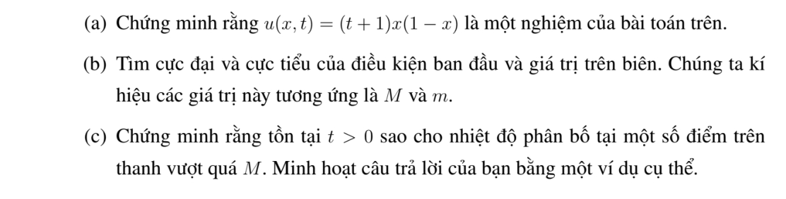
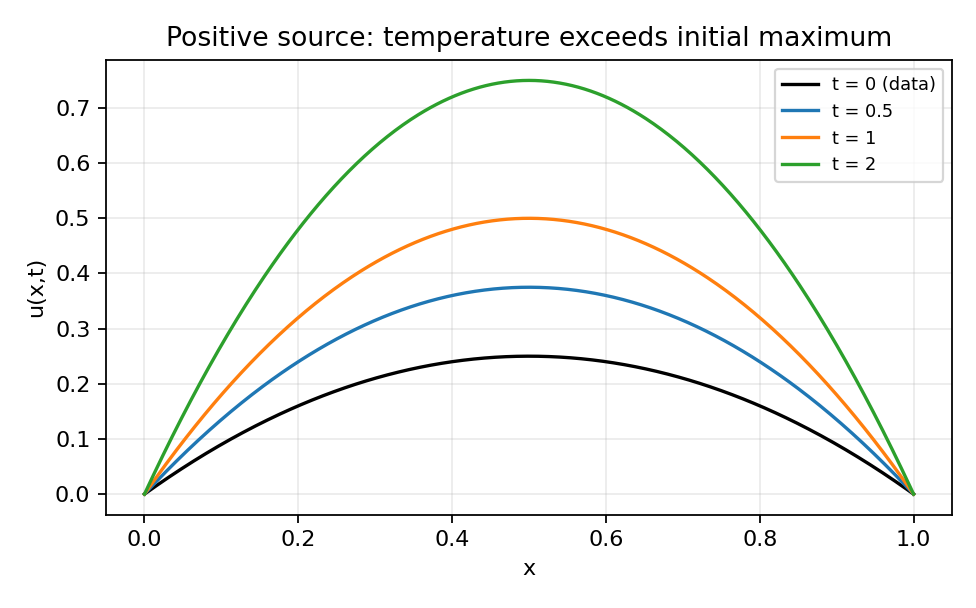

# Bài tập thực hành 8 — Mục 4.2.3

**Mã:** `BT_4_2_3_08` · **Trang sách:** 198–199

[← Mục lục](../MUC_LUC.md) · [Bản PDF của bài](BT_4_2_3_08.pdf)

## Đề bài

## Kiến thức và trình tự giải

**Bước 1 — Viết toán tử và biên parabol.** Đặt $P=\partial_t-a(x,t)\partial_{xx}-b(x,t)\partial_x-c(x,t)$ với $a\ge0$, $c\le0$. Biên parabol gồm mặt $t=0$ và các biên không gian; mặt $t=T$ vẫn thuộc miền được ước lượng. Với phương trình nhiệt, $a=K>0$, $b=c=0$.

**Bước 2 — Loại cực đại dương bằng dấu đạo hàm.** Tại cực đại dương nội miền, $w_x=0$, $w_{xx}\le0$, $w_t=0$; nếu cực đại trên mặt thời gian trên thì đạo hàm một phía cho $w_t\ge0$. Suy $Pw\ge0$, mâu thuẫn $Pw<0$. Với $Pw\le0$, xét $w_\varepsilon=w-\varepsilon e^{\gamma t}$, $\gamma>0$: $Pw_\varepsilon=Pw-\varepsilon(\gamma-c)e^{\gamma t}<0$. Chứng minh $w_\varepsilon\le0$ rồi cho $\varepsilon\downarrow0$.

**Bước 3 — So sánh hai hàm bằng hiệu.** Để chứng minh $v\le u\le V$, kiểm tra $Pv\le Pu\le PV$ và thứ tự của dữ liệu đầu, biên. Áp dụng bước 2 cho $v-u$ và $u-V$. Nếu có nguồn dương, hằng số không nhất thiết là nghiệm trên, nên phải tính $PV-Pu$; không dùng cực đại của dữ liệu để chặn một bài có nguồn mà chưa kiểm tra.

**Bước 4 — Xử lý Neumann, Robin và tuần hoàn.** Neumann thuần nhất có thể phản xạ chẵn qua đầu mút; điểm biên trở thành điểm trong. Robin viết theo pháp tuyến ngoài $\partial_\nu u+\sigma u=0$, $\sigma\ge0$. Tại cực đại dương không hằng, bổ đề Hopf cho $\partial_\nu u>0$, trái với $\partial_\nu u=-\sigma u\le0$. Với Robin phải thêm mức $0$ vào cận hằng nếu dữ liệu mang một dấu. Biên tuần hoàn ghép hai đầu thành đường tròn; không còn biên không gian.

**Bước 5 — Miền vô hạn và nguồn bị chặn.** Trên toàn trục/nửa trục, cần nghiệm bị chặn trên mỗi dải thời gian (hoặc điều kiện tăng trưởng đủ dùng). Dùng rào $\varepsilon((x-x_0)^2+2Kt)$ trên đoạn lớn, áp dụng cực đại trên miền hữu hạn rồi cho $\varepsilon\downarrow0$; cách này loại ảnh hưởng từ vô cực. Nếu $|Pu|\le N$ và $|u|\le M$ trên biên parabol, đặt $V=M+Nt$. Vì $PV=N-cV\ge N$, suy $|u|\le M+Nt\le M+NT$. $M$ ở đây là cận của $|u|$, không phải cực đại có dấu.

## Lời giải áp dụng cho bài

**(a) Thế trực tiếp nghiệm.** Với $u=(t+1)x(1-x)$,

$$
u_t=x(1-x),\quad u_x=(t+1)(1-2x),\quad u_{xx}=-2(t+1).
$$

Suy $u_t-u_{xx}=x(1-x)+2(t+1)$, đúng nguồn. Tại $x=0,1$, $u=0$; tại $t=0$, $u=x(1-x)$.
**(b) Cực trị dữ liệu.** $f'=1-2x=0$ cho $x=1/2$, $f(1/2)=1/4$; hai đầu bằng $0$ và $f\ge0$. Biên cũng bằng $0$, nên $m=0$, $M=1/4$.
**(c) Nhiệt độ vượt $M$.** Tại $x=1/2$,

$$
u(1/2,t)=\frac{t+1}4>\frac14=M\quad\text{với mọi }t>0.
$$

Ví dụ $t=1$ cho $u=1/2$. Nguyên lý cực đại của phương trình thuần nhất không áp dụng trực tiếp vì $Pu=2(t+1)+x(1-x)>0$; nguồn dương làm nhiệt tăng.

## Đồ thị minh họa

## Đối chiếu kết quả

Khi sử dụng kết quả, kiểm tra đồng thời phương trình, dữ liệu ban đầu/biên và miền được nêu trong lời giải. Các điều kiện về tính trơn, nghiệm thực, tồn tại hoặc duy nhất là một phần của kết luận; không bỏ chúng khi ghi đáp án.
