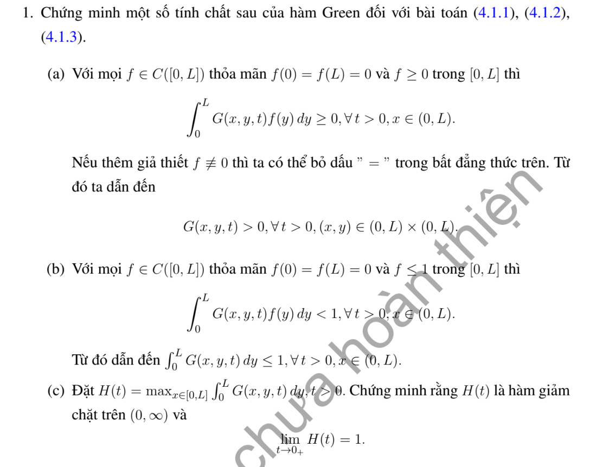

# Bài tập thực hành 1 — Mục 4.3.3

**Mã:** `BT_4_3_3_01` · **Trang sách:** 202–202

[← Mục lục](../MUC_LUC.md) · [Bản PDF của bài](BT_4_3_3_01.pdf)

## Đề bài

## Kiến thức và trình tự giải

**Bước 1 — Tìm cơ sở và chuẩn.** Giải $-X_n''=\lambda_nX_n$ với đúng biên thuần nhất. Đặt $N_n=\int_0^LX_n^2dx$; các hàm riêng ở biên Robin không có chuẩn mặc định $L/2$. Từ $c_n=N_n^{-1}\int fX_n$ trong chuỗi nghiệm, đổi thứ tự tổng–tích phân với $t>0$ để nhận ra

$$
G(x,y,t)=\sum_n\frac{X_n(x)X_n(y)}{N_n}e^{-K\lambda_nt},\qquad
u(x,t)=\int_0^LG(x,y,t)f(y)dy.
$$

**Bước 2 — Tính chuẩn Robin đến biểu thức sơ cấp.** Nếu $X=\cos kx+\sin kx/k$, dùng

$$
N=\frac L2(1+k^{-2})+\frac{\sin(2kL)}{4k}(1-k^{-2})+\frac{\sin^2(kL)}{k^2}.
$$

Nếu $X=\cos kx$, $N=L/2+\sin(2kL)/(4k)$. Hai biên tuần hoàn có mode hằng $1/L$ trong $G$ và cặp sine/cosine tần số $2n\pi/L$.

**Bước 3 — Kiểm tra PDE, biên và đối xứng.** Đạo hàm $e^{-K\lambda_nt}X_n(x)$ cho $G_t=KG_{xx}$; đạo hàm theo $y$ tương tự. Biên được kiểm tra trên từng $X_n$. Mỗi tích $X_n(x)X_n(y)$ đối xứng; hội tụ đều của chuỗi đạo hàm trên $t\ge\varepsilon$ biện minh các thao tác. Dữ liệu delta ban đầu hiểu qua $\int Gf\to f$ trong miền hoặc trong $L^2$, không bằng cách thế $t=0$ trực tiếp vào một chuỗi không hội tụ.

**Bước 4 — Chứng minh dương và khối lượng.** Nguyên lý cực đại cho $\int Gf\ge0$ với $f\ge0$, suy $G\ge0$ bằng cách lấy $f$ tập trung gần một điểm. Kết hợp tính nửa nhóm và nguyên lý mạnh để suy $G>0$ trong miền. $m(x,t)=\int G(x,y,t)dy$ là nghiệm có dữ liệu đầu $1$. Neumann/tuần hoàn giữ $m=1$; Dirichlet hoặc Robin hấp thụ cho $0<m<1$.

**Bước 5 — Nửa nhóm và thời gian dài.** Trực giao cho $\int G(x,z,s)G(z,y,t)dz=G(x,y,s+t)$. Với $H(t)=\max_xm(x,t)$ ở Dirichlet, $m(x,t+s)\le H(t)m(x,s)$, nên $H(t+s)\le H(t)H(s)<H(t)$. Để chứng minh $H(t)\to1$ lúc đầu, giữ một $x_0$ trong miền, dùng $m(x_0,t)\to1$ và $m(x_0,t)\le H(t)\le1$.

## Lời giải áp dụng cho bài

**Bước 1. Nhân Dirichlet và hội tụ.**

$$
G(x,y,t)=\frac2L\sum_{n\ge1}e^{-K(n\pi/L)^2t}
\sin(n\pi x/L)\sin(n\pi y/L).
$$

Với $t\ge\varepsilon>0$, chuỗi và các đạo hàm hội tụ đều. Với dữ liệu $f$, $u=\int Gf$ giải PDE, biên $0$ và trả lại $f$ tại các điểm liên tục.

**(a) Dương yếu rồi dương nghiêm ngặt.**
Nếu $f\ge0$, cực đại cho $u\ge0$. Nếu $f\not\equiv0$, nguyên lý cực đại mạnh cho $u(x,t)>0$ khi $0<x<L,t>0$. Để suy $G\ge0$, nếu $G(x_0,y_0,t_0)<0$, tính liên tục theo $y$ cho một khoảng mà $G<0$; chọn $f\ge0$, không bằng $0$, hỗ trợ trong khoảng này, sẽ có $\int G(x_0,y,t_0)f(y)dy<0$, mâu thuẫn. Để chứng minh $G>0$ tại mọi điểm, chú ý

$$
G(y,y,s)=\frac2L\sum_{n\ge1}e^{-K(n\pi/L)^2s}\sin^2(n\pi y/L)>0\quad(0<y<L).
$$

Với $s=t/2$, hàm $G(\cdot,y,s)\ge0$ và không bằng không. Nguyên lý mạnh cho nghiệm tiến thêm $s$; tính nửa nhóm suy $G(x,y,t)>0$.

**(b) Cận nhỏ hơn $1$ và khối lượng.**
Với $f\le1$, hàm $1-u$ giải PDE, dữ liệu đầu không âm và biên bằng $1$, nên $1-u>0$ trong miền, tức $\int Gf<1$. Để chuyển từ $f$ vanishing ở hai đầu sang dữ liệu $1$, chọn $f_j(y)=\min(1,jy,j(L-y))$: $0\le f_j\uparrow1$ trong miền, $f_j(0)=f_j(L)=0$. Vì $G\ge0$, hội tụ đơn điệu cho

$$
m(x,t)=\int_0^LG(x,y,t)dy=\lim_j\int Gf_j\le1.
$$

Hàm $m$ là nghiệm với dữ liệu đầu $1$ trong miền và biên $0$ cho $t>0$. Nguyên lý mạnh cho $m>0$ và $1-m>0$ trong miền; vì thế $0<m<1$, $m(0,t)=m(L,t)=0$. Tính liên tục trên đoạn với $t>0$ cho $H(t)=\max_xm(x,t)$ thỏa $0<H(t)<1$.

**(c) Tính giảm nghiêm ngặt và giới hạn đầu.**
Trực giao sine cho đẳng thức nửa nhóm; tích phân theo $y$ rồi dùng $m(z,t)\le H(t)$:

$$
m(x,t+s)=\int_0^LG(x,z,s)m(z,t)dz\le H(t)m(x,s).
$$

Lấy maximum theo $x$: $H(t+s)\le H(t)H(s)<H(t)$ với mọi $s,t>0$, nên $H$ giảm chặt. Giữ $x_0=L/2$: dữ liệu $1$ liên tục gần $x_0$ cho $m(x_0,t)\to1$ khi $t\downarrow0$. Vì $m(x_0,t)\le H(t)\le1$, định lý kẹp cho $\lim_{t\downarrow0}H(t)=1$. Không yêu cầu hội tụ đều của $m$ đến $1$ ở hai đầu, vì $m$ luôn bằng $0$ tại đó.

## Đối chiếu kết quả

Khi sử dụng kết quả, kiểm tra đồng thời phương trình, dữ liệu ban đầu/biên và miền được nêu trong lời giải. Các điều kiện về tính trơn, nghiệm thực, tồn tại hoặc duy nhất là một phần của kết luận; không bỏ chúng khi ghi đáp án.
