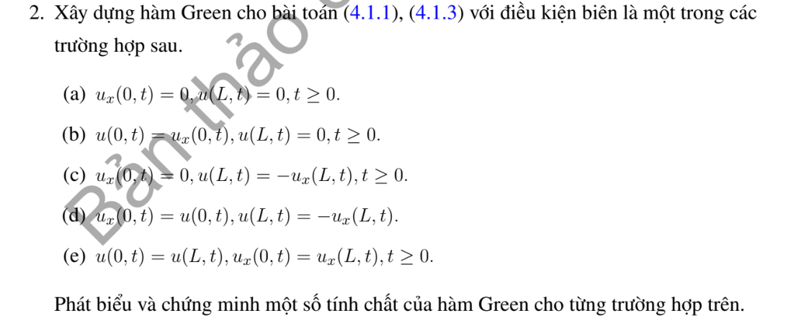

# Bài tập thực hành 2 — Mục 4.3.3

**Mã:** `BT_4_3_3_02` · **Trang sách:** 202–202

[← Mục lục](../MUC_LUC.md) · [Bản PDF của bài](BT_4_3_3_02.pdf)

## Đề bài

## Kiến thức và trình tự giải

**Bước 1 — Tìm cơ sở và chuẩn.** Giải $-X_n''=\lambda_nX_n$ với đúng biên thuần nhất. Đặt $N_n=\int_0^LX_n^2dx$; các hàm riêng ở biên Robin không có chuẩn mặc định $L/2$. Từ $c_n=N_n^{-1}\int fX_n$ trong chuỗi nghiệm, đổi thứ tự tổng–tích phân với $t>0$ để nhận ra

$$
G(x,y,t)=\sum_n\frac{X_n(x)X_n(y)}{N_n}e^{-K\lambda_nt},\qquad
u(x,t)=\int_0^LG(x,y,t)f(y)dy.
$$

**Bước 2 — Tính chuẩn Robin đến biểu thức sơ cấp.** Nếu $X=\cos kx+\sin kx/k$, dùng

$$
N=\frac L2(1+k^{-2})+\frac{\sin(2kL)}{4k}(1-k^{-2})+\frac{\sin^2(kL)}{k^2}.
$$

Nếu $X=\cos kx$, $N=L/2+\sin(2kL)/(4k)$. Hai biên tuần hoàn có mode hằng $1/L$ trong $G$ và cặp sine/cosine tần số $2n\pi/L$.

**Bước 3 — Kiểm tra PDE, biên và đối xứng.** Đạo hàm $e^{-K\lambda_nt}X_n(x)$ cho $G_t=KG_{xx}$; đạo hàm theo $y$ tương tự. Biên được kiểm tra trên từng $X_n$. Mỗi tích $X_n(x)X_n(y)$ đối xứng; hội tụ đều của chuỗi đạo hàm trên $t\ge\varepsilon$ biện minh các thao tác. Dữ liệu delta ban đầu hiểu qua $\int Gf\to f$ trong miền hoặc trong $L^2$, không bằng cách thế $t=0$ trực tiếp vào một chuỗi không hội tụ.

**Bước 4 — Chứng minh dương và khối lượng.** Nguyên lý cực đại cho $\int Gf\ge0$ với $f\ge0$, suy $G\ge0$ bằng cách lấy $f$ tập trung gần một điểm. Kết hợp tính nửa nhóm và nguyên lý mạnh để suy $G>0$ trong miền. $m(x,t)=\int G(x,y,t)dy$ là nghiệm có dữ liệu đầu $1$. Neumann/tuần hoàn giữ $m=1$; Dirichlet hoặc Robin hấp thụ cho $0<m<1$.

**Bước 5 — Nửa nhóm và thời gian dài.** Trực giao cho $\int G(x,z,s)G(z,y,t)dz=G(x,y,s+t)$. Với $H(t)=\max_xm(x,t)$ ở Dirichlet, $m(x,t+s)\le H(t)m(x,s)$, nên $H(t+s)\le H(t)H(s)<H(t)$. Để chứng minh $H(t)\to1$ lúc đầu, giữ một $x_0$ trong miền, dùng $m(x_0,t)\to1$ và $m(x_0,t)\le H(t)\le1$.

## Lời giải áp dụng cho bài

**Bước 1. Tách biến và giải từng điều kiện biên.**
Đặt $X=A\cos kx+B\sin kx$, $-X''=k^2X$.

**Ý (a).**  $X'(0)=0$ cho $B=0$, $X(L)=0$ cho $\cos kL=0$. Vậy $k_n=(n+1/2)\pi/L$, $X_n=\cos k_nx$, $N_n=L/2$, $n\ge0$:

$$
G_a=\frac2L\sum_{n\ge0}e^{-Kk_n^2t}\cos k_nx\cos k_ny.
$$

**Ý (b).**  $X(0)=X'(0)$ cho $A=kB$, chọn $X=\cos kx+\sin kx/k$. Biên $X(L)=0$ cho $k\cos kL+\sin kL=0$.

**Ý (c).**  $X'(0)=0$ cho $X=\cos kx$, $X(L)+X'(L)=0$ cho $\cos kL-k\sin kL=0$.

**Ý (d).**  $X'(0)=X(0)$ cho $X=\cos kx+\sin kx/k$, và $X(L)+X'(L)=0$ cho $(1-k^2)\sin kL+2k\cos kL=0$.

**Bước 2. Chuẩn hóa các biên Robin đến công thức rõ.**
Ở (b),(d), dùng $\cos^2kx=(1+\cos2kx)/2$, $\sin^2kx=(1-\cos2kx)/2$ và $2\sin kx\cos kx=\sin2kx$:

$$
N(k)=\int_0^LX^2dx
=\frac L2(1+k^{-2})+\frac{\sin2kL}{4k}(1-k^{-2})+\frac{\sin^2kL}{k^2}.
$$

Ở (c), $N(k)=L/2+\sin2kL/(4k)$. Vì vậy trong mỗi trường hợp (b),(c),(d),

$$
G_j(x,y,t)=\sum_{k_n>0}\frac{X_n(x)X_n(y)}{N(k_n)}e^{-Kk_n^2t},\quad j=b,c,d,
$$

với $k_n,X_n$ vừa xác định. Đây là các chuẩn đã tính, không bỏ lại $\int X_n^2$ chưa thực hiện. Trị riêng $0$ không có: $X=A+Bx$ thay vào từng cặp biên buộc $A=B=0$. Bỏ nghiệm $k=0$ ngoại lai của phương trình ở (d).

**Bước 3. Biên tuần hoàn (e).**
Các mode $1,\cos(2n\pi x/L),\sin(2n\pi x/L)$ có chuẩn $L,L/2,L/2$. Cộng hai tích bằng $\cos(a-b)$:

$$
G_e=\frac1L+\frac2L\sum_{n\ge1}e^{-K(2n\pi/L)^2t}\cos\frac{2n\pi(x-y)}L.
$$

Biểu diễn ảnh theo một chu kỳ là $G_e=\sum_{j\in\mathbb Z}g_K(x-y+jL,t)$; mỗi hạng dương và $\int_0^LG_e\,dy=\int_{\mathbb R}g_K\,dy=1$.

**Bước 4. Chứng minh các tính chất cho từng nhân.**
Trên $t\ge\varepsilon$, các hệ có $k_n$ tăng tuyến tính và chuẩn không suy biến, nên chuỗi đạo hàm hội tụ đều. Từ $X_n''=-k_n^2X_n$ suy $G_t=KG_{xx}=KG_{yy}$; từng $X_n$ cho đúng cặp biên (a)--(e); tích $X_n(x)X_n(y)$ cho đối xứng. Định lý khai triển Sturm–Liouville tự liên hợp ở (a)--(d), hoặc Fourier tuần hoàn ở (e), cho $\int G_jf\to f$ trong $L^2$ và tại điểm liên tục thích hợp. Trực giao cho tính nửa nhóm.

Nguyên lý cực đại ở từng biên cho $\int G_jf\ge0$ nếu $f\ge0$, suy $G_j\ge0$ bằng dữ liệu tập trung. Cùng lập luận nửa nhóm và nguyên lý mạnh cho $G_j>0$ trong miền. $m_j=\int G_jdy$ có dữ liệu đầu $1$: ở (a)--(d), biên Dirichlet hoặc Robin hấp thụ làm $0<m_j<1$ trong miền, còn (e) giữ $m_e=1$. Tất cả mode ở (a)--(d) dương, nên $G_j\to0$; ở (e), $G_e\to1/L$. Do đó nghiệm lần lượt tiến về $0$ hoặc trung bình dữ liệu. Các kết luận về dương, khối lượng và giới hạn được chứng minh bằng đúng biên của từng trường hợp.

## Đối chiếu kết quả

Khi sử dụng kết quả, kiểm tra đồng thời phương trình, dữ liệu ban đầu/biên và miền được nêu trong lời giải. Các điều kiện về tính trơn, nghiệm thực, tồn tại hoặc duy nhất là một phần của kết luận; không bỏ chúng khi ghi đáp án.
