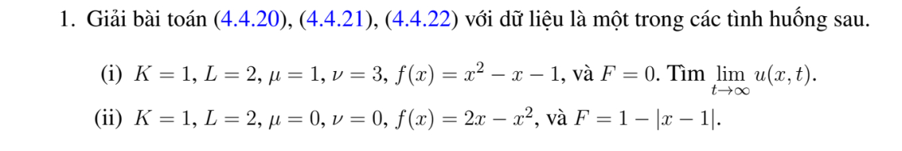

# Bài tập thực hành 1 — Mục 4.4.3

**Mã:** `BT_4_4_3_01` · **Trang sách:** 207–207

[← Mục lục](../MUC_LUC.md) · [Bản PDF của bài](BT_4_4_3_01.pdf)

## Đề bài

## Kiến thức và trình tự giải

**Bước 1 — Khử điều kiện biên không thuần nhất.** Viết $u=b+w$ với $b$ thỏa đúng biên. Dirichlet hai đầu: $b=\mu+(\nu-\mu)x/L$. Neumann hai đầu: $b=\mu x+(\nu-\mu)x^2/(2L)$. Neumann–Dirichlet: $b=\nu+\mu(x-L)$; Dirichlet–Neumann: $b=\mu+x\nu$. Robin trái–Dirichlet phải: $b=\mu+d+dx$, $d=(\nu-\mu)/(L+1)$. Neumann trái–Robin phải: $b=\nu-\mu(L+1)+\mu x$. Hai Robin: $b=\mu+d+dx$, $d=(\nu-\mu)/(L+2)$.

**Bước 2 — Tính lại nguồn và dữ liệu đầu.** Từ $u_t=Ku_{xx}+F$ suy $w_t=Kw_{xx}+Q$, $Q=F+Kb_{xx}-b_t$, $w(x,0)=f(x)-b(x,0)$. Tính $b_t,b_{xx}$ trước khi chiếu; với hàm nâng bậc hai Neumann, $Kb_{xx}$ không bằng không. Nếu dùng trạng thái dừng $P$, giải $KP''+F=0$ và đúng biên rồi đặt $w=u-P$.

**Bước 3 — Chiếu và giải ODE bằng nhân tử.** Với $N_n=\int X_n^2$, đặt $d_n=N_n^{-1}\int(f-b_0)X_n$, $Q_n(t)=N_n^{-1}\int QX_n$. Phương trình mode là $T_n'+K\lambda_nT_n=Q_n$. Nhân với $e^{K\lambda_nt}$, tích phân từ $0$ đến $t$, rồi chia:

$$
T_n=d_ne^{-K\lambda_nt}+\int_0^te^{-K\lambda_n(t-s)}Q_n(s)ds,\qquad
u=b+\sum_nT_nX_n.
$$

Đây cũng là công thức Green $u=b+\int G(f-b_0)+\int_0^t\int GQ$ cho biên đã được khử.

**Bước 4 — Thực hiện tích phân thời gian.** Với $Q_n(s)=C_ne^{-\rho s}$, đặt $d=K\lambda_n$:

$$
\int_0^te^{-d(t-s)}C_ne^{-\rho s}ds
=C_ne^{-dt}\int_0^te^{(d-\rho)s}ds
=C_n\frac{e^{-\rho t}-e^{-dt}}{d-\rho}.
$$

Nếu $d=\rho$, kết quả là $C_nte^{-dt}$. Với nguồn hằng, kết quả $C_n(1-e^{-dt})/d$ khi $d>0$; mode $d=0$ phải dùng $\int_0^tQ_0(s)ds$. Nguồn đa thức thời gian tích phân từng phần hoặc giải ODE với nghiệm riêng đa thức.

**Bước 5 — Kiểm tra và tìm giới hạn.** Mỗi mode đúng PDE, biên; $T_n(0)=d_n$ trả lại dữ liệu đầu sau khi cộng $b_0$. Tách mode hằng Neumann: $\frac d{dt}\int u=K(\nu-\mu)+\int F$. Trạng thái dừng chỉ tồn tại nếu tổng nguồn và thông lượng cân bằng. Với các mode dương, kiểm tra hội tụ đủ để lấy giới hạn đều; không bỏ một mode bằng không hoặc mode tăng.

## Lời giải áp dụng cho bài

**Bước 1. Khử biên Dirichlet và dùng Duhamel.**
Đặt $b=\mu+(\nu-\mu)x/L$, $w=u-b$. Khi đó $w_t=Kw_{xx}+F-b_t$, biên $0$, mặt đầu $f-b_0$. Với $k_n=n\pi/L$ và hệ số sine chuẩn $q_n=(2/L)\int q\sin k_nx$,

$$
u=b+\sum_{n\ge1}\left[(f-b_0)_ne^{-Kk_n^2t}
+\int_0^te^{-Kk_n^2(t-s)}(F-b_t)_n(s)ds\right]\sin k_nx.
$$

**Bước 2. Câu (i).** $K=1,L=2,b=1+x$, $q=f-b=x^2-2x-2$, $k=n\pi/2$. Tích phân hai lần cho

$$
\begin{aligned}
d_n=\int_0^2q\sin kx\,dx
&=\left[-q\cos kx/k\right]_0^2-\frac1{k^2}\int_0^2q''\sin kx\,dx\\
&=\frac{2((-1)^n-1)}k-\frac{2(1-(-1)^n)}{k^3}
=-2(1-(-1)^n)(k^{-1}+k^{-3}).
\end{aligned}
$$

Nguồn bằng $0$, nên

$$
u=1+x-\sum_{n\ge1}2(1-(-1)^n)(k_n^{-1}+k_n^{-3})e^{-k_n^2t}\sin k_nx.
$$

Thời gian dài các mode mất đi đều: $u\to1+x$. $f(0)=-1\ne1$, $f(2)=1\ne3$, nên không liên tục tại hai góc; chuỗi trả lại $f$ trong miền và biên được giữ bởi $b$ khi $t>0$.

**Bước 3. Câu (ii).** $b=0,f=2x-x^2,F=1-|x-1|$, $k=n\pi/2$. Vì $f(0)=f(2)=0,f''=-2$,

$$
f_n=-\frac1{k^2}\int_0^2f''\sin kx\,dx=\frac{2(1-(-1)^n)}{k^3}.
$$

Tách nguồn tại $1$, dùng nguyên hàm của $x\sin kx$:

$$
\begin{aligned}
F_n&=\int_0^1x\sin kx\,dx+\int_1^2(2-x)\sin kx\,dx\\
&=\left[-\frac{x\cos kx}k+\frac{\sin kx}{k^2}\right]_0^1
+\left[-\frac{(2-x)\cos kx}k-\frac{\sin kx}{k^2}\right]_1^2
=\frac{2\sin k}{k^2}.
\end{aligned}
$$

Do nguồn hằng theo thời gian,

$$
u=\sum_{n\ge1}\left[\frac{2(1-(-1)^n)}{k_n^3}e^{-k_n^2t}
+\frac{2\sin k_n}{k_n^4}(1-e^{-k_n^2t})\right]\sin k_nx.
$$

Trạng thái dừng giải $-P''=F$, biên $0$. Đối xứng quanh $1$ cho

$$
P(x)=\begin{cases}x/2-x^3/6,&0\le x\le1,\\(2-x)/2-(2-x)^3/6,&1\le x\le2.\end{cases}
$$

Hai vết $P,P'$ tại $1$ bằng nhau; $P''=-F$, $P(0)=P(2)=0$. Các hệ số dừng bằng $F_n/k_n^2$, nên $u\to P$ đều.

## Đối chiếu kết quả

Khi sử dụng kết quả, kiểm tra đồng thời phương trình, dữ liệu ban đầu/biên và miền được nêu trong lời giải. Các điều kiện về tính trơn, nghiệm thực, tồn tại hoặc duy nhất là một phần của kết luận; không bỏ chúng khi ghi đáp án.
