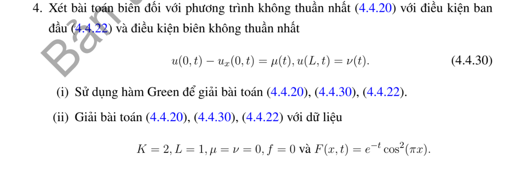

# Bài tập thực hành 4 — Mục 4.4.3

**Mã:** `BT_4_4_3_04` · **Trang sách:** 207–207

[← Mục lục](../MUC_LUC.md) · [Bản PDF của bài](BT_4_4_3_04.pdf)

## Đề bài

## Kiến thức và trình tự giải

**Bước 1 — Khử điều kiện biên không thuần nhất.** Viết $u=b+w$ với $b$ thỏa đúng biên. Dirichlet hai đầu: $b=\mu+(\nu-\mu)x/L$. Neumann hai đầu: $b=\mu x+(\nu-\mu)x^2/(2L)$. Neumann–Dirichlet: $b=\nu+\mu(x-L)$; Dirichlet–Neumann: $b=\mu+x\nu$. Robin trái–Dirichlet phải: $b=\mu+d+dx$, $d=(\nu-\mu)/(L+1)$. Neumann trái–Robin phải: $b=\nu-\mu(L+1)+\mu x$. Hai Robin: $b=\mu+d+dx$, $d=(\nu-\mu)/(L+2)$.

**Bước 2 — Tính lại nguồn và dữ liệu đầu.** Từ $u_t=Ku_{xx}+F$ suy $w_t=Kw_{xx}+Q$, $Q=F+Kb_{xx}-b_t$, $w(x,0)=f(x)-b(x,0)$. Tính $b_t,b_{xx}$ trước khi chiếu; với hàm nâng bậc hai Neumann, $Kb_{xx}$ không bằng không. Nếu dùng trạng thái dừng $P$, giải $KP''+F=0$ và đúng biên rồi đặt $w=u-P$.

**Bước 3 — Chiếu và giải ODE bằng nhân tử.** Với $N_n=\int X_n^2$, đặt $d_n=N_n^{-1}\int(f-b_0)X_n$, $Q_n(t)=N_n^{-1}\int QX_n$. Phương trình mode là $T_n'+K\lambda_nT_n=Q_n$. Nhân với $e^{K\lambda_nt}$, tích phân từ $0$ đến $t$, rồi chia:

$$
T_n=d_ne^{-K\lambda_nt}+\int_0^te^{-K\lambda_n(t-s)}Q_n(s)ds,\qquad
u=b+\sum_nT_nX_n.
$$

Đây cũng là công thức Green $u=b+\int G(f-b_0)+\int_0^t\int GQ$ cho biên đã được khử.

**Bước 4 — Thực hiện tích phân thời gian.** Với $Q_n(s)=C_ne^{-\rho s}$, đặt $d=K\lambda_n$:

$$
\int_0^te^{-d(t-s)}C_ne^{-\rho s}ds
=C_ne^{-dt}\int_0^te^{(d-\rho)s}ds
=C_n\frac{e^{-\rho t}-e^{-dt}}{d-\rho}.
$$

Nếu $d=\rho$, kết quả là $C_nte^{-dt}$. Với nguồn hằng, kết quả $C_n(1-e^{-dt})/d$ khi $d>0$; mode $d=0$ phải dùng $\int_0^tQ_0(s)ds$. Nguồn đa thức thời gian tích phân từng phần hoặc giải ODE với nghiệm riêng đa thức.

**Bước 5 — Kiểm tra và tìm giới hạn.** Mỗi mode đúng PDE, biên; $T_n(0)=d_n$ trả lại dữ liệu đầu sau khi cộng $b_0$. Tách mode hằng Neumann: $\frac d{dt}\int u=K(\nu-\mu)+\int F$. Trạng thái dừng chỉ tồn tại nếu tổng nguồn và thông lượng cân bằng. Với các mode dương, kiểm tra hội tụ đủ để lấy giới hạn đều; không bỏ một mode bằng không hoặc mode tăng.

## Lời giải áp dụng cho bài

**Bước 1. Khử Robin trái–Dirichlet phải.**
Với $b=a+dx$, $b(0)-b_x(0)=a-d=\mu$, $b(L)=a+dL=\nu$, nên $d=(\nu-\mu)/(L+1)$, $a=\mu+d$. $w=u-b$ có nguồn $Q=F-b_t$, dữ liệu $q=f-b_0$.
$X=\cos kx+\sin kx/k$ thỏa $X(0)-X'(0)=0$; $X(L)=0$ cho $k\cos kL+\sin kL=0$. Chuẩn

$$
N(k)=\frac L2(1+k^{-2})+\frac{\sin2kL}{4k}(1-k^{-2})+\frac{\sin^2kL}{k^2}.
$$

Nhân Green $G=\sum XXe^{-Kk^2t}/N$ cho $u=b+\int Gq+\int_0^t\int GQ$. Công thức trực tiếp cho $u$ có hạng biên $K\int_0^t[G(x,0,t-s)\mu(s)-G_y(x,L,t-s)\nu(s)]ds$, vì $G_y(0)=G(0),G(L)=0$.

**Bước 2. Tính hệ số cụ thể $K=2,L=1$, các biên và mặt đầu bằng $0$.**
Đặt

$$
A(k)=\int_0^1\cos^2\pi y\cos ky\,dy
=\frac{\sin k(k^2-2\pi^2)}{k(k^2-4\pi^2)},\quad
B(k)=\int_0^1\cos^2\pi y\sin ky\,dy
=\frac{(1-\cos k)(k^2-2\pi^2)}{k(k^2-4\pi^2)}.
$$

Các đẳng thức có được bằng $\cos^2\pi y=(1+\cos2\pi y)/2$ và tích–tổng, rồi tích phân $\cos ry,\sin ry$ trên $0,1$. Các nghiệm riêng không bằng $0,2\pi$, nên các mẫu ở đây không bằng không. Hệ số nguồn là

$$
C_n=\frac{A(k_n)+B(k_n)/k_n}{N(k_n)},\qquad k_n\cos k_n+\sin k_n=0.
$$

**Bước 3. Giải ODE và ghép.**

$$
u=\sum_{n\ge1}\frac{A(k_n)+B(k_n)/k_n}{N(k_n)}
\frac{e^{-t}-e^{-2k_n^2t}}{2k_n^2-1}
\left(\cos k_nx+\frac{\sin k_nx}{k_n}\right).
$$

Thương thời gian xuất phát từ $e^{-2k_n^2t}\int_0^te^{(2k_n^2-1)s}ds$; nếu trùng tốc độ thì dùng $te^{-t}$. Mỗi mode thỏa hai biên; $T_n'+2k_n^2T_n=C_ne^{-t}$ cho đúng nguồn, $T_n(0)=0$ cho dữ liệu đầu. Tất cả tốc độ giảm dương, nên giới hạn bằng $0$.

## Đối chiếu kết quả

Khi sử dụng kết quả, kiểm tra đồng thời phương trình, dữ liệu ban đầu/biên và miền được nêu trong lời giải. Các điều kiện về tính trơn, nghiệm thực, tồn tại hoặc duy nhất là một phần của kết luận; không bỏ chúng khi ghi đáp án.
