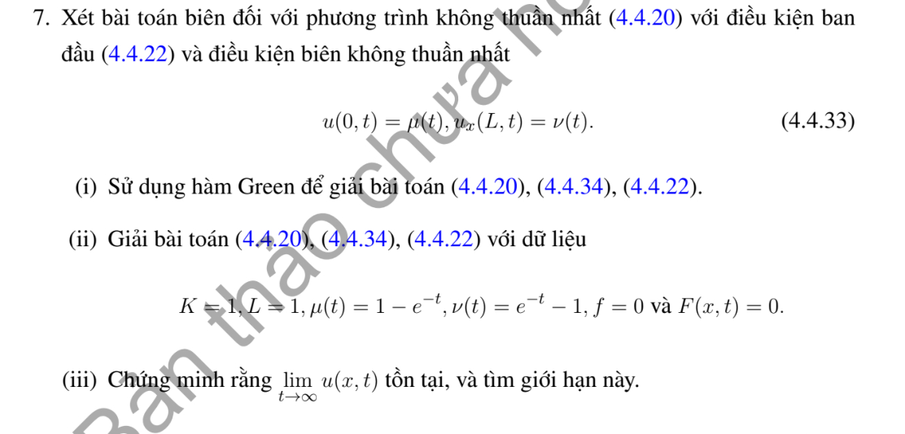

# Bài tập thực hành 7 — Mục 4.4.3

**Mã:** `BT_4_4_3_07` · **Trang sách:** 208–208

[← Mục lục](../MUC_LUC.md) · [Bản PDF của bài](BT_4_4_3_07.pdf)

## Đề bài

## Kiến thức và trình tự giải

**Bước 1 — Khử điều kiện biên không thuần nhất.** Viết $u=b+w$ với $b$ thỏa đúng biên. Dirichlet hai đầu: $b=\mu+(\nu-\mu)x/L$. Neumann hai đầu: $b=\mu x+(\nu-\mu)x^2/(2L)$. Neumann–Dirichlet: $b=\nu+\mu(x-L)$; Dirichlet–Neumann: $b=\mu+x\nu$. Robin trái–Dirichlet phải: $b=\mu+d+dx$, $d=(\nu-\mu)/(L+1)$. Neumann trái–Robin phải: $b=\nu-\mu(L+1)+\mu x$. Hai Robin: $b=\mu+d+dx$, $d=(\nu-\mu)/(L+2)$.

**Bước 2 — Tính lại nguồn và dữ liệu đầu.** Từ $u_t=Ku_{xx}+F$ suy $w_t=Kw_{xx}+Q$, $Q=F+Kb_{xx}-b_t$, $w(x,0)=f(x)-b(x,0)$. Tính $b_t,b_{xx}$ trước khi chiếu; với hàm nâng bậc hai Neumann, $Kb_{xx}$ không bằng không. Nếu dùng trạng thái dừng $P$, giải $KP''+F=0$ và đúng biên rồi đặt $w=u-P$.

**Bước 3 — Chiếu và giải ODE bằng nhân tử.** Với $N_n=\int X_n^2$, đặt $d_n=N_n^{-1}\int(f-b_0)X_n$, $Q_n(t)=N_n^{-1}\int QX_n$. Phương trình mode là $T_n'+K\lambda_nT_n=Q_n$. Nhân với $e^{K\lambda_nt}$, tích phân từ $0$ đến $t$, rồi chia:

$$
T_n=d_ne^{-K\lambda_nt}+\int_0^te^{-K\lambda_n(t-s)}Q_n(s)ds,\qquad
u=b+\sum_nT_nX_n.
$$

Đây cũng là công thức Green $u=b+\int G(f-b_0)+\int_0^t\int GQ$ cho biên đã được khử.

**Bước 4 — Thực hiện tích phân thời gian.** Với $Q_n(s)=C_ne^{-\rho s}$, đặt $d=K\lambda_n$:

$$
\int_0^te^{-d(t-s)}C_ne^{-\rho s}ds
=C_ne^{-dt}\int_0^te^{(d-\rho)s}ds
=C_n\frac{e^{-\rho t}-e^{-dt}}{d-\rho}.
$$

Nếu $d=\rho$, kết quả là $C_nte^{-dt}$. Với nguồn hằng, kết quả $C_n(1-e^{-dt})/d$ khi $d>0$; mode $d=0$ phải dùng $\int_0^tQ_0(s)ds$. Nguồn đa thức thời gian tích phân từng phần hoặc giải ODE với nghiệm riêng đa thức.

**Bước 5 — Kiểm tra và tìm giới hạn.** Mỗi mode đúng PDE, biên; $T_n(0)=d_n$ trả lại dữ liệu đầu sau khi cộng $b_0$. Tách mode hằng Neumann: $\frac d{dt}\int u=K(\nu-\mu)+\int F$. Trạng thái dừng chỉ tồn tại nếu tổng nguồn và thông lượng cân bằng. Với các mode dương, kiểm tra hội tụ đủ để lấy giới hạn đều; không bỏ một mode bằng không hoặc mode tăng.

## Lời giải áp dụng cho bài

**Bước 1. Biên Dirichlet–Neumann và công thức Green.**
Lấy $b=\mu+x\nu$, $w=u-b$, $Q=F-b_t$, $q=f-b_0$. Biên thuần nhất có $X_n=\sin k_nx$, $k_n=(n+1/2)\pi/L$, $N_n=L/2$. Nhân $G=\sum XXe^{-Kk^2t}/N$ cho $u=b+\int Gq+\int_0^t\int GQ$. Công thức trực tiếp có hạng biên

$$
K\int_0^t\{G_y(x,0,t-s)\mu(s)+G(x,L,t-s)\nu(s)\}ds,
$$

do $G(0)=0,G_y(L)=0$. Dòng tham chiếu (4.4.34) trong đề phải đọc theo biên Dirichlet–Neumann (4.4.33) được nêu ngay trước.

**Bước 2. Dữ kiện cụ thể.**
$K=L=1,\mu=1-e^{-t},\nu=e^{-t}-1$, $f=F=0$. Khi đó $b=(1-x)(1-e^{-t})$, $b_t=(1-x)e^{-t}$, $q=0$, $Q=-(1-x)e^{-t}$.
Với $k=(n+1/2)\pi$, $\cos k=0,\sin k=(-1)^n$,

$$
\begin{aligned}
c_n&=2\int_0^1(1-y)\sin ky\,dy\\
&=2\left[\frac{-(1-y)\cos ky}k-\frac{\sin ky}{k^2}\right]_0^1
=2\left(\frac1k-\frac{(-1)^n}{k^2}\right).
\end{aligned}
$$

**Bước 3. Tích phân và ghép.**
$T_n'+k_n^2T_n=-c_ne^{-t}$, $T_n(0)=0$, nên

$$
u=(1-x)(1-e^{-t})
-\sum_{n\ge0}c_n\frac{e^{-t}-e^{-k_n^2t}}{k_n^2-1}\sin k_nx.
$$

$k_n$ nửa nguyên nhân $\pi$, không bằng $1$. Thế biên: tại $0$, chuỗi bằng $0$, $u=1-e^{-t}$; đạo hàm tại $1$ của chuỗi bằng $0$, $u_x=e^{-t}-1$. Tại $t=0$ mọi hạng bằng $0$. Nguồn phụ $-b_t$ bị triệt tiêu khi cộng lại $b_t$, cho PDE gốc không nguồn.
**Bước 4. Giới hạn.** $b\to1-x$ đều. Các hệ số quá độ $O(k_n^{-3})$ và hai mũ giảm cho chuỗi tiến đều về $0$, nên $\lim_{t\to\infty}u=1-x$.

## Đối chiếu kết quả

Khi sử dụng kết quả, kiểm tra đồng thời phương trình, dữ liệu ban đầu/biên và miền được nêu trong lời giải. Các điều kiện về tính trơn, nghiệm thực, tồn tại hoặc duy nhất là một phần của kết luận; không bỏ chúng khi ghi đáp án.
