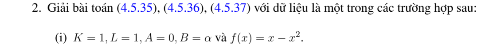

# Bài tập thực hành 2 — Mục 4.5.3

**Mã:** `BT_4_5_3_02` · **Trang sách:** 213–214

[← Mục lục](../MUC_LUC.md) · [Bản PDF của bài](BT_4_5_3_02.pdf)

## Đề bài

## Kiến thức và trình tự giải

**Bước 1 — Loại đạo hàm cấp một bằng tính đạo hàm đầy đủ.** Với $u_t=Ku_{xx}+Au_x+Bu$, đặt $u=e^{-hx}v$, $h=A/(2K)$. Khi đó

$$
u_t=e^{-hx}v_t,\quad u_x=e^{-hx}(v_x-hv),\quad
u_{xx}=e^{-hx}(v_{xx}-2hv_x+h^2v).
$$

Thay vào PDE, hệ số $v_x$ là $A-2Kh=0$, hệ số $v$ là $Kh^2-Ah+B=B-A^2/(4K)$. Vì thế $v_t=Kv_{xx}+Cv$, $C=B-A^2/(4K)$; có thể tiếp tục đặt $v=e^{Ct}z$ để $z_t=Kz_{xx}$.

**Bước 2 — Đổi dữ liệu và biên cùng phép đổi ẩn.** $v(x,0)=e^{hx}f(x)$. Dirichlet thuần nhất giữ nguyên; Neumann biến thành $v_x-hv=0$, nên không giữ nguyên một cơ sở cosine nếu $A\ne0$. Với Dirichlet:

$$
u=e^{-hx}\sum_{n\ge1}\left(\frac2L\int_0^Le^{hy}f(y)\sin\frac{n\pi y}Ldy\right)
e^{[C-K(n\pi/L)^2]t}\sin\frac{n\pi x}L.
$$

**Bước 3 — Tính hệ số mũ–đa thức.** Dùng nguyên hàm

$$
\int e^{hy}\sin ky\,dy
=\frac{e^{hy}(h\sin ky-k\cos ky)}{h^2+k^2}.
$$

Với $y e^{hy}$ hoặc $y(1-y)e^{hy}$, lấy đạo hàm theo $h$ của tích phân đã tính trên cận cố định; trình bày đạo hàm để tìm hệ số thực. Cách này tránh để lại một tích phân sơ cấp chưa thực hiện.

**Bước 4 — Hệ số không gian biến thiên.** Với $x^2u_{xx}$ trên $x>0$, đặt $z=\ln x$: nếu $U(z,t)=u(e^z,t)$ thì $u_x=U_z/x$, $x^2u_{xx}=U_{zz}-U_z$. Đổi miền và biên sang biến $z$ rồi dùng bước 1. Biên không thuần nhất nên tìm trạng thái dừng trước khi khai triển.

**Bước 5 — Duy nhất và ổn định.** Với hiệu nghiệm Dirichlet, $I'=-K\int w_x^2+2BI\le2BI$ suy $w=0$ khi $I(0)=0$. Giới hạn phụ thuộc các số $C-K\lambda_n$ có hệ số khác không: âm thì giảm, bằng không thì tồn tại mode dừng, dương thì tăng. Phải kiểm tra tính thống nhất giữa miền PDE và vị trí biên trước khi dùng công thức.

## Lời giải áp dụng cho bài

**Bước 1. Câu (i), phản ứng $\alpha u$.**
$K=L=1,A=0,B=\alpha$. Với $f=x(1-x)$, tích phân từng phần hai lần, $f''=-2$, cho

$$
c_n=2\int_0^1f\sin n\pi x\,dx
=\frac{4(1-(-1)^n)}{n^3\pi^3}.
$$

$T_n'+(n^2\pi^2-\alpha)T_n=0$, nên

$$
u=\sum_{\substack{n\ge1\\n\ {\rm lẻ}}}\frac8{n^3\pi^3}
e^{(\alpha-n^2\pi^2)t}\sin n\pi x.
$$

Mode đầu có hệ số $8/\pi^3>0$. Nếu $\alpha<\pi^2$, mọi mode giảm và giới hạn đều bằng $0$; nếu $\alpha=\pi^2$, chỉ mode đầu đứng yên và giới hạn là $8\sin\pi x/\pi^3$; nếu $\alpha>\pi^2$, mode đầu tăng, nghiệm không bị chặn theo thời gian.

**Bước 2. Câu (ii), vận chuyển $\alpha u_x$.**
Đặt $h=\alpha/2$, $u=e^{-hx}v$. Đạo hàm cho $v_t=v_{xx}-h^2v$ và $v(x,0)=e^{hx}x(1-x)$. Với $k=n\pi$, $s_n=(-1)^n$, đặt $D=h^2+k^2$, $E=s_ne^h$.
**Bước 3. Tính hệ số không để lại tích phân.**

$$
J(h)=\int_0^1e^{hy}\sin ky\,dy=\frac{k(1-E)}D.
$$

Do $\partial_h(e^{hy})=ye^{hy}$, $\int e^{hy}y(1-y)\sin ky=J'-J''$. Tính

$$
J'=-\frac{kE}D-\frac{2kh(1-E)}{D^2},\quad
J''=-\frac{kE}D+\frac{4khE-2k(1-E)}{D^2}
+\frac{8kh^2(1-E)}{D^3}.
$$

Vì vậy hệ số $c_n=2(J'-J'')$ là

$$
c_n=\frac{4k\{(1-h)-(1+h)E\}}{D^2}
-\frac{16kh^2(1-E)}{D^3}.
$$

Nghiệm:

$$
u=e^{-hx}\sum_{n\ge1}c_ne^{-(n^2\pi^2+h^2)t}\sin n\pi x.
$$

Mọi tốc độ giảm đều dương với $\alpha$ thực, nên giới hạn đều bằng $0$. Khi $\alpha=0$, công thức hệ số trở về $4(1-(-1)^n)/(n^3\pi^3)$, kiểm tra khớp câu (i) với $\alpha=0$. Các mode và phép đổi ẩn kiểm tra PDE, biên, dữ liệu của từng câu.

## Đối chiếu kết quả

Khi sử dụng kết quả, kiểm tra đồng thời phương trình, dữ liệu ban đầu/biên và miền được nêu trong lời giải. Các điều kiện về tính trơn, nghiệm thực, tồn tại hoặc duy nhất là một phần của kết luận; không bỏ chúng khi ghi đáp án.
