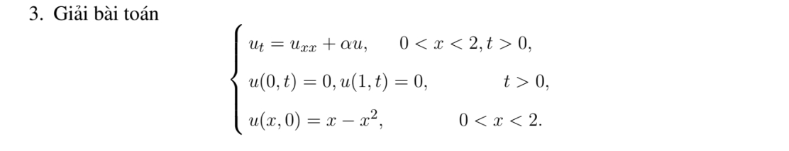

# Bài tập thực hành 3 — Mục 4.5.3

**Mã:** `BT_4_5_3_03` · **Trang sách:** 214–214

[← Mục lục](../MUC_LUC.md) · [Bản PDF của bài](BT_4_5_3_03.pdf)

## Đề bài

## Kiến thức và trình tự giải

**Bước 1 — Loại đạo hàm cấp một bằng tính đạo hàm đầy đủ.** Với $u_t=Ku_{xx}+Au_x+Bu$, đặt $u=e^{-hx}v$, $h=A/(2K)$. Khi đó

$$
u_t=e^{-hx}v_t,\quad u_x=e^{-hx}(v_x-hv),\quad
u_{xx}=e^{-hx}(v_{xx}-2hv_x+h^2v).
$$

Thay vào PDE, hệ số $v_x$ là $A-2Kh=0$, hệ số $v$ là $Kh^2-Ah+B=B-A^2/(4K)$. Vì thế $v_t=Kv_{xx}+Cv$, $C=B-A^2/(4K)$; có thể tiếp tục đặt $v=e^{Ct}z$ để $z_t=Kz_{xx}$.

**Bước 2 — Đổi dữ liệu và biên cùng phép đổi ẩn.** $v(x,0)=e^{hx}f(x)$. Dirichlet thuần nhất giữ nguyên; Neumann biến thành $v_x-hv=0$, nên không giữ nguyên một cơ sở cosine nếu $A\ne0$. Với Dirichlet:

$$
u=e^{-hx}\sum_{n\ge1}\left(\frac2L\int_0^Le^{hy}f(y)\sin\frac{n\pi y}Ldy\right)
e^{[C-K(n\pi/L)^2]t}\sin\frac{n\pi x}L.
$$

**Bước 3 — Tính hệ số mũ–đa thức.** Dùng nguyên hàm

$$
\int e^{hy}\sin ky\,dy
=\frac{e^{hy}(h\sin ky-k\cos ky)}{h^2+k^2}.
$$

Với $y e^{hy}$ hoặc $y(1-y)e^{hy}$, lấy đạo hàm theo $h$ của tích phân đã tính trên cận cố định; trình bày đạo hàm để tìm hệ số thực. Cách này tránh để lại một tích phân sơ cấp chưa thực hiện.

**Bước 4 — Hệ số không gian biến thiên.** Với $x^2u_{xx}$ trên $x>0$, đặt $z=\ln x$: nếu $U(z,t)=u(e^z,t)$ thì $u_x=U_z/x$, $x^2u_{xx}=U_{zz}-U_z$. Đổi miền và biên sang biến $z$ rồi dùng bước 1. Biên không thuần nhất nên tìm trạng thái dừng trước khi khai triển.

**Bước 5 — Duy nhất và ổn định.** Với hiệu nghiệm Dirichlet, $I'=-K\int w_x^2+2BI\le2BI$ suy $w=0$ khi $I(0)=0$. Giới hạn phụ thuộc các số $C-K\lambda_n$ có hệ số khác không: âm thì giảm, bằng không thì tồn tại mode dừng, dương thì tăng. Phải kiểm tra tính thống nhất giữa miền PDE và vị trí biên trước khi dùng công thức.

## Lời giải áp dụng cho bài

**Bước 1. Chỉ ra chỗ thiếu của đề gốc.**
PDE và dữ liệu đầu ghi $0<x<2$, nhưng hai biên đặt tại $0$ và $1$, không có biên tại $2$. Không thể dùng sine $n\pi x$ như một cơ sở Dirichlet trên toàn $(0,2)$ rồi tự coi $1$ là đầu phải. Đây không phải bài Dirichlet trên đoạn được ghi. Trong lớp nghiệm cổ điển với $t>0$ và liên tục đến dữ liệu đầu trong miền, còn có mâu thuẫn: nghiệm trên $(0,1)$ được xác định duy nhất bởi hai biên $0$. Nghiệm nhiệt hệ số hằng giải tích theo $x$ ở thời gian dương, nên thác triển qua điểm trong $1$ buộc trùng phản xạ lẻ của nghiệm sine. Khi $1<x<2$, mặt đầu thác triển là $-f(2-x)=x^2-3x+2$, khác $f=x-x^2$ đã in, với hiệu $-2(x-1)^2$. Vì vậy cần sửa miền hoặc biên/dữ liệu để có nghiệm trong lớp này.
**Bước 2. Nếu miền dự kiến là $(0,1)$.**
Đây là giả thiết sửa đề, cần ghi riêng. Khi ấy $X_n=\sin n\pi x$, $\lambda_n=n^2\pi^2$. Với $f=x-x^2$,

$$
c_n=2\int_0^1f\sin kx\,dx
=-\frac2{k^2}\int_0^1(-2)\sin kx\,dx
=\frac{4(1-(-1)^n)}{k^3},\quad k=n\pi.
$$

Mode thỏa $T_n'=(\alpha-k^2)T_n$:

$$
u=\sum_{\substack{n\ge1\\n\ {\rm lẻ}}}\frac8{n^3\pi^3}
e^{(\alpha-n^2\pi^2)t}\sin n\pi x,\quad 0<x<1.
$$

Sine bằng $0$ ở $0,1$, chuỗi đầu bằng $x-x^2$, và $u_t-u_{xx}=\alpha u$ theo từng mode. Nếu $\alpha<\pi^2$, giới hạn $0$; nếu bằng $\pi^2$, giới hạn $8\sin\pi x/\pi^3$; nếu lớn hơn, mode đầu tăng. Những kết quả này giải bài đã sửa miền, không tự bổ sung điều kiện cho phần $(1,2)$ của đề gốc.

## Đối chiếu kết quả

Khi sử dụng kết quả, kiểm tra đồng thời phương trình, dữ liệu ban đầu/biên và miền được nêu trong lời giải. Các điều kiện về tính trơn, nghiệm thực, tồn tại hoặc duy nhất là một phần của kết luận; không bỏ chúng khi ghi đáp án.
