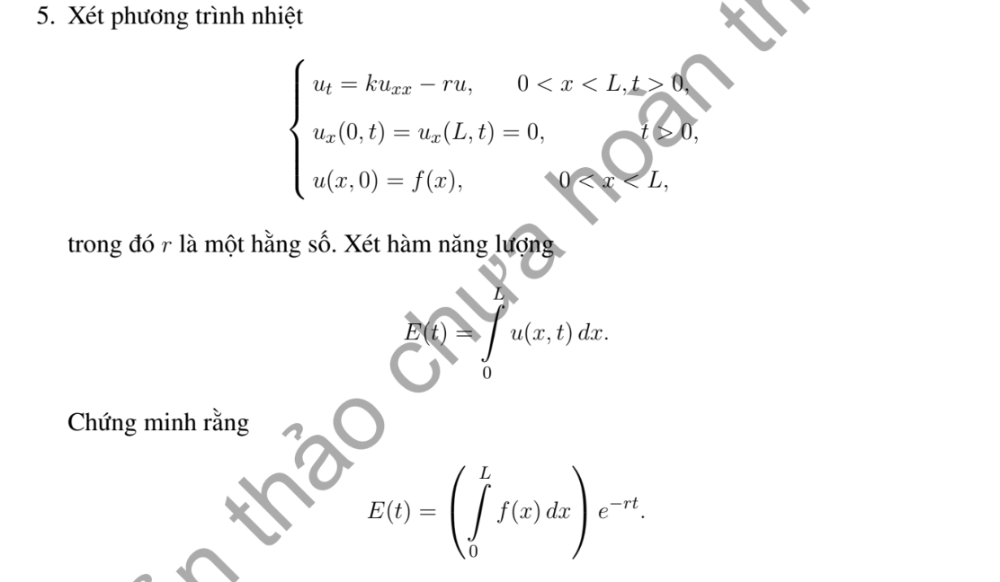

# Bài tập thực hành 5 — Mục 4.5.3

**Mã:** `BT_4_5_3_05` · **Trang sách:** 214–214

[← Mục lục](../MUC_LUC.md) · [Bản PDF của bài](BT_4_5_3_05.pdf)

## Đề bài

## Kiến thức và trình tự giải

**Bước 1 — Chọn đúng đại lượng.** Năng lượng bình phương là $I(t)=\frac12\int_0^Lu^2dx$. Để chứng minh duy nhất, áp dụng cho hiệu $w$ của hai nghiệm cùng dữ kiện; $w$ có dữ liệu đầu bằng không và biên thuần nhất. Tổng nhiệt $E=\int_0^Lu\,dx$ là đại lượng khác, dùng khi đề hỏi bảo toàn hoặc suy giảm tổng nhiệt.

**Bước 2 — Đạo hàm và tích phân từng phần.** Với $u_t=Ku_{xx}$,

$$
I'=\int_0^Luu_t\,dx
=K[uu_x]_0^L-K\int_0^Lu_x^2dx.
$$

Thay biên tại $L$ rồi trừ giá trị tại $0$. Dirichlet/Neumann thuần nhất làm hạng biên bằng không. Robin $u_x(0)=u(0)$ đóng góp $-u(0)^2$; Robin $u_x(L)=-u(L)$ đóng góp $-u(L)^2$. Biên tuần hoàn triệt tiêu hai đầu. Một điều kiện ghép khác phải được kiểm tra trực tiếp, vì hạng biên có thể dương.

**Bước 3 — Suy duy nhất và tính dương của trị riêng.** Nếu $I'\le0$ và $I(0)=0$ thì $0\le I(t)\le0$, nên $w=0$. Với $X''+\lambda X=0$, nhân với $X$ rồi tích phân:

$$
\lambda\int_0^LX^2dx=\int_0^L(X')^2dx-[XX']_0^L.
$$

Nếu vế phải không âm thì $\lambda\ge0$. Khi bằng không, buộc từng số hạng không âm bằng không và kiểm tra biên để quyết định có mode hằng hay chỉ nghiệm tầm thường.

**Bước 4 — Chứng minh trực giao.** Nhân hai phương trình riêng lần lượt với $X_m,X_n$, trừ rồi tích phân:

$$
(\lambda_n-\lambda_m)\int_0^LX_nX_mdx
=[X_nX_m'-X_n'X_m]_0^L.
$$

Biên tự liên hợp làm vế phải bằng không; $\lambda_n\ne\lambda_m$ suy trực giao. Với biên không tự liên hợp hoặc đạo hàm bậc ba, không tự động dùng công thức chiếu trực giao.

**Bước 5 — Khi có hạng phản ứng hoặc bậc đạo hàm khác.** Với Dirichlet và $u_t=Ku_{xx}+Au_x+Bu$, hạng $A\int uu_x=A[u^2]_0^L/2=0$, nên $I'=-K\int u_x^2+2BI\le2BI$; $e^{-2Bt}I$ không tăng, vẫn suy duy nhất. Với $u_t=Ku_{xxx}$, tích phân hai lần cho $I'=K[uu_{xx}-u_x^2/2]_0^L$. Với tổng nhiệt trong bài Neumann có $-ru$, $E'=K[u_x]_0^L-rE$; giải ODE này trước khi kết luận.

## Lời giải áp dụng cho bài

**Bước 1. Phân biệt tổng nhiệt với năng lượng bình phương.**
Đề đặt $E(t)=\int_0^Lu(x,t)dx$, là tổng nhiệt có dấu. Với $u_t=ku_{xx}-ru$ và hai biên Neumann $0$,

$$
\begin{aligned}
E'(t)&=\int_0^Lu_tdx=k\int_0^Lu_{xx}dx-r\int_0^Lu\,dx\\
&=k(u_x(L,t)-u_x(0,t))-rE(t)=-rE(t).
\end{aligned}
$$

**Bước 2. Giải ODE.**
Nhân với $e^{rt}$ cho $(e^{rt}E)'=0$, nên $e^{rt}E(t)=E(0)=\int_0^Lf$. Do đó

$$
E(t)=e^{-rt}\int_0^Lf(x)dx.
$$

Kết quả đúng cả khi $r=0$ (bảo toàn), $r>0$ (giảm độ lớn) và $r<0$ (tăng độ lớn). Với dữ liệu không trơn, thực hiện từ $\varepsilon>0$ rồi lấy giới hạn nếu $u(\cdot,t)\to f$ trong $L^1$.
**Bước 3. Kiểm tra bằng mode hằng.**
Nhân cosine có mode trung bình $c_0(t)=E(t)/L$; PDE chiếu lên $1$ cho $c_0'=-rc_0$. Các cosine khác có tích phân bằng $0$, nên không đóng góp tổng nhiệt. Không thay $E$ bằng $\frac12\int u^2$, vì đại lượng sau còn có hạng $-k\int u_x^2$ trong đạo hàm.

## Đối chiếu kết quả

Khi sử dụng kết quả, kiểm tra đồng thời phương trình, dữ liệu ban đầu/biên và miền được nêu trong lời giải. Các điều kiện về tính trơn, nghiệm thực, tồn tại hoặc duy nhất là một phần của kết luận; không bỏ chúng khi ghi đáp án.
