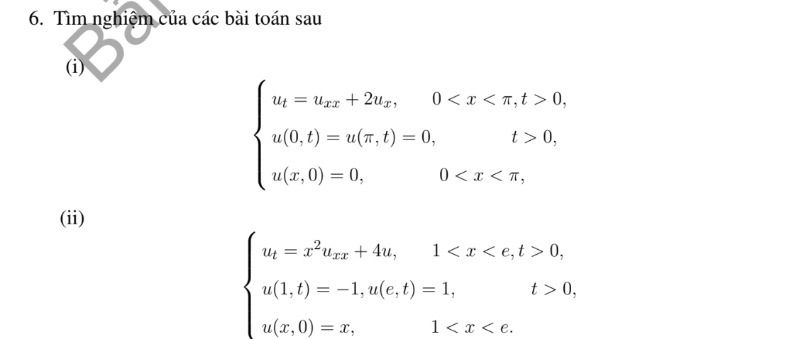
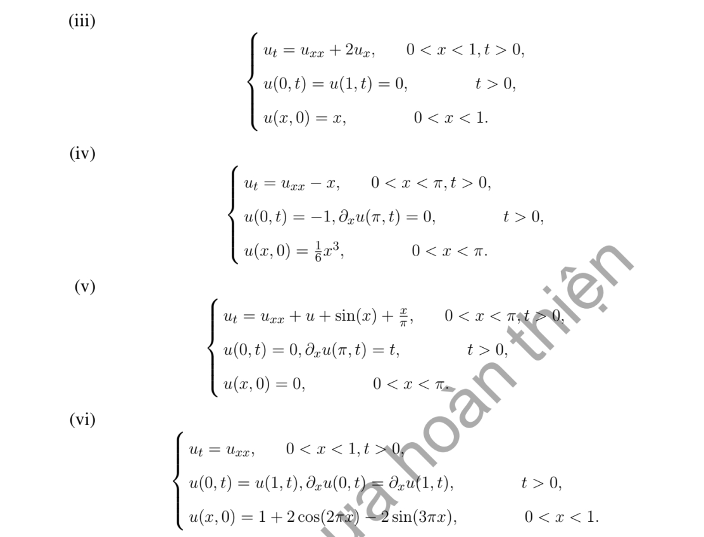

# Bài tập thực hành 6 — Mục 4.5.3

**Mã:** `BT_4_5_3_06` · **Trang sách:** 214–215

[← Mục lục](../MUC_LUC.md) · [Bản PDF của bài](BT_4_5_3_06.pdf)

## Đề bài

## Kiến thức và trình tự giải

**Bước 1 — Loại đạo hàm cấp một bằng tính đạo hàm đầy đủ.** Với $u_t=Ku_{xx}+Au_x+Bu$, đặt $u=e^{-hx}v$, $h=A/(2K)$. Khi đó

$$
u_t=e^{-hx}v_t,\quad u_x=e^{-hx}(v_x-hv),\quad
u_{xx}=e^{-hx}(v_{xx}-2hv_x+h^2v).
$$

Thay vào PDE, hệ số $v_x$ là $A-2Kh=0$, hệ số $v$ là $Kh^2-Ah+B=B-A^2/(4K)$. Vì thế $v_t=Kv_{xx}+Cv$, $C=B-A^2/(4K)$; có thể tiếp tục đặt $v=e^{Ct}z$ để $z_t=Kz_{xx}$.

**Bước 2 — Đổi dữ liệu và biên cùng phép đổi ẩn.** $v(x,0)=e^{hx}f(x)$. Dirichlet thuần nhất giữ nguyên; Neumann biến thành $v_x-hv=0$, nên không giữ nguyên một cơ sở cosine nếu $A\ne0$. Với Dirichlet:

$$
u=e^{-hx}\sum_{n\ge1}\left(\frac2L\int_0^Le^{hy}f(y)\sin\frac{n\pi y}Ldy\right)
e^{[C-K(n\pi/L)^2]t}\sin\frac{n\pi x}L.
$$

**Bước 3 — Tính hệ số mũ–đa thức.** Dùng nguyên hàm

$$
\int e^{hy}\sin ky\,dy
=\frac{e^{hy}(h\sin ky-k\cos ky)}{h^2+k^2}.
$$

Với $y e^{hy}$ hoặc $y(1-y)e^{hy}$, lấy đạo hàm theo $h$ của tích phân đã tính trên cận cố định; trình bày đạo hàm để tìm hệ số thực. Cách này tránh để lại một tích phân sơ cấp chưa thực hiện.

**Bước 4 — Hệ số không gian biến thiên.** Với $x^2u_{xx}$ trên $x>0$, đặt $z=\ln x$: nếu $U(z,t)=u(e^z,t)$ thì $u_x=U_z/x$, $x^2u_{xx}=U_{zz}-U_z$. Đổi miền và biên sang biến $z$ rồi dùng bước 1. Biên không thuần nhất nên tìm trạng thái dừng trước khi khai triển.

**Bước 5 — Duy nhất và ổn định.** Với hiệu nghiệm Dirichlet, $I'=-K\int w_x^2+2BI\le2BI$ suy $w=0$ khi $I(0)=0$. Giới hạn phụ thuộc các số $C-K\lambda_n$ có hệ số khác không: âm thì giảm, bằng không thì tồn tại mode dừng, dương thì tăng. Phải kiểm tra tính thống nhất giữa miền PDE và vị trí biên trước khi dùng công thức.

## Lời giải áp dụng cho bài

**(i) Dữ liệu đầu và biên đều bằng $0$.**
Với $u_t=u_{xx}+2u_x$ trên $(0,\pi)$, $u=0$ thỏa mọi dữ kiện. Hiệu nghiệm có $I'=-\int u_x^2+[u^2]_0^\pi=-\int u_x^2\le0$ và $I(0)=0$, nên đây là nghiệm duy nhất.

**(ii) Hệ số $x^2$, biên tại $1,e$.**
Đặt $z=\ln x$, $U(z,t)=u(e^z,t)$. Tính $u_x=U_z/x$, $x^2u_{xx}=U_{zz}-U_z$, nên $U_t=U_{zz}-U_z+4U$ trên $0<z<1$. Đặt $U=e^{z/2}v$:

$$
U_{zz}-U_z+4U=e^{z/2}(v_{zz}+15v/4),\quad v_t=v_{zz}+15v/4.
$$

Biên $v(0)=-1$, $v(1)=e^{-1/2}$, dữ liệu đầu $v(z,0)=e^{z/2}$. Đặt $b=\sqrt{15}/2$, $D=(e^{-1/2}+\cos b)/\sin b$. Nghiệm dừng $S=-\cos bz+D\sin bz$ giải $S''+b^2S=0$, đúng hai biên. Vì $v-S$ có biên $0$,

$$
u=P(x)+\sqrt x\sum_{n\ge1}A_ne^{(15/4-n^2\pi^2)t}\sin(n\pi\ln x),\quad
P(x)=\sqrt x\,S(\ln x).
$$

Để tính $A_n$, đặt $k=n\pi,s=(-1)^n$:

$$
\begin{aligned}
\int_0^1e^{z/2}\sin kz\,dz&=\frac{k(1-se^{1/2})}{k^2+1/4},\\
\int_0^1\cos bz\sin kz\,dz&=\frac{k(1-s\cos b)}{k^2-b^2},\\
\int_0^1\sin bz\sin kz\,dz&=-\frac{sk\sin b}{k^2-b^2}.
\end{aligned}
$$

Các đẳng thức lần lượt dùng nguyên hàm mũ–sine và tích–tổng. Cộng theo dữ liệu $e^{z/2}+\cos bz-D\sin bz$ cho

$$
A_n=2k\left\{\frac{1-se^{1/2}}{k^2+1/4}
+\frac{1+se^{-1/2}}{k^2-15/4}\right\}.
$$

Mọi $15/4-n^2\pi^2<0$, nên $u\to P$ đều. $P(1)=-1,P(e)=1$, $x^2P''+4P=0$; dữ liệu đầu $x$ không khớp giá trị biên tại góc, nên chỉ có liên tục đến mặt đầu trong miền.

**(iii) Vận chuyển với dữ liệu $x$ trên $(0,1)$.**
Đặt $u=e^{-x}v$ cho $v_t=v_{xx}-v$, $v(x,0)=xe^x$, biên $0$. Với $k=n\pi,s=(-1)^n$, nguyên hàm cho $J(h)=\int_0^1e^{hy}\sin ky=k(1-se^h)/(h^2+k^2)$. Do đó

$$
A_n=2J'(1)=-\frac{2kse}{1+k^2}-\frac{4k(1-se)}{(1+k^2)^2},\qquad
u=e^{-x}\sum_{n\ge1}A_ne^{-(n^2\pi^2+1)t}\sin n\pi x.
$$

Tại $t=0$, sine trả lại $xe^x$, rồi nhân $e^{-x}$ trả lại $x$ trong miền. Sine kiểm tra hai biên; phép đổi ẩn kiểm tra PDE. Giá trị $f(1)=1$ không khớp biên $0$ ở góc.

**(iv) Nguồn $-x$, Dirichlet–Neumann.**
Nghiệm dừng thỏa $P''=x,P(0)=-1,P'(\pi)=0$: tích phân cho $P=x^3/6-\pi^2x/2-1$. Khi $w=u-P$, nguồn bằng $0$, biên $w(0)=w_x(\pi)=0$, mặt đầu $q=1+\pi^2x/2$. Cơ sở $X_n=\sin k_nx$, $k_n=n+1/2$, $N_n=\pi/2$.

$$
\int_0^\pi\sin k_ny\,dy=1/k_n,\quad
\int_0^\pi y\sin k_ny\,dy=(-1)^n/k_n^2.
$$

Vì vậy

$$
A_n=\frac2{\pi k_n}+\frac{\pi(-1)^n}{k_n^2},\qquad
u=P+\sum_{n\ge0}A_ne^{-k_n^2t}\sin k_nx.
$$

Biên đúng, mặt đầu trong miền bằng $x^3/6$; $P''-x=0$ và từng mode cho PDE. Giới hạn đều $P$, nhưng mặt đầu không khớp $u(0,0)=-1$.

**(v) Nguồn và đạo hàm biên phụ thuộc thời gian.**
Đặt $u=xt+w$, vì $(xt)(0,t)=0$, $(xt)_x(\pi,t)=t$. Từ PDE:

$$
w_t=w_{xx}+w+\sin x+x(t-1+1/\pi),\quad
w(0,t)=w_x(\pi,t)=0,\quad w(x,0)=0.
$$

Với $k_n=n+1/2,s_n=(-1)^n$, tích–tổng và tích phân từng phần cho

$$
S_n=\frac2\pi\int_0^\pi\sin y\sin k_ny\,dy
=\frac{2s_n}{\pi(1-k_n^2)},\quad
R_n=\frac2\pi\int_0^\pi y\sin k_ny\,dy=\frac{2s_n}{\pi k_n^2}.
$$

Đặt $d_n=1-k_n^2\ne0$, $C_n=S_n+R_n(-1+1/\pi)$. ODE là $T_n'=d_nT_n+R_nt+C_n$, $T_n(0)=0$. Hai tích phân thời gian thực hiện đến hết:

$$
\int_0^te^{d(t-s)}ds=\frac{e^{dt}-1}d,\quad
\int_0^te^{d(t-s)}s\,ds=\frac{e^{dt}-1-dt}{d^2}.
$$

Do đó

$$
u=xt+\sum_{n\ge0}\left\{
R_n\frac{e^{d_nt}-1-d_nt}{d_n^2}
+C_n\frac{e^{d_nt}-1}{d_n}\right\}\sin k_nx.
$$

Mỗi mode đúng ODE và biên thuần nhất; cộng $xt$ trả lại nguồn và đạo hàm biên. Các hệ số $O(k_n^{-4})$ ở thời gian cố định cho hội tụ của nghiệm. Mode $n=0$ có $d_0=3/4>0$; không được kết luận mọi mode đều giảm.

**(vi) Biên tuần hoàn chu kỳ $1$.**
$f=1+2\cos2\pi x-2\sin3\pi x$ đối xứng qua $1/2$, nên các hệ số sine chu kỳ $1$ bằng $0$ (đổi biến $x\mapsto1-x$ trong tích phân). Trung bình:

$$
c_0=\int_0^1f\,dx=1-\frac4{3\pi}.
$$

Với $n\ge1$, $\int_0^1\sin3\pi x\cos2n\pi x\,dx=6/[\pi(9-4n^2)]$ từ tích–tổng. Vì vậy

$$
c_n=2\delta_{n1}-\frac{24}{\pi(9-4n^2)},\qquad
u=1-\frac4{3\pi}+\sum_{n\ge1}c_ne^{-4n^2\pi^2t}\cos2n\pi x.
$$

Các cosine có cùng giá trị và đạo hàm tại $0,1$; ODE kiểm tra PDE, chuỗi ban đầu trả lại $f$ liên tục. $f'(0)=-6\pi$, $f'(1)=6\pi$ không khớp đạo hàm tuần hoàn ở góc, nên không trơn đến góc. Giới hạn đều là $1-4/(3\pi)$.

## Đối chiếu kết quả

Khi sử dụng kết quả, kiểm tra đồng thời phương trình, dữ liệu ban đầu/biên và miền được nêu trong lời giải. Các điều kiện về tính trơn, nghiệm thực, tồn tại hoặc duy nhất là một phần của kết luận; không bỏ chúng khi ghi đáp án.
