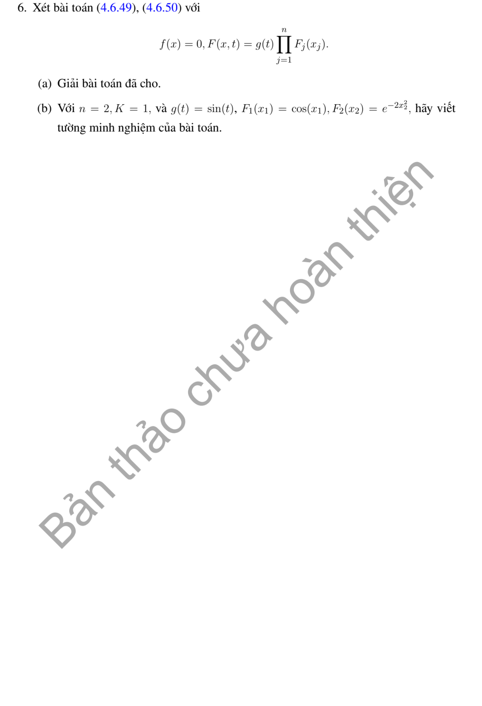

# Bài tập thực hành 6 — Mục 4.6.3

**Mã:** `BT_4_6_3_06` · **Trang sách:** 224–224

[← Mục lục](../MUC_LUC.md) · [Bản PDF của bài](BT_4_6_3_06.pdf)

## Đề bài

## Kiến thức và trình tự giải

**Bước 1 — Chọn nhân nhiệt theo miền và hệ số.** Trên $\mathbb R$, $g_K(z,t)=(4\pi Kt)^{-1/2}e^{-z^2/(4Kt)}$, $u=g_K*f$. Trên nửa trục, thác triển lẻ cho Dirichlet $0$, chẵn cho Neumann $0$; sau đổi $y\mapsto-y$ ở nửa âm:

$$
H_D(x,y,t)=g_K(x-y,t)-g_K(x+y,t),\qquad
H_N(x,y,t)=g_K(x-y,t)+g_K(x+y,t).
$$

Kiểm tra $H_D(0,y,t)=0$, $\partial_xH_N(0,y,t)=0$. Nửa trục phải có một điều kiện biên; dữ liệu đầu một mình không xác định duy nhất.

**Bước 2 — Tính các tích phân không gian.** Mode $\sin ky,\cos ky$ biến thành $e^{-Kk^2t}\sin kx,e^{-Kk^2t}\cos kx$. Với Gauss $e^{-\alpha(y-m)^2}$, $\alpha>0$, hoàn thành bình phương:

$$
-\frac{(x-y)^2}{4Kt}-\alpha(y-m)^2
=-\frac{1+4\alpha Kt}{4Kt}\left(y-\frac{x+4\alpha Ktm}{1+4\alpha Kt}\right)^2
-\frac{\alpha(x-m)^2}{1+4\alpha Kt}.
$$

Đổi biến để $\int_{\mathbb R}e^{-z^2}dz=\sqrt\pi$, suy $(g_K*f)(x)=e^{-\alpha(x-m)^2/(1+4\alpha Kt)}/\sqrt{1+4\alpha Kt}$. Với dữ liệu chỉ thị đoạn, cận hữu hạn tạo $\operatorname{erf}$; với $e^{-y}$ trên nửa trục, cận $0,\infty$ tạo $\operatorname{erfc}$, trong đó $\operatorname{erf}z=2\int_0^ze^{-r^2}dr/\sqrt\pi$, $\operatorname{erfc}z=1-\operatorname{erf}z$.

**Bước 3 — Thêm nguồn và biên.** Nguồn cho $u=g_K*f+\int_0^tg_K(\cdot,t-s)*F(\cdot,s)\,ds$, hoặc thay $g_K$ bằng $H_D,H_N$. Biên Dirichlet $\mu(t)$ trên nửa trục thêm

$$
\int_0^t\frac{x\,e^{-x^2/[4K(t-s)]}}{\sqrt{4\pi K}(t-s)^{3/2}}\mu(s)ds.
$$

Nguồn một mode giảm cùng tốc độ khuếch tán cho tích phân thời gian hằng sau khi gom mũ, nên xuất hiện $te^{-Kk^2t}$.

**Bước 4 — Đổi biến khi hệ số phụ thuộc thời gian hoặc có vận chuyển.** Với $u_t=a(t)u_{xx}+b(t)u_x+c(t)u$, đặt $A=\int_0^ta$, $B=\int_0^tb$, $C=\int_0^tc$, $u=e^Cv(x+B,A)$. Tính $u_t=e^C(cv+bv_z+av_\tau)$, $u_x=e^Cv_z$, $u_{xx}=e^Cv_{zz}$, suy $v_\tau=v_{zz}$. Dấu dịch là $x+B$, không phải $x-B$. Với hạng $xu_x$, dùng $z=e^{\pm t}x$ và chọn đồng hồ $\tau'(t)=e^{\pm2t}$.

**Bước 5 — Nhiều chiều và kiểm tra.** Nhân $n$ chiều là tích các nhân một chiều. Dữ liệu dạng tích tách được tích phân không gian bằng Fubini; nguồn dạng tích vẫn phải tích phân theo một thời gian chung $s$. Kiểm tra PDE bằng đạo hàm Duhamel: đạo hàm cận trên trả lại $F(x,t)$, phần còn lại bằng $K\Delta u$. Nhân Gauss là xấp xỉ đơn vị, nên trả lại dữ liệu tại điểm liên tục; dữ liệu nhảy không cho nghiệm liên tục đến mọi điểm lúc đầu.

## Lời giải áp dụng cho bài

**(a) Duhamel nhiều chiều và tách tích phân không gian.**
Với $f=0,F(x,t)=g(t)\prod_{j=1}^nF_j(x_j)$, nhân nhiệt $n$ chiều là $\prod_jg_K(x_j-y_j,t-s)$. Vì vậy

$$
\begin{aligned}
u(x,t)&=\int_0^t\!\int_{\mathbb R^n}
g(s)\prod_{j=1}^n[g_K(x_j-y_j,t-s)F_j(y_j)]dy\,ds\\
&=\int_0^tg(s)\prod_{j=1}^n
\left(\int_{\mathbb R}g_K(x_j-y_j,t-s)F_j(y_j)dy_j\right)ds.
\end{aligned}
$$

Fubini tách các tích phân không gian; không tách tích phân thời gian thành tích của $n$ tích phân, vì tất cả thừa số dùng cùng thời gian $s$.
**(b) $n=2,K=1,g(s)=\sin s,F_1=\cos x,F_2=e^{-2y^2}$.**
Đặt $\tau=t-s$. Mode cosine cho $g_1(\cdot,\tau)*F_1=e^{-\tau}\cos x$. Với Gauss, hoàn thành bình phương

$$
-(y-z)^2/(4\tau)-2z^2
=-\frac{1+8\tau}{4\tau}\left(z-\frac y{1+8\tau}\right)^2
-\frac{2y^2}{1+8\tau},
$$

nên $g_1*F_2=e^{-2y^2/(1+8\tau)}/\sqrt{1+8\tau}$. Do đó

$$
u(x,y,t)=\cos x\int_0^t
\frac{\sin s\,e^{-(t-s)}}{\sqrt{1+8(t-s)}}
\exp\left[-\frac{2y^2}{1+8(t-s)}\right]ds.
$$

Tích phân thời gian hữu hạn trên hàm đã biết là biểu diễn tường minh; không có nguyên hàm sơ cấp thông thường cần tính tiếp.
**Kiểm tra bằng đạo hàm Duhamel.**
Gọi $V(x,y,\tau)=e^{-\tau}\cos x\,e^{-2y^2/(1+8\tau)}/\sqrt{1+8\tau}$, thì $V_\tau=\Delta V$, $V(x,y,0)=\cos x\,e^{-2y^2}$. Do đó

$$
u_t=\sin t\,V(x,y,0)+\int_0^t\sin s\,V_\tau(x,y,t-s)ds
=\sin t\cos x\,e^{-2y^2}+\Delta u.
$$

Tại $t=0$ tích phân bằng $0$, đúng mặt đầu.

## Đối chiếu kết quả

Khi sử dụng kết quả, kiểm tra đồng thời phương trình, dữ liệu ban đầu/biên và miền được nêu trong lời giải. Các điều kiện về tính trơn, nghiệm thực, tồn tại hoặc duy nhất là một phần của kết luận; không bỏ chúng khi ghi đáp án.
