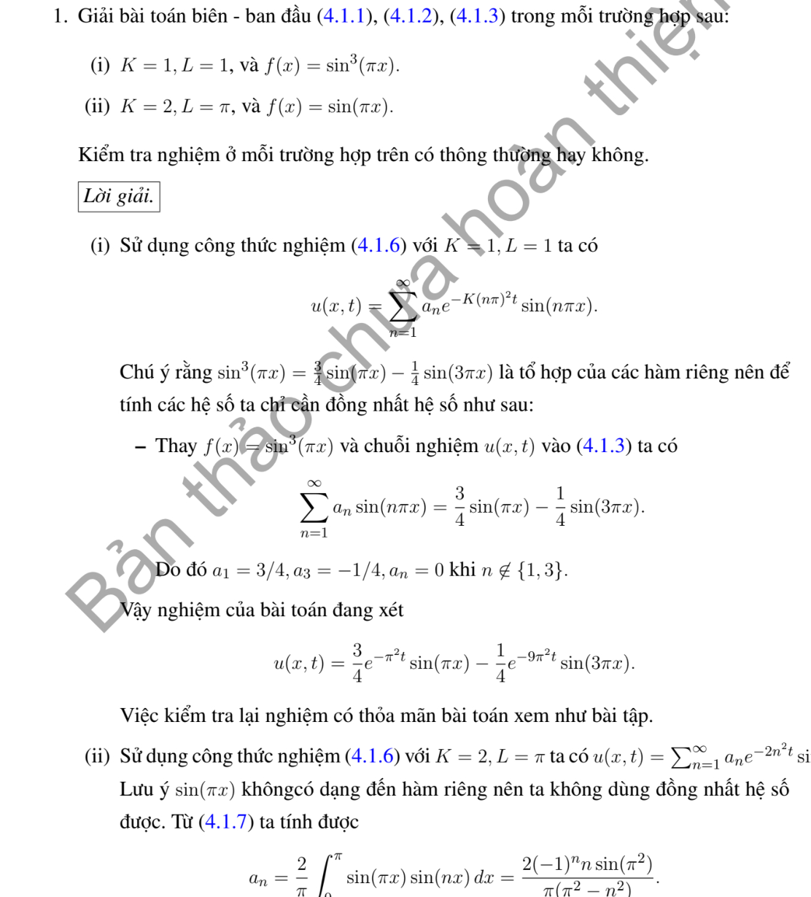
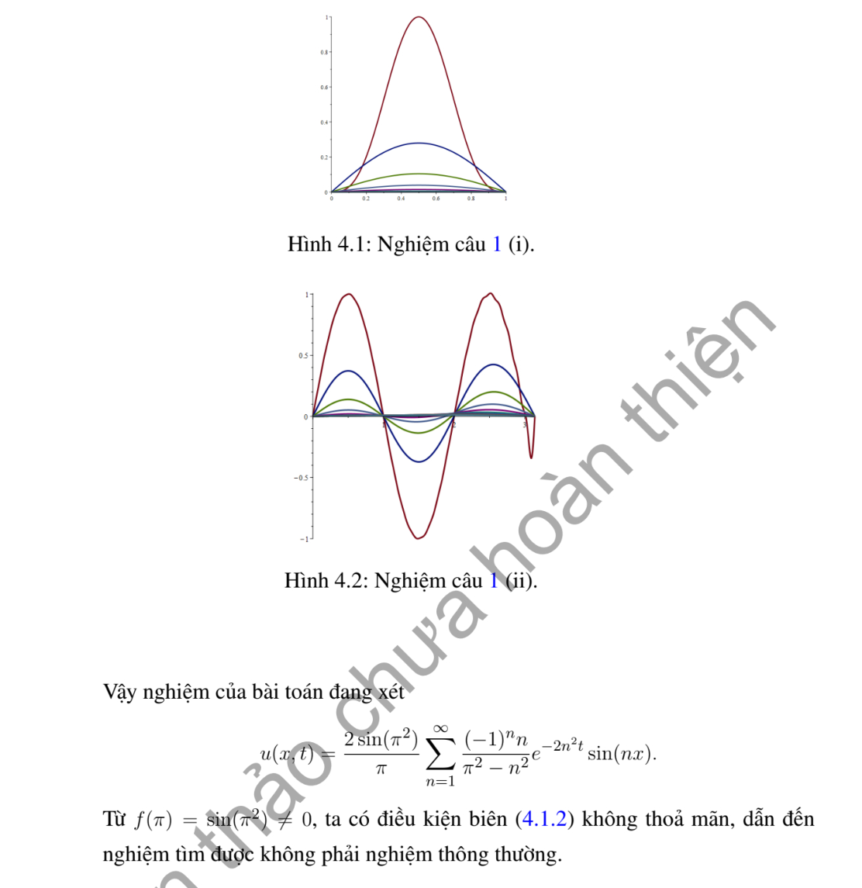
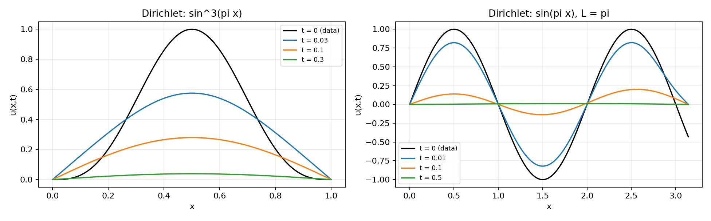

# Ví dụ 1 — Mục 4.1.2

**Mã:** `VD_4_1_2_01` · **Trang sách:** 187–188

[← Mục lục](../MUC_LUC.md) · [Bản PDF của bài](VD_4_1_2_01.pdf)

## Đề bài và phần trình bày có sẵn trong sách

## Kiến thức và trình tự giải

**Bước 1 — Đọc hệ số và điều kiện biên.** Viết phương trình dưới dạng $u_t=Ku_{xx}$, $K>0$. Nếu đề ký hiệu tốc độ $a$ và viết $u_t=a^2u_{xx}$ thì thay $K=a^2$; không nhầm $a$ với $K$. Kiểm tra điều kiện đầu $f$ có khớp giá trị biên tại $t=0$ hay không. Sự không tương thích tại góc không ngăn nghiệm trơn với $t>0$, nhưng ngăn tính liên tục đến góc khi biên Dirichlet khác vết của $f$.

**Bước 2 — Tách biến và giải bài toán không gian.** Thế $u=XT$ vào PDE, chia cho $KXT$ để có $X''/X=T'/(KT)=-\lambda$. Do đó $X''+\lambda X=0$, $T'+K\lambda T=0$. Với $\lambda=k^2>0$, $X=A\cos kx+B\sin kx$; thay từng điều kiện biên để tìm $k$. Hai biên Dirichlet cho $X_n=\sin(n\pi x/L)$, $n\ge1$; hai biên Neumann cho $1$ và $\cos(n\pi x/L)$; biên Dirichlet–Neumann cho sine, biên Neumann–Dirichlet cho cosine, với $k_n=(n+1/2)\pi/L$, $n\ge0$. Trường hợp $\lambda=0$ phải giải riêng $X=A+Bx$; chỉ giữ mode hằng nếu biên cho phép.

**Bước 3 — Tính hệ số, không chỉ ghi tích phân.** Đặt $N_n=\int_0^L X_n^2dx$, $c_n=N_n^{-1}\int_0^L fX_n\,dx$. Với các mode sine/cosine chuẩn, $N_n=L/2$; mode hằng có $N_0=L$. Nếu $f$ là đa thức, tích phân từng phần đến hết; nếu $f$ chia đoạn, tách đúng cận; nếu $f$ lượng giác, dùng tích–tổng. Chẳng hạn với $k=n\pi/L$, $f(0)=f(L)=0$,

$$
\int_0^Lf\sin kx\,dx=\frac1k\int_0^Lf'\cos kx\,dx
=-\frac1{k^2}\int_0^Lf''\sin kx\,dx.
$$

Các hạng biên phải được tính trước khi bỏ. Khi tích–tổng tạo mẫu $k-m=0$, tính trực tiếp tích phân ở tần số đó.

**Bước 4 — Giải ODE và ghép nghiệm.** Nhân $T_n'+K\lambda_nT_n=0$ với $e^{K\lambda_nt}$, được $(e^{K\lambda_nt}T_n)'=0$. Vì $T_n(0)=c_n$,

$$
u(x,t)=\sum_n c_ne^{-K\lambda_nt}X_n(x).
$$

Thêm $c_0=L^{-1}\int_0^Lf$ cho Neumann hai đầu. Kiểm tra từng mode: $X_n''=-\lambda_nX_n$, nên đạo hàm theo $t$ và $K$ lần đạo hàm theo $x$ cấp hai bằng nhau.

**Bước 5 — Kiểm tra dữ liệu, hội tụ và thời gian dài.** Với $t\ge\varepsilon>0$, thừa số $e^{-K\lambda_nt}$ cho phép lấy đạo hàm chuỗi. Với dữ liệu có bước nhảy, giới hạn ban đầu tại bước nhảy là trung bình hai vết. Nếu $f\in L^1$, $|c_n|\le2\|f\|_1/L$ cho hệ chuẩn, nên tổng các mode dương tiến về không đều theo $x$. Neumann giữ trung bình; Dirichlet và biên hỗn hợp có giới hạn không. Một nghiệm giảm theo hàm mũ và khác không không thể tuần hoàn theo thời gian.

## Lời giải áp dụng cho bài

**Bước 1. Tách biến theo hai biên Dirichlet.**
Với $u_t=Ku_{xx}$, $u(0,t)=u(L,t)=0$, đặt $u=XT$. Ta có $X''+\lambda X=0$, $T'+K\lambda T=0$. Điều kiện $X(0)=X(L)=0$ cho $X_n=\sin(n\pi x/L)$, $\lambda_n=(n\pi/L)^2$, chuẩn $L/2$. Vì vậy $u=\sum c_ne^{-K\lambda_nt}X_n$, $c_n=(2/L)\int_0^LfX_n$.

**Bước 2. Tính riêng từng dữ liệu.**

**Ý (i).**  $K=L=1$. Từ $\sin3z=3\sin z-4\sin^3z$ suy $\sin^3(\pi x)=3\sin(\pi x)/4-\sin(3\pi x)/4$. Trực giao cho $c_1=3/4,c_3=-1/4$, các hệ số khác bằng không. Do đó

$$
u=\frac34e^{-\pi^2t}\sin\pi x-\frac14e^{-9\pi^2t}\sin3\pi x.
$$

Tại $t=0$, công thức trả lại $f$; hai sine bằng không ở hai đầu. Đạo hàm mỗi hạng theo $t$ bằng đạo hàm theo $x$ cấp hai, nên PDE đúng. Đây là nghiệm trơn đến $t=0$.

**Ý (ii).**  $K=2,L=\pi$, nhưng $f=\sin(\pi x)$, không phải $\sin x$. Dùng $2\sin(\pi x)\sin(nx)=\cos((\pi-n)x)-\cos((\pi+n)x)$:

$$
\begin{aligned}
c_n&=\frac1\pi\left[\frac{\sin((\pi-n)x)}{\pi-n}-\frac{\sin((\pi+n)x)}{\pi+n}\right]_0^\pi\\
&=\frac{(-1)^n\sin(\pi^2)}{\pi}\left(\frac1{\pi-n}-\frac1{\pi+n}\right)
=\frac{2(-1)^nn\sin(\pi^2)}{\pi(\pi^2-n^2)}.
\end{aligned}
$$

Không có mẫu bằng không vì $\pi$ không nguyên. Nghiệm là

$$
u=\frac{2\sin(\pi^2)}{\pi}\sum_{n=1}^\infty\frac{(-1)^nn}{\pi^2-n^2}e^{-2n^2t}\sin nx.
$$

**Bước 3. Kiểm tra ý nghĩa nghiệm.** Chuỗi trơn với $t>0$, có biên $0$, và tiến về $f(x)$ khi $0<x<\pi$, $t\downarrow0$. Tuy nhiên $f(\pi)=\sin(\pi^2)\ne0$: không có nghiệm liên tục đến góc $(\pi,0)$ thỏa mọi dữ kiện. Khái niệm nghiệm thông thường nếu chỉ yêu cầu liên tục trên toàn bao đóng không được thỏa ở câu này.

## Đồ thị minh họa

