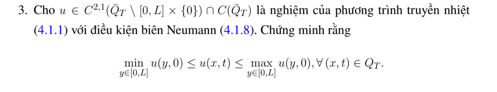

# Ví dụ 3 — Mục 4.2.2

**Mã:** `VD_4_2_2_03` · **Trang sách:** 196–196

[← Mục lục](../MUC_LUC.md) · [Bản PDF của bài](VD_4_2_2_03.pdf)

## Đề bài và phần trình bày có sẵn trong sách

## Kiến thức và trình tự giải

**Bước 1 — Viết toán tử và biên parabol.** Đặt $P=\partial_t-a(x,t)\partial_{xx}-b(x,t)\partial_x-c(x,t)$ với $a\ge0$, $c\le0$. Biên parabol gồm mặt $t=0$ và các biên không gian; mặt $t=T$ vẫn thuộc miền được ước lượng. Với phương trình nhiệt, $a=K>0$, $b=c=0$.

**Bước 2 — Loại cực đại dương bằng dấu đạo hàm.** Tại cực đại dương nội miền, $w_x=0$, $w_{xx}\le0$, $w_t=0$; nếu cực đại trên mặt thời gian trên thì đạo hàm một phía cho $w_t\ge0$. Suy $Pw\ge0$, mâu thuẫn $Pw<0$. Với $Pw\le0$, xét $w_\varepsilon=w-\varepsilon e^{\gamma t}$, $\gamma>0$: $Pw_\varepsilon=Pw-\varepsilon(\gamma-c)e^{\gamma t}<0$. Chứng minh $w_\varepsilon\le0$ rồi cho $\varepsilon\downarrow0$.

**Bước 3 — So sánh hai hàm bằng hiệu.** Để chứng minh $v\le u\le V$, kiểm tra $Pv\le Pu\le PV$ và thứ tự của dữ liệu đầu, biên. Áp dụng bước 2 cho $v-u$ và $u-V$. Nếu có nguồn dương, hằng số không nhất thiết là nghiệm trên, nên phải tính $PV-Pu$; không dùng cực đại của dữ liệu để chặn một bài có nguồn mà chưa kiểm tra.

**Bước 4 — Xử lý Neumann, Robin và tuần hoàn.** Neumann thuần nhất có thể phản xạ chẵn qua đầu mút; điểm biên trở thành điểm trong. Robin viết theo pháp tuyến ngoài $\partial_\nu u+\sigma u=0$, $\sigma\ge0$. Tại cực đại dương không hằng, bổ đề Hopf cho $\partial_\nu u>0$, trái với $\partial_\nu u=-\sigma u\le0$. Với Robin phải thêm mức $0$ vào cận hằng nếu dữ liệu mang một dấu. Biên tuần hoàn ghép hai đầu thành đường tròn; không còn biên không gian.

**Bước 5 — Miền vô hạn và nguồn bị chặn.** Trên toàn trục/nửa trục, cần nghiệm bị chặn trên mỗi dải thời gian (hoặc điều kiện tăng trưởng đủ dùng). Dùng rào $\varepsilon((x-x_0)^2+2Kt)$ trên đoạn lớn, áp dụng cực đại trên miền hữu hạn rồi cho $\varepsilon\downarrow0$; cách này loại ảnh hưởng từ vô cực. Nếu $|Pu|\le N$ và $|u|\le M$ trên biên parabol, đặt $V=M+Nt$. Vì $PV=N-cV\ge N$, suy $|u|\le M+Nt\le M+NT$. $M$ ở đây là cận của $|u|$, không phải cực đại có dấu.

## Lời giải áp dụng cho bài

**Bước 1. Đổi biên Neumann thành điểm trong bằng phản xạ.** Mở rộng $u$ chẵn qua $0$, rồi chẵn qua $L$, và tuần hoàn chu kỳ $2L$. $u_x(0,t)=u_x(L,t)=0$ làm đạo hàm cấp một ghép liên tục; đạo hàm cấp hai và $u_t$ ghép theo tính chẵn và PDE, nên hàm mở rộng giải phương trình nhiệt với $t>0$.
**Bước 2. Áp dụng cực đại trên đường tròn.** Đặt $m=\min_{[0,L]}f$, $M=\max_{[0,L]}f$. Hai hằng $m,M$ đều giải PDE và có biên Neumann. Với $w=u-M$, xét $w_\varepsilon=w-\varepsilon e^t$ trên miền tuần hoàn. Vì $(\partial_t-K\partial_{xx})w_\varepsilon=-\varepsilon e^t<0$, cực đại dương không thể ở $t>0$; ở $t=0$ cũng không dương. Do đó $u\le M+\varepsilon e^t$, cho $\varepsilon\downarrow0$ suy $u\le M$. Thay $u$ bằng $-u$ suy $u\ge m$.
**Bước 3. Kết luận.**

$$
\min_{y\in[0,L]}u(y,0)\le u(x,t)\le\max_{y\in[0,L]}u(y,0).
$$

Nếu dữ liệu không khớp đạo hàm tại góc, phản xạ vẫn dùng cho $t>0$; tính liên tục của nghiệm đến mặt đầu đủ để áp dụng cực đại.

