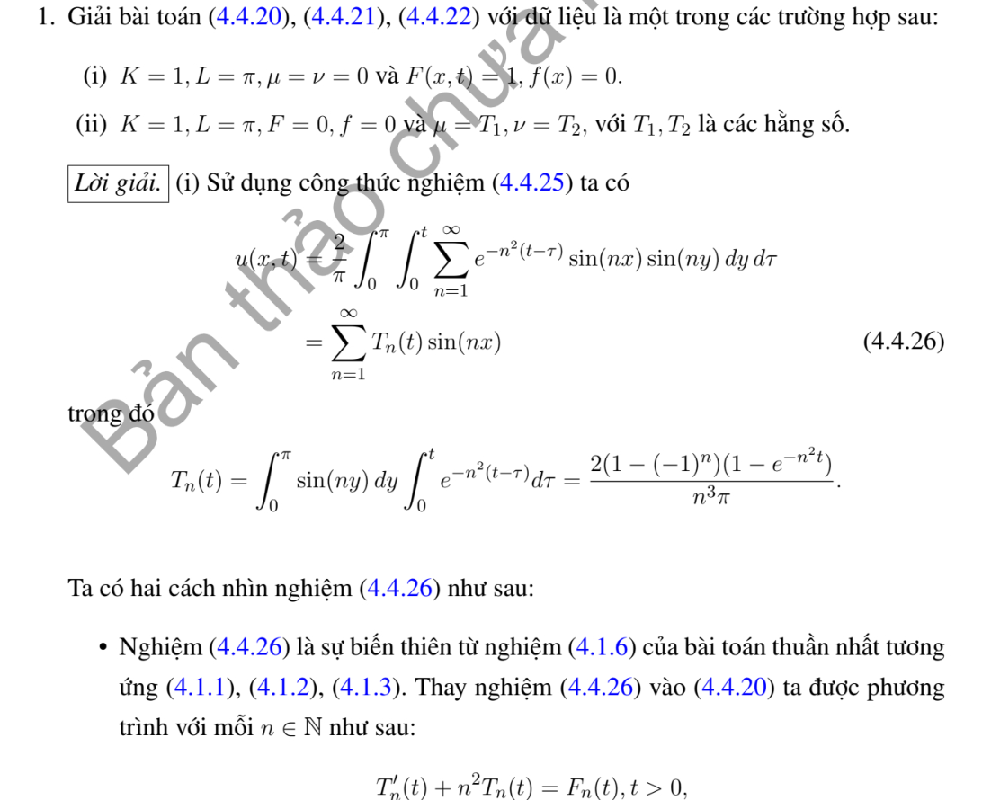
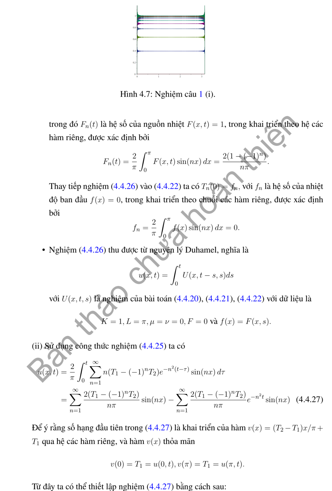
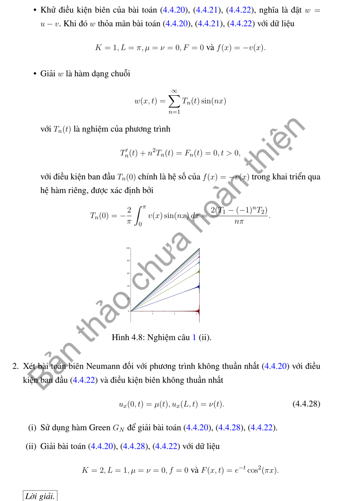
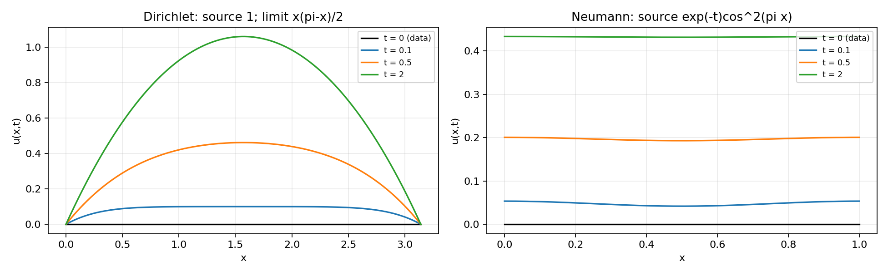

# Ví dụ 1 — Mục 4.4.2

**Mã:** `VD_4_4_2_01` · **Trang sách:** 204–206

[← Mục lục](../MUC_LUC.md) · [Bản PDF của bài](VD_4_4_2_01.pdf)

## Đề bài và phần trình bày có sẵn trong sách

## Kiến thức và trình tự giải

**Bước 1 — Khử điều kiện biên không thuần nhất.** Viết $u=b+w$ với $b$ thỏa đúng biên. Dirichlet hai đầu: $b=\mu+(\nu-\mu)x/L$. Neumann hai đầu: $b=\mu x+(\nu-\mu)x^2/(2L)$. Neumann–Dirichlet: $b=\nu+\mu(x-L)$; Dirichlet–Neumann: $b=\mu+x\nu$. Robin trái–Dirichlet phải: $b=\mu+d+dx$, $d=(\nu-\mu)/(L+1)$. Neumann trái–Robin phải: $b=\nu-\mu(L+1)+\mu x$. Hai Robin: $b=\mu+d+dx$, $d=(\nu-\mu)/(L+2)$.

**Bước 2 — Tính lại nguồn và dữ liệu đầu.** Từ $u_t=Ku_{xx}+F$ suy $w_t=Kw_{xx}+Q$, $Q=F+Kb_{xx}-b_t$, $w(x,0)=f(x)-b(x,0)$. Tính $b_t,b_{xx}$ trước khi chiếu; với hàm nâng bậc hai Neumann, $Kb_{xx}$ không bằng không. Nếu dùng trạng thái dừng $P$, giải $KP''+F=0$ và đúng biên rồi đặt $w=u-P$.

**Bước 3 — Chiếu và giải ODE bằng nhân tử.** Với $N_n=\int X_n^2$, đặt $d_n=N_n^{-1}\int(f-b_0)X_n$, $Q_n(t)=N_n^{-1}\int QX_n$. Phương trình mode là $T_n'+K\lambda_nT_n=Q_n$. Nhân với $e^{K\lambda_nt}$, tích phân từ $0$ đến $t$, rồi chia:

$$
T_n=d_ne^{-K\lambda_nt}+\int_0^te^{-K\lambda_n(t-s)}Q_n(s)ds,\qquad
u=b+\sum_nT_nX_n.
$$

Đây cũng là công thức Green $u=b+\int G(f-b_0)+\int_0^t\int GQ$ cho biên đã được khử.

**Bước 4 — Thực hiện tích phân thời gian.** Với $Q_n(s)=C_ne^{-\rho s}$, đặt $d=K\lambda_n$:

$$
\int_0^te^{-d(t-s)}C_ne^{-\rho s}ds
=C_ne^{-dt}\int_0^te^{(d-\rho)s}ds
=C_n\frac{e^{-\rho t}-e^{-dt}}{d-\rho}.
$$

Nếu $d=\rho$, kết quả là $C_nte^{-dt}$. Với nguồn hằng, kết quả $C_n(1-e^{-dt})/d$ khi $d>0$; mode $d=0$ phải dùng $\int_0^tQ_0(s)ds$. Nguồn đa thức thời gian tích phân từng phần hoặc giải ODE với nghiệm riêng đa thức.

**Bước 5 — Kiểm tra và tìm giới hạn.** Mỗi mode đúng PDE, biên; $T_n(0)=d_n$ trả lại dữ liệu đầu sau khi cộng $b_0$. Tách mode hằng Neumann: $\frac d{dt}\int u=K(\nu-\mu)+\int F$. Trạng thái dừng chỉ tồn tại nếu tổng nguồn và thông lượng cân bằng. Với các mode dương, kiểm tra hội tụ đủ để lấy giới hạn đều; không bỏ một mode bằng không hoặc mode tăng.

## Lời giải áp dụng cho bài

**Bước 1. Công thức mode có nguồn.**
Với Dirichlet thuần nhất trên $(0,\pi)$, đặt $u=\sum T_n\sin nx$. Chiếu PDE cho $T_n'+n^2T_n=F_n$, $T_n(0)=f_n$. Nhân với $e^{n^2t}$ rồi tích phân:

$$
T_n=f_ne^{-n^2t}+\int_0^te^{-n^2(t-s)}F_n(s)ds.
$$

**Bước 2. Ví dụ 1(i), $F=1,f=0$.**

$$
F_n=\frac2\pi[-\cos ny/n]_0^\pi=\frac{2(1-(-1)^n)}{\pi n}.
$$

Vì $\int_0^te^{-n^2(t-s)}ds=(1-e^{-n^2t})/n^2$,

$$
u=\sum_{n\ge1}\frac{2(1-(-1)^n)}{\pi n^3}(1-e^{-n^2t})\sin nx.
$$

Trạng thái dừng giải $P''=-1$, $P(0)=P(\pi)=0$, nên $P=x(\pi-x)/2$. Hệ số sine của $P$ chính là $F_n/n^2$; do đó $u\to P$, không tiến về hằng $1$. Đồ thị trong sách cần được đối chiếu với nghiệm này.

**Bước 3. Ví dụ 1(ii), biên $T_1,T_2$, nguồn và dữ liệu đầu bằng không.**
Đặt $b=T_1+(T_2-T_1)x/\pi$ và $w=u-b$. $b_t=b_{xx}=0$, nên $w_t=w_{xx}$, biên $0$, dữ liệu đầu $-b$. Tích phân từng phần:

$$
\int_0^\pi b\sin nx\,dx
=\left[-\frac{b\cos nx}n\right]_0^\pi+\frac{b'}n\int_0^\pi\cos nx\,dx
=\frac{T_1-(-1)^nT_2}n.
$$

Vì vậy

$$
u=b-\sum_{n\ge1}\frac{2(T_1-(-1)^nT_2)}{\pi n}e^{-n^2t}\sin nx.
$$

Biên được bảo đảm bởi $b$, mặt đầu trong miền bằng $0$ theo khai triển sine của $b$, và $u\to b$ đều lúc thời gian dài. Nếu $T_1$ hoặc $T_2$ khác $0$, không có liên tục tại góc tương ứng với dữ liệu đầu $0$.

**Bước 4. Ví dụ 2 nằm tiếp trong cùng phần scan: Neumann có nguồn.**
Với $u_x(0)=\mu,u_x(L)=\nu$, chọn $b=\mu x+(\nu-\mu)x^2/(2L)$. Khi đó $w=u-b$ có biên Neumann $0$, nguồn $Q=F+K(\nu-\mu)/L-b_t$, dữ liệu $f-b_0$. Nhân Green Neumann cho $w=\int G_N(f-b_0)+\int_0^t\int G_NQ$. Cũng có công thức trực tiếp

$$
u=\int_0^LG_N(x,y,t)f(y)dy+
\int_0^t\!\int_0^LG_N(x,y,t-s)F(y,s)dy\,ds+
K\int_0^t\{G_N(x,L,t-s)\nu(s)-G_N(x,0,t-s)\mu(s)\}ds.
$$

Dấu hai đầu được suy từ $K[G_Nu_y-(G_N)_yu]_0^L$.
Với $K=2,L=1,\mu=\nu=f=0,F=e^{-t}\cos^2\pi x$, dùng $\cos^2\pi x=(1+\cos2\pi x)/2$. Chỉ có mode $0,2$:

$$
T_0'=\tfrac12e^{-t},\quad T_2'+8\pi^2T_2=\tfrac12e^{-t},\quad T_0(0)=T_2(0)=0.
$$

Tích phân cho

$$
u=\frac{1-e^{-t}}2+\frac{e^{-t}-e^{-8\pi^2t}}{2(8\pi^2-1)}\cos2\pi x.
$$

Đúng biên, nguồn, mặt đầu; giới hạn bằng $1/2$. Hai ví dụ có đánh số 1 và 2 được giữ chung ở đây vì cùng nằm trong ảnh đề của mục này.

## Đồ thị minh họa

