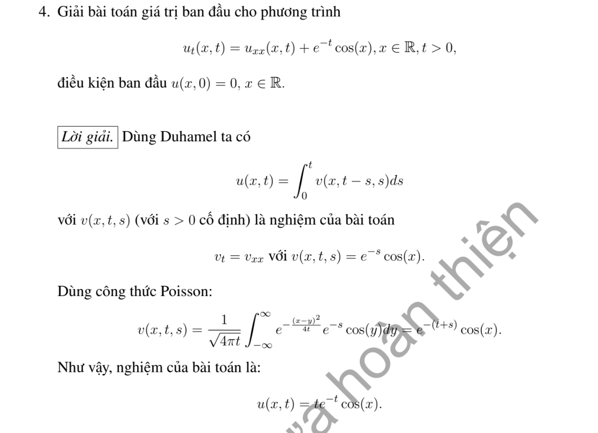

# Ví dụ 4 — Mục 4.6.2

**Mã:** `VD_4_6_2_04` · **Trang sách:** 221–221

[← Mục lục](../MUC_LUC.md) · [Bản PDF của bài](VD_4_6_2_04.pdf)

## Đề bài và phần trình bày có sẵn trong sách

## Kiến thức và trình tự giải

**Bước 1 — Chọn nhân nhiệt theo miền và hệ số.** Trên $\mathbb R$, $g_K(z,t)=(4\pi Kt)^{-1/2}e^{-z^2/(4Kt)}$, $u=g_K*f$. Trên nửa trục, thác triển lẻ cho Dirichlet $0$, chẵn cho Neumann $0$; sau đổi $y\mapsto-y$ ở nửa âm:

$$
H_D(x,y,t)=g_K(x-y,t)-g_K(x+y,t),\qquad
H_N(x,y,t)=g_K(x-y,t)+g_K(x+y,t).
$$

Kiểm tra $H_D(0,y,t)=0$, $\partial_xH_N(0,y,t)=0$. Nửa trục phải có một điều kiện biên; dữ liệu đầu một mình không xác định duy nhất.

**Bước 2 — Tính các tích phân không gian.** Mode $\sin ky,\cos ky$ biến thành $e^{-Kk^2t}\sin kx,e^{-Kk^2t}\cos kx$. Với Gauss $e^{-\alpha(y-m)^2}$, $\alpha>0$, hoàn thành bình phương:

$$
-\frac{(x-y)^2}{4Kt}-\alpha(y-m)^2
=-\frac{1+4\alpha Kt}{4Kt}\left(y-\frac{x+4\alpha Ktm}{1+4\alpha Kt}\right)^2
-\frac{\alpha(x-m)^2}{1+4\alpha Kt}.
$$

Đổi biến để $\int_{\mathbb R}e^{-z^2}dz=\sqrt\pi$, suy $(g_K*f)(x)=e^{-\alpha(x-m)^2/(1+4\alpha Kt)}/\sqrt{1+4\alpha Kt}$. Với dữ liệu chỉ thị đoạn, cận hữu hạn tạo $\operatorname{erf}$; với $e^{-y}$ trên nửa trục, cận $0,\infty$ tạo $\operatorname{erfc}$, trong đó $\operatorname{erf}z=2\int_0^ze^{-r^2}dr/\sqrt\pi$, $\operatorname{erfc}z=1-\operatorname{erf}z$.

**Bước 3 — Thêm nguồn và biên.** Nguồn cho $u=g_K*f+\int_0^tg_K(\cdot,t-s)*F(\cdot,s)\,ds$, hoặc thay $g_K$ bằng $H_D,H_N$. Biên Dirichlet $\mu(t)$ trên nửa trục thêm

$$
\int_0^t\frac{x\,e^{-x^2/[4K(t-s)]}}{\sqrt{4\pi K}(t-s)^{3/2}}\mu(s)ds.
$$

Nguồn một mode giảm cùng tốc độ khuếch tán cho tích phân thời gian hằng sau khi gom mũ, nên xuất hiện $te^{-Kk^2t}$.

**Bước 4 — Đổi biến khi hệ số phụ thuộc thời gian hoặc có vận chuyển.** Với $u_t=a(t)u_{xx}+b(t)u_x+c(t)u$, đặt $A=\int_0^ta$, $B=\int_0^tb$, $C=\int_0^tc$, $u=e^Cv(x+B,A)$. Tính $u_t=e^C(cv+bv_z+av_\tau)$, $u_x=e^Cv_z$, $u_{xx}=e^Cv_{zz}$, suy $v_\tau=v_{zz}$. Dấu dịch là $x+B$, không phải $x-B$. Với hạng $xu_x$, dùng $z=e^{\pm t}x$ và chọn đồng hồ $\tau'(t)=e^{\pm2t}$.

**Bước 5 — Nhiều chiều và kiểm tra.** Nhân $n$ chiều là tích các nhân một chiều. Dữ liệu dạng tích tách được tích phân không gian bằng Fubini; nguồn dạng tích vẫn phải tích phân theo một thời gian chung $s$. Kiểm tra PDE bằng đạo hàm Duhamel: đạo hàm cận trên trả lại $F(x,t)$, phần còn lại bằng $K\Delta u$. Nhân Gauss là xấp xỉ đơn vị, nên trả lại dữ liệu tại điểm liên tục; dữ liệu nhảy không cho nghiệm liên tục đến mọi điểm lúc đầu.

## Lời giải áp dụng cho bài

**Bước 1. Nhận dạng một mode cộng hưởng.**
Nguồn $e^{-t}\cos x$ và mặt đầu $0$ cho phép đặt $u=T(t)\cos x$. Khi đó $u_{xx}=-T\cos x$, PDE thành $T'+T=e^{-t}$, $T(0)=0$.
**Bước 2. Thực hiện tích phân.** Nhân với $e^t$:

$$
(e^tT)'=1,\quad e^tT=t,\quad T=te^{-t}.
$$

Tương đương Duhamel: $u=\int_0^te^{-(t-s)}e^{-s}\cos x\,ds=e^{-t}\cos x\int_0^tds$.
**Bước 3. Kiểm tra.**

$$
u=te^{-t}\cos x,\quad u_t=(1-t)e^{-t}\cos x,\quad
u_{xx}=-te^{-t}\cos x.
$$

Suy $u_t-u_{xx}=e^{-t}\cos x$ và $u(x,0)=0$. Thừa số $t$ xuất hiện vì tốc độ giảm của nguồn bằng tốc độ giảm của mode nhiệt.

