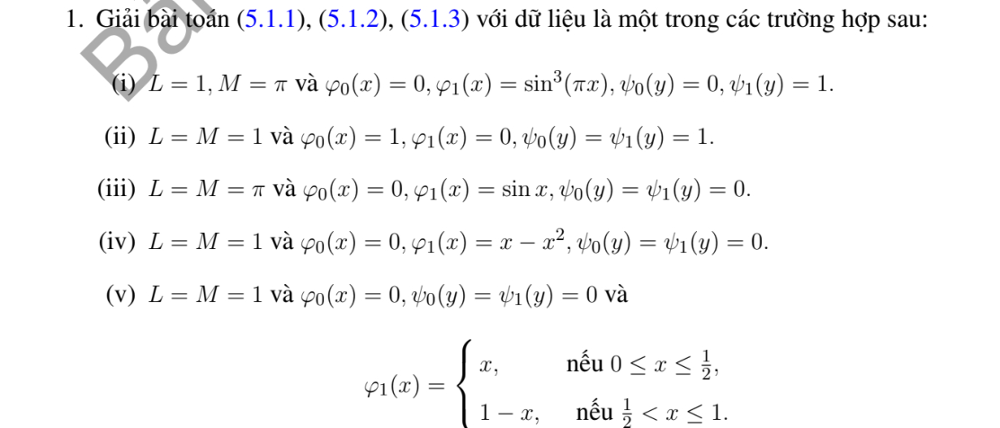
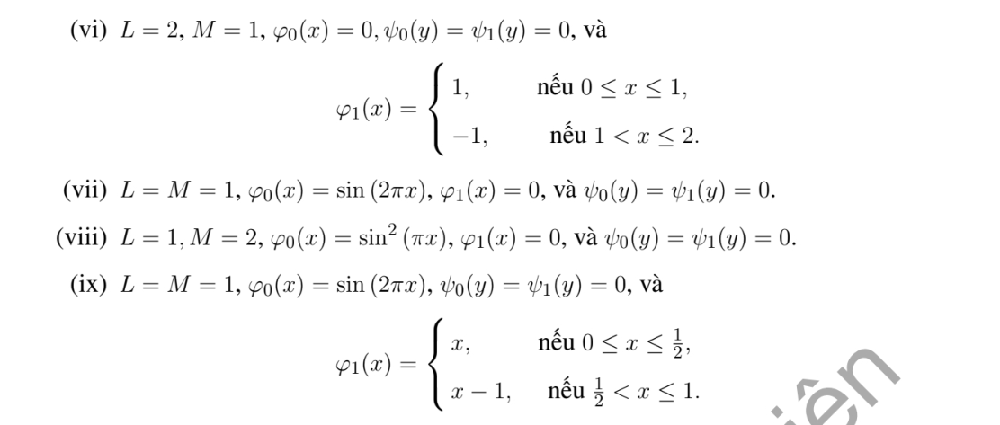

# Bài tập thực hành 1 — Mục 5.1.3

**Mã:** `BT_5_1_3_01` · **Trang sách:** 235–236

[← Mục lục](../MUC_LUC.md) · [Bản PDF của bài](BT_5_1_3_01.pdf)

## Đề bài

## Kiến thức và trình tự giải

**Bước 1 — Tách biên và chọn cơ sở.** Với hình chữ nhật, tách một bài có một cạnh dữ liệu khác 0 rồi chồng chất. Các cạnh đối diện Dirichlet 0 chọn sine, Neumann 0 chọn cosine; sau tách biến $-X''=\lambda X$, phần còn lại thỏa $Y''-\lambda Y=F_n$.

**Bước 2 — Giải phương trình theo tọa độ còn lại.** Khi $F_n=0$, dùng sinh/cosh thay vì sine/cosine dao động. Khi có nguồn, dùng nghiệm riêng hoặc Green của ODE. Hệ số được tính từ tích phân trực giao, ví dụ $f_n=2L^{-1}\int_0^Lf(x)\sin(n\pi x/L)dx$.

**Bước 3 — Kiểm tra tồn tại và duy nhất.** Với $\Delta u=F$, biên Neumann phải có $\int_{\partial\Omega}\partial_\nu u=\int_\Omega F$. Hiệu hai nghiệm cùng dữ liệu là điều hòa; tích phân Green xác định nó bằng 0 hoặc bằng hằng tùy biên. Các giá trị trái nhau ở góc không thể cho nghiệm liên tục trên toàn miền đóng.

## Lời giải áp dụng cho bài

Đặt $S_{D,n}(q)=2D^{-1}\int_0^Dq(s)\sin(n\pi s/D)ds$, $k_n=n\pi/L,\ell_n=n\pi/M$. Chồng chất bốn bài có một cạnh khác 0 cho công thức đã tính hệ số:

$$
\begin{aligned}
u={}&\sum_{n\ge1}\sin k_nx\frac{S_{L,n}(\varphi_0)\sinh k_n(M-y)+S_{L,n}(\varphi_1)\sinh k_ny}{\sinh k_nM}\\
&+\sum_{n\ge1}\sin\ell_ny\frac{S_{M,n}(\psi_0)\sinh\ell_n(L-x)+S_{M,n}(\psi_1)\sinh\ell_nx}{\sinh\ell_nL}.
\end{aligned}
$$

Để áp dụng từng câu, các hệ số không bằng 0 là:

**Ý (i).**  $L=1,M=\pi$, $S(\varphi_1)=(3\delta_{n1}-\delta_{n3})/4$, $S(\psi_1)=2(1-(-1)^n)/(\pi n)$.

**Ý (ii).**  $L=M=1$, $S(\varphi_0)=S(\psi_0)=S(\psi_1)=2(1-(-1)^n)/(\pi n)$; cũng có thể viết $u=1-$chuỗi một cạnh trên với dữ liệu 1.

**Ý (iii).**  $u=\sin x\sinh y/\sinh\pi$.

**Ý (iv).**  $S(\varphi_1)=4(1-(-1)^n)/(n^3\pi^3)$.

**Ý (v).**  $S(\varphi_1)=4\sin(n\pi/2)/(n^2\pi^2)$.

**Ý (vi).**  $L=2,M=1$, $S(\varphi_1)=2[1+(-1)^n-2\cos(n\pi/2)]/(n\pi)$.

**Ý (vii).**  $u=\sin2\pi x\sinh(2\pi(1-y))/\sinh2\pi$.

**Ý (viii).**  $L=1,M=2$, $S(\varphi_0)=8/[\pi n(4-n^2)]$ nếu $n$ lẻ, bằng 0 nếu $n$ chẵn.

**Ý (ix).**  $S(\varphi_0)=\delta_{n2}$, $S(\varphi_1)=-2\cos(n\pi/2)/(n\pi)$.

Thay các hệ số trên vào hai chuỗi là nghiệm của từng trường hợp. Đạo hàm trong miền cho $\Delta u=0$; trên cạnh hội tụ về dữ liệu tại điểm liên tục, và về trung bình ở điểm gián đoạn. Nếu dữ liệu ở góc không khớp, không có nghiệm liên tục trên cả hình chữ nhật đóng; chuỗi vẫn giải bài trong miền và trên các cạnh mở.

## Đối chiếu kết quả

Khi sử dụng kết quả, kiểm tra đồng thời phương trình, dữ liệu ban đầu/biên và miền được nêu trong lời giải. Các điều kiện về tính trơn, nghiệm thực, tồn tại hoặc duy nhất là một phần của kết luận; không bỏ chúng khi ghi đáp án.
