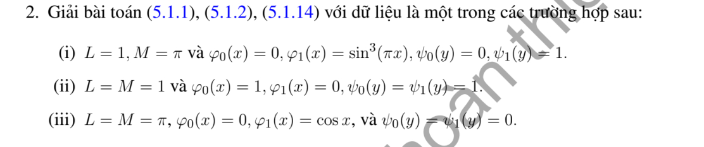

# Bài tập thực hành 2 — Mục 5.1.3

**Mã:** `BT_5_1_3_02` · **Trang sách:** 236–236

[← Mục lục](../MUC_LUC.md) · [Bản PDF của bài](BT_5_1_3_02.pdf)

## Đề bài

## Kiến thức và trình tự giải

**Bước 1 — Tách biên và chọn cơ sở.** Với hình chữ nhật, tách một bài có một cạnh dữ liệu khác 0 rồi chồng chất. Các cạnh đối diện Dirichlet 0 chọn sine, Neumann 0 chọn cosine; sau tách biến $-X''=\lambda X$, phần còn lại thỏa $Y''-\lambda Y=F_n$.

**Bước 2 — Giải phương trình theo tọa độ còn lại.** Khi $F_n=0$, dùng sinh/cosh thay vì sine/cosine dao động. Khi có nguồn, dùng nghiệm riêng hoặc Green của ODE. Hệ số được tính từ tích phân trực giao, ví dụ $f_n=2L^{-1}\int_0^Lf(x)\sin(n\pi x/L)dx$.

**Bước 3 — Kiểm tra tồn tại và duy nhất.** Với $\Delta u=F$, biên Neumann phải có $\int_{\partial\Omega}\partial_\nu u=\int_\Omega F$. Hiệu hai nghiệm cùng dữ liệu là điều hòa; tích phân Green xác định nó bằng 0 hoặc bằng hằng tùy biên. Các giá trị trái nhau ở góc không thể cho nghiệm liên tục trên toàn miền đóng.

## Lời giải áp dụng cho bài

Điều kiện (5.1.14) là $u_x(0,y)=\psi_0(y),u_x(L,y)=\psi_1(y)$, còn biên dưới/trên là Dirichlet. Đặt hệ số cosine $c_0(q)=L^{-1}\int q$, $c_n(q)=2L^{-1}\int q\cos(n\pi x/L)$; hệ số sine $s_n(q)=2M^{-1}\int q\sin(n\pi y/M)$.

$$
\begin{aligned}
u={}&c_0(\varphi_0)(1-y/M)+c_0(\varphi_1)y/M\\
&+\sum_{n\ge1}\cos k_nx\frac{c_n(\varphi_0)\sinh k_n(M-y)+c_n(\varphi_1)\sinh k_ny}{\sinh k_nM}\\
&+\sum_{n\ge1}\sin\ell_ny\frac{s_n(\psi_1)\cosh\ell_nx-s_n(\psi_0)\cosh\ell_n(L-x)}{\ell_n\sinh\ell_nL}.
\end{aligned}
$$

**Ý (i).**  $c_0(\varphi_1)=4/(3\pi)$, $c_n(\varphi_1)=24/[\pi(1-n^2)(9-n^2)]$ nếu $n$ chẵn, bằng 0 nếu $n$ lẻ; $s_n(\psi_1)=2(1-(-1)^n)/(\pi n)$. Các hệ số còn lại 0.

**Ý (ii).**  $c_0(\varphi_0)=1$, các cosine khác 0; $s_n(\psi_0)=s_n(\psi_1)=2(1-(-1)^n)/(\pi n)$. Thế vào công thức.

**Ý (iii).**  $u=\cos x\sinh y/\sinh\pi$. Các công thức thỏa đạo hàm biên trực tiếp; năng lượng cho tính duy nhất.

## Đối chiếu kết quả

Khi sử dụng kết quả, kiểm tra đồng thời phương trình, dữ liệu ban đầu/biên và miền được nêu trong lời giải. Các điều kiện về tính trơn, nghiệm thực, tồn tại hoặc duy nhất là một phần của kết luận; không bỏ chúng khi ghi đáp án.
