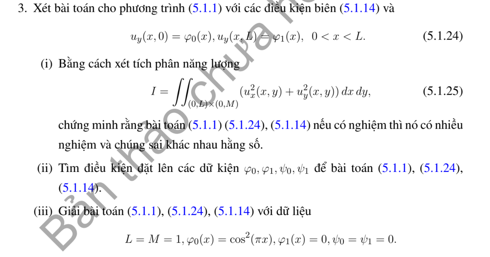

# Bài tập thực hành 3 — Mục 5.1.3

**Mã:** `BT_5_1_3_03` · **Trang sách:** 236–236

[← Mục lục](../MUC_LUC.md) · [Bản PDF của bài](BT_5_1_3_03.pdf)

## Đề bài

## Kiến thức và trình tự giải

**Bước 1 — Tách biên và chọn cơ sở.** Với hình chữ nhật, tách một bài có một cạnh dữ liệu khác 0 rồi chồng chất. Các cạnh đối diện Dirichlet 0 chọn sine, Neumann 0 chọn cosine; sau tách biến $-X''=\lambda X$, phần còn lại thỏa $Y''-\lambda Y=F_n$.

**Bước 2 — Giải phương trình theo tọa độ còn lại.** Khi $F_n=0$, dùng sinh/cosh thay vì sine/cosine dao động. Khi có nguồn, dùng nghiệm riêng hoặc Green của ODE. Hệ số được tính từ tích phân trực giao, ví dụ $f_n=2L^{-1}\int_0^Lf(x)\sin(n\pi x/L)dx$.

**Bước 3 — Kiểm tra tồn tại và duy nhất.** Với $\Delta u=F$, biên Neumann phải có $\int_{\partial\Omega}\partial_\nu u=\int_\Omega F$. Hiệu hai nghiệm cùng dữ liệu là điều hòa; tích phân Green xác định nó bằng 0 hoặc bằng hằng tùy biên. Các giá trị trái nhau ở góc không thể cho nghiệm liên tục trên toàn miền đóng.

## Lời giải áp dụng cho bài

Với hiệu $w$ của hai nghiệm, $\int_\Omega|\nabla w|^2=\int_{\partial\Omega}w\partial_\nu w=0$, nên $w$ hằng; vì vậy nếu có một nghiệm thì mọi nghiệm là $u+C$.

Điều kiện tương thích (dùng đạo hàm tọa độ trong đề) là

$$
\int_0^L(\varphi_1-\varphi_0)dx+\int_0^M(\psi_1-\psi_0)dy=0.
$$

Đủ tồn tại nghiệm yếu Neumann, duy nhất sau khi ấn định trung bình; để có nghiệm cổ điển đến góc còn cần độ trơn và tương thích góc.

**Ý (iii).**  Dữ liệu cho $\int(\varphi_1-\varphi_0)=-1/2$, hai cạnh kia 0. Do đó **không có nghiệm**; không được triển khai Fourier bỏ qua mode 0.

## Đối chiếu kết quả

Khi sử dụng kết quả, kiểm tra đồng thời phương trình, dữ liệu ban đầu/biên và miền được nêu trong lời giải. Các điều kiện về tính trơn, nghiệm thực, tồn tại hoặc duy nhất là một phần của kết luận; không bỏ chúng khi ghi đáp án.
