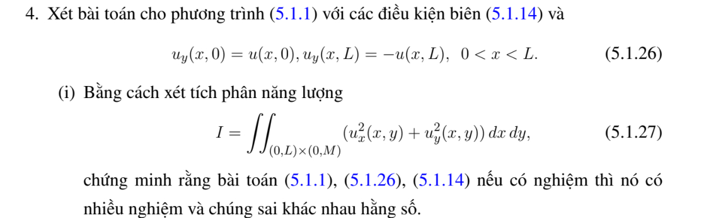
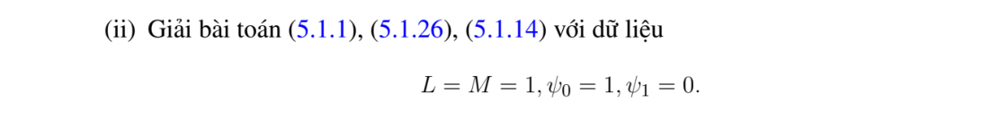

# Bài tập thực hành 4 — Mục 5.1.3

**Mã:** `BT_5_1_3_04` · **Trang sách:** 236–237

[← Mục lục](../MUC_LUC.md) · [Bản PDF của bài](BT_5_1_3_04.pdf)

## Đề bài

## Kiến thức và trình tự giải

**Bước 1 — Tách biên và chọn cơ sở.** Với hình chữ nhật, tách một bài có một cạnh dữ liệu khác 0 rồi chồng chất. Các cạnh đối diện Dirichlet 0 chọn sine, Neumann 0 chọn cosine; sau tách biến $-X''=\lambda X$, phần còn lại thỏa $Y''-\lambda Y=F_n$.

**Bước 2 — Giải phương trình theo tọa độ còn lại.** Khi $F_n=0$, dùng sinh/cosh thay vì sine/cosine dao động. Khi có nguồn, dùng nghiệm riêng hoặc Green của ODE. Hệ số được tính từ tích phân trực giao, ví dụ $f_n=2L^{-1}\int_0^Lf(x)\sin(n\pi x/L)dx$.

**Bước 3 — Kiểm tra tồn tại và duy nhất.** Với $\Delta u=F$, biên Neumann phải có $\int_{\partial\Omega}\partial_\nu u=\int_\Omega F$. Hiệu hai nghiệm cùng dữ liệu là điều hòa; tích phân Green xác định nó bằng 0 hoặc bằng hằng tùy biên. Các giá trị trái nhau ở góc không thể cho nghiệm liên tục trên toàn miền đóng.

## Lời giải áp dụng cho bài

Biên dưới $u_y=u$, trên $u_y=-u$ tương đương $\partial_\nu u=-u$ ở cả hai cạnh; hai cạnh đứng Neumann. Với hiệu $w$,

$$
\int_\Omega|\nabla w|^2=-\int_{y=0,M}w^2\le0.
$$

Do đó $w=0$. Kết luận “vô số nghiệm sai khác hằng số” của đề là sai: cộng hằng khác 0 phá điều kiện Robin.

Câu (ii), $L=M=1,u_x(0,y)=1,u_x(1,y)=0$. Gọi $Y_j=\cos k_jy+\sin k_jy/k_j$, với $(1-k_j^2)\sin k_j+2k_j\cos k_j=0$, $k_j>0$, $N_j=\int_0^1Y_j^2$, $d_j=\int_0^1Y_j/N_j$. Tách biến theo $y$ cho

$$
u(x,y)=-\sum_j\frac{d_j\cosh(k_j(1-x))}{k_j\sinh k_j}Y_j(y).
$$

Đạo hàm $x$ cho đúng dữ liệu hai cạnh; $Y_j$ thỏa Robin. Đây là nghiệm duy nhất.

## Đối chiếu kết quả

Khi sử dụng kết quả, kiểm tra đồng thời phương trình, dữ liệu ban đầu/biên và miền được nêu trong lời giải. Các điều kiện về tính trơn, nghiệm thực, tồn tại hoặc duy nhất là một phần của kết luận; không bỏ chúng khi ghi đáp án.
