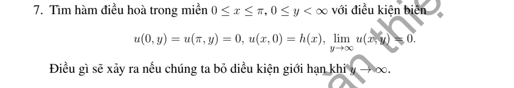

# Bài tập thực hành 7 — Mục 5.1.3

**Mã:** `BT_5_1_3_07` · **Trang sách:** 237–237

[← Mục lục](../MUC_LUC.md) · [Bản PDF của bài](BT_5_1_3_07.pdf)

## Đề bài

## Kiến thức và trình tự giải

**Bước 1 — Tách biên và chọn cơ sở.** Với hình chữ nhật, tách một bài có một cạnh dữ liệu khác 0 rồi chồng chất. Các cạnh đối diện Dirichlet 0 chọn sine, Neumann 0 chọn cosine; sau tách biến $-X''=\lambda X$, phần còn lại thỏa $Y''-\lambda Y=F_n$.

**Bước 2 — Giải phương trình theo tọa độ còn lại.** Khi $F_n=0$, dùng sinh/cosh thay vì sine/cosine dao động. Khi có nguồn, dùng nghiệm riêng hoặc Green của ODE. Hệ số được tính từ tích phân trực giao, ví dụ $f_n=2L^{-1}\int_0^Lf(x)\sin(n\pi x/L)dx$.

**Bước 3 — Kiểm tra tồn tại và duy nhất.** Với $\Delta u=F$, biên Neumann phải có $\int_{\partial\Omega}\partial_\nu u=\int_\Omega F$. Hiệu hai nghiệm cùng dữ liệu là điều hòa; tích phân Green xác định nó bằng 0 hoặc bằng hằng tùy biên. Các giá trị trái nhau ở góc không thể cho nghiệm liên tục trên toàn miền đóng.

## Lời giải áp dụng cho bài

Sine Fourier $h_n=2\pi^{-1}\int_0^\pi h(x)\sin nx\,dx$. Điều kiện giảm ở vô cực loại $e^{ny}$:

$$
u=\sum_{n\ge1}h_ne^{-ny}\sin nx.
$$

Nếu bỏ điều kiện ở vô cực, có thể cộng tùy ý $c_n\sinh(ny)\sin nx$, ít nhất các tổng hữu hạn, nên mất tính duy nhất. Trong lớp nghiệm bị chặn, điều kiện giảm vẫn suy ra và nghiệm trên duy nhất.

## Đối chiếu kết quả

Khi sử dụng kết quả, kiểm tra đồng thời phương trình, dữ liệu ban đầu/biên và miền được nêu trong lời giải. Các điều kiện về tính trơn, nghiệm thực, tồn tại hoặc duy nhất là một phần của kết luận; không bỏ chúng khi ghi đáp án.
