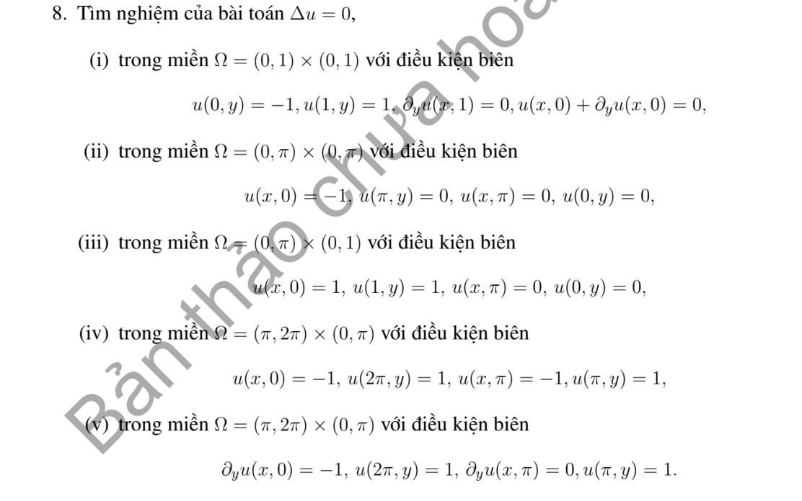

# Bài tập thực hành 8 — Mục 5.1.3

**Mã:** `BT_5_1_3_08` · **Trang sách:** 237–237

[← Mục lục](../MUC_LUC.md) · [Bản PDF của bài](BT_5_1_3_08.pdf)

## Đề bài

## Kiến thức và trình tự giải

**Bước 1 — Tách biên và chọn cơ sở.** Với hình chữ nhật, tách một bài có một cạnh dữ liệu khác 0 rồi chồng chất. Các cạnh đối diện Dirichlet 0 chọn sine, Neumann 0 chọn cosine; sau tách biến $-X''=\lambda X$, phần còn lại thỏa $Y''-\lambda Y=F_n$.

**Bước 2 — Giải phương trình theo tọa độ còn lại.** Khi $F_n=0$, dùng sinh/cosh thay vì sine/cosine dao động. Khi có nguồn, dùng nghiệm riêng hoặc Green của ODE. Hệ số được tính từ tích phân trực giao, ví dụ $f_n=2L^{-1}\int_0^Lf(x)\sin(n\pi x/L)dx$.

**Bước 3 — Kiểm tra tồn tại và duy nhất.** Với $\Delta u=F$, biên Neumann phải có $\int_{\partial\Omega}\partial_\nu u=\int_\Omega F$. Hiệu hai nghiệm cùng dữ liệu là điều hòa; tích phân Green xác định nó bằng 0 hoặc bằng hằng tùy biên. Các giá trị trái nhau ở góc không thể cho nghiệm liên tục trên toàn miền đóng.

## Lời giải áp dụng cho bài

**Ý (i).**  Theo $y$, dùng $Y_j=\cos k_jy-\sin k_jy/k_j$, vì $Y'(0)=-Y(0),Y'(1)=0$. Các mode gồm cả khả năng trị riêng âm: viết chung $-Y_j''=\lambda_jY_j$, $d_j=\int_0^1Y_j/\int_0^1Y_j^2$. Mỗi hệ số $V_j$ giải $V_j''-\lambda_jV_j=0$, $V_j(0)=-d_j,V_j(1)=d_j$. Với $\lambda_j>0$,

$$
V_j=d_j\frac{\sinh(\sqrt{\lambda_j}x)-\sinh(\sqrt{\lambda_j}(1-x))}{\sinh\sqrt{\lambda_j}}.
$$

Với $\lambda_j=-\kappa_j^2<0$, thay sinh bởi sin. Ở đây trị riêng âm duy nhất thỏa $\kappa\tanh\kappa=1$ và $\kappa<\pi$, nên không có cộng hưởng với hai biên Dirichlet theo $x$. $u=\sum V_jY_j$.

**Ý (ii).**  $u=-\sum_{n\text{ lẻ}}4\sin nx\sinh(n(\pi-y))/[\pi n\sinh n\pi]$.

**Ý (iii).**  Miền ghi $(0,\pi)\times(0,1)$ nhưng biên ghi $x=1,y=\pi$: không khép miền, không xác định duy nhất như bản in. Nếu miền dự kiến là $(0,1)\times(0,\pi)$, dùng công thức bốn cạnh Dirichlet với cạnh dưới và phải bằng 1, hai cạnh còn lại 0.

**Ý (iv).**  Đặt $X=x-\pi$. Nghiệm là $1-2v$, với

$$
v=\sum_{n\text{ lẻ}}\frac4{\pi n}\sin nX\frac{\sinh ny+\sinh(n(\pi-y))}{\sinh n\pi}.
$$

**Ý (v).**  $u=1+w$, $w=0$ ở $x=\pi,2\pi$, $w_y(x,0)=-1,w_y(x,\pi)=0$. Do đó

$$
w=\sum_{n\text{ lẻ}}\frac4{\pi n^2}\frac{\cosh(n(\pi-y))}{\sinh n\pi}\sin(n(x-\pi)).
$$

## Đối chiếu kết quả

Khi sử dụng kết quả, kiểm tra đồng thời phương trình, dữ liệu ban đầu/biên và miền được nêu trong lời giải. Các điều kiện về tính trơn, nghiệm thực, tồn tại hoặc duy nhất là một phần của kết luận; không bỏ chúng khi ghi đáp án.
