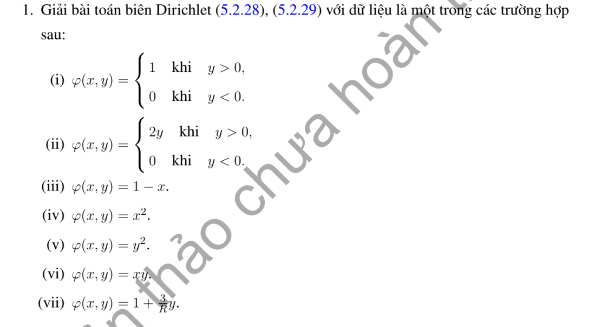

# Bài tập thực hành 1 — Mục 5.2.3

**Mã:** `BT_5_2_3_01` · **Trang sách:** 242–242

[← Mục lục](../MUC_LUC.md) · [Bản PDF của bài](BT_5_2_3_01.pdf)

## Đề bài

## Kiến thức và trình tự giải

**Bước 1 — Viết toán tử theo tọa độ cực.**

$$\Delta u=u_{rr}+\frac1r u_r+\frac1{r^2}u_{\theta\theta}.$$

Với mode $\cos n\theta,\sin n\theta$, phương trình xuyên tâm thuần nhất có hai nghiệm $r^n,r^{-n}$; mode 0 có $1,\log r$. Trên đĩa chứa tâm, tính chính quy loại $r^{-n}$ và $\log r$; trên vành khuyên giữ cả hai.

**Bước 2 — Dùng dữ liệu.** Khai triển Fourier dữ liệu trên đường tròn để tìm hệ số; mỗi mode trên đĩa nhân $(r/R)^n$. Trên hình quạt, điều kiện ở hai cạnh góc xác định tần số $n\pi/\alpha$. Với Neumann, $\partial_\nu=\partial_r$ trên cung ngoài, còn trên cạnh góc là $\pm r^{-1}\partial_\theta$.

**Bước 3 — Nguồn và tương thích.** Tách một nghiệm riêng của $\Delta P=F$, rồi giải bài điều hòa cho $u-P$. Tổng thông lượng ngoài phải bằng tích phân nguồn đối với Neumann; mode hằng thể hiện đúng điều kiện này.

## Lời giải áp dụng cho bài

Đặt $q=r/R$. (i) $u=1/2+(2/\pi)\sum_{n\text{ lẻ}}q^n\sin n\theta/n$.

**Ý (ii).**  Biên $2y\chi_{y>0}=y+|y|$ cho

$$
u=y+\frac{2R}\pi-\frac{4R}\pi\sum_{n\ge1}\frac{q^{2n}}{4n^2-1}\cos2n\theta.
$$

**Ý (iii).**  $u=1-x$.

**Ý (iv).**  $u=(R^2+x^2-y^2)/2$.

**Ý (v).**  $u=(R^2-x^2+y^2)/2$.

**Ý (vi).**  $u=xy$.

**Ý (vii).**  $u=1+3y/\pi$.
Các đa thức được chọn điều hòa và khớp biên; hai trường hợp phân đoạn lấy hệ số Fourier trên đường tròn rồi nhân $(r/R)^n$.

## Đối chiếu kết quả

Khi sử dụng kết quả, kiểm tra đồng thời phương trình, dữ liệu ban đầu/biên và miền được nêu trong lời giải. Các điều kiện về tính trơn, nghiệm thực, tồn tại hoặc duy nhất là một phần của kết luận; không bỏ chúng khi ghi đáp án.
