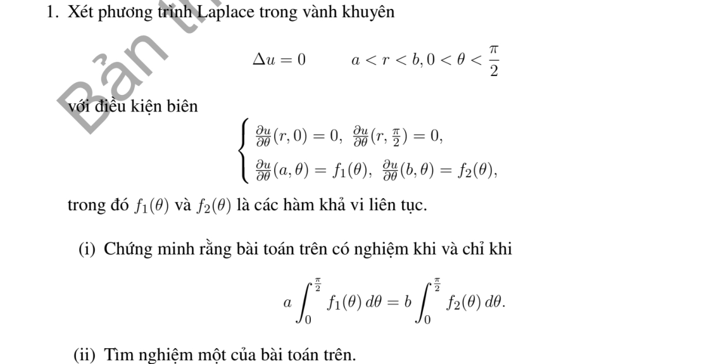

# Bài tập thực hành 1 — Mục 5.3.3

**Mã:** `BT_5_3_3_01` · **Trang sách:** 245–246

[← Mục lục](../MUC_LUC.md) · [Bản PDF của bài](BT_5_3_3_01.pdf)

## Đề bài

## Kiến thức và trình tự giải

**Bước 1 — Viết toán tử theo tọa độ cực.**

$$\Delta u=u_{rr}+\frac1r u_r+\frac1{r^2}u_{\theta\theta}.$$

Với mode $\cos n\theta,\sin n\theta$, phương trình xuyên tâm thuần nhất có hai nghiệm $r^n,r^{-n}$; mode 0 có $1,\log r$. Trên đĩa chứa tâm, tính chính quy loại $r^{-n}$ và $\log r$; trên vành khuyên giữ cả hai.

**Bước 2 — Dùng dữ liệu.** Khai triển Fourier dữ liệu trên đường tròn để tìm hệ số; mỗi mode trên đĩa nhân $(r/R)^n$. Trên hình quạt, điều kiện ở hai cạnh góc xác định tần số $n\pi/\alpha$. Với Neumann, $\partial_\nu=\partial_r$ trên cung ngoài, còn trên cạnh góc là $\pm r^{-1}\partial_\theta$.

**Bước 3 — Nguồn và tương thích.** Tách một nghiệm riêng của $\Delta P=F$, rồi giải bài điều hòa cho $u-P$. Tổng thông lượng ngoài phải bằng tích phân nguồn đối với Neumann; mode hằng thể hiện đúng điều kiện này.

## Lời giải áp dụng cho bài

Tổng thông lượng trên hai cung là $b\int f_2-a\int f_1$, hai cạnh góc thông lượng 0. Vì $\Delta u=0$, điều kiện cần là $a\int f_1=b\int f_2$. Đặt $z=\ln(r/a)$, $H=\ln(b/a)$, $k_n=2n$, $c_{in}=4\pi^{-1}\int_0^{\pi/2}f_i\cos2n\theta$, $c_{i0}=2\pi^{-1}\int f_i$. Nghiệm là

$$
u=C+ac_{10}\ln(r/a)+\sum_{n\ge1}\frac{bc_{2n}\cosh(k_nz)-ac_{1n}\cosh(k_n(H-z))}{k_n\sinh k_nH}\cos2n\theta.
$$

Đạo hàm theo $r$ cho đúng $f_i$; mode 0 cần $ac_{10}=bc_{20}$, chính là điều kiện đã cho. Vì thế điều kiện đủ; năng lượng cho duy nhất modulo hằng, nên không duy nhất nếu chưa chuẩn hóa.

## Đối chiếu kết quả

Khi sử dụng kết quả, kiểm tra đồng thời phương trình, dữ liệu ban đầu/biên và miền được nêu trong lời giải. Các điều kiện về tính trơn, nghiệm thực, tồn tại hoặc duy nhất là một phần của kết luận; không bỏ chúng khi ghi đáp án.
