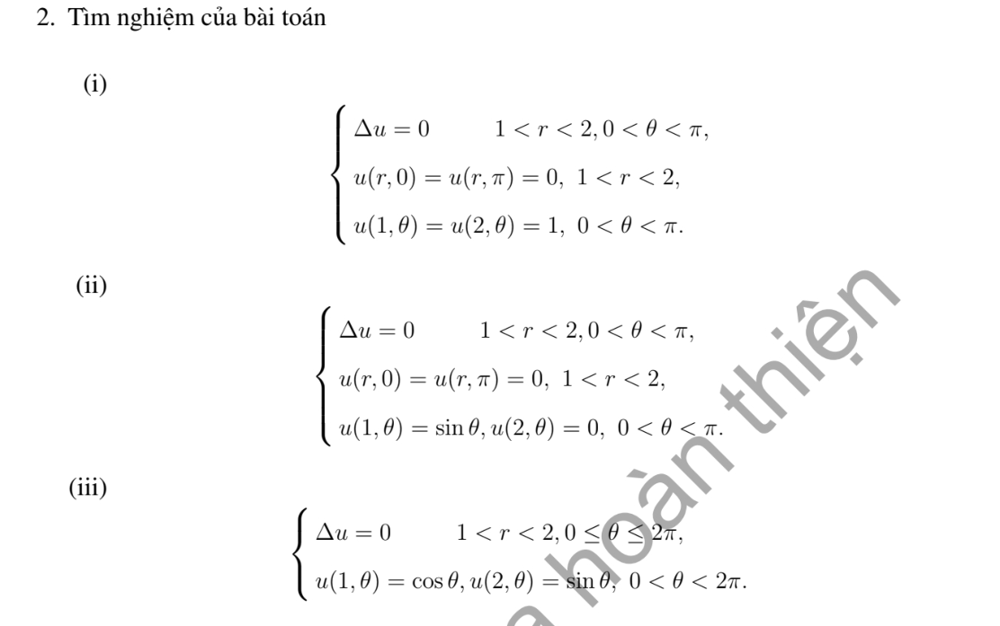

# Bài tập thực hành 2 — Mục 5.3.3

**Mã:** `BT_5_3_3_02` · **Trang sách:** 246–246

[← Mục lục](../MUC_LUC.md) · [Bản PDF của bài](BT_5_3_3_02.pdf)

## Đề bài

## Kiến thức và trình tự giải

**Bước 1 — Viết toán tử theo tọa độ cực.**

$$\Delta u=u_{rr}+\frac1r u_r+\frac1{r^2}u_{\theta\theta}.$$

Với mode $\cos n\theta,\sin n\theta$, phương trình xuyên tâm thuần nhất có hai nghiệm $r^n,r^{-n}$; mode 0 có $1,\log r$. Trên đĩa chứa tâm, tính chính quy loại $r^{-n}$ và $\log r$; trên vành khuyên giữ cả hai.

**Bước 2 — Dùng dữ liệu.** Khai triển Fourier dữ liệu trên đường tròn để tìm hệ số; mỗi mode trên đĩa nhân $(r/R)^n$. Trên hình quạt, điều kiện ở hai cạnh góc xác định tần số $n\pi/\alpha$. Với Neumann, $\partial_\nu=\partial_r$ trên cung ngoài, còn trên cạnh góc là $\pm r^{-1}\partial_\theta$.

**Bước 3 — Nguồn và tương thích.** Tách một nghiệm riêng của $\Delta P=F$, rồi giải bài điều hòa cho $u-P$. Tổng thông lượng ngoài phải bằng tích phân nguồn đối với Neumann; mode hằng thể hiện đúng điều kiện này.

## Lời giải áp dụng cho bài

Đặt $z=\ln r,H=\ln2$. (i) Khai triển $1=\sum_{n\text{ lẻ}}4\sin n\theta/(\pi n)$:

$$
u=\sum_{n\text{ lẻ}}\frac4{\pi n}\frac{\sinh(n(H-z))+\sinh nz}{\sinh nH}\sin n\theta.
$$

**Ý (ii).**  $u=(4/r-r)\sin\theta/3$.

**Ý (iii).**  Trên vành khuyên toàn phần, $u=(4/r-r)\cos\theta/3+2(r-1/r)\sin\theta/3$. Các biểu thức đều là tổ hợp $r^n,r^{-n}$ nên điều hòa và thỏa đúng hai cung.

## Đối chiếu kết quả

Khi sử dụng kết quả, kiểm tra đồng thời phương trình, dữ liệu ban đầu/biên và miền được nêu trong lời giải. Các điều kiện về tính trơn, nghiệm thực, tồn tại hoặc duy nhất là một phần của kết luận; không bỏ chúng khi ghi đáp án.
