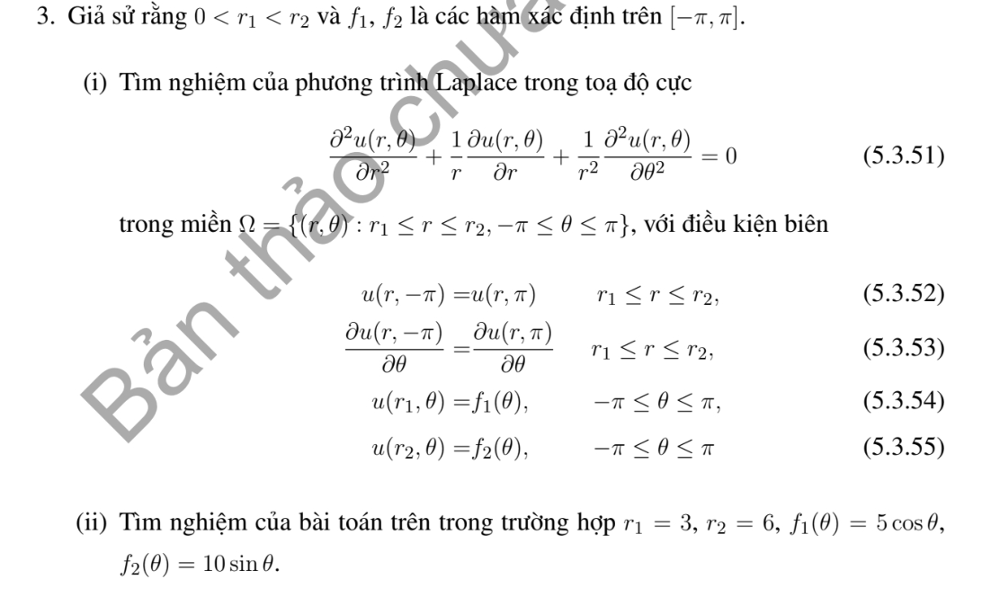

# Bài tập thực hành 3 — Mục 5.3.3

**Mã:** `BT_5_3_3_03` · **Trang sách:** 246–246

[← Mục lục](../MUC_LUC.md) · [Bản PDF của bài](BT_5_3_3_03.pdf)

## Đề bài

## Kiến thức và trình tự giải

**Bước 1 — Viết toán tử theo tọa độ cực.**

$$\Delta u=u_{rr}+\frac1r u_r+\frac1{r^2}u_{\theta\theta}.$$

Với mode $\cos n\theta,\sin n\theta$, phương trình xuyên tâm thuần nhất có hai nghiệm $r^n,r^{-n}$; mode 0 có $1,\log r$. Trên đĩa chứa tâm, tính chính quy loại $r^{-n}$ và $\log r$; trên vành khuyên giữ cả hai.

**Bước 2 — Dùng dữ liệu.** Khai triển Fourier dữ liệu trên đường tròn để tìm hệ số; mỗi mode trên đĩa nhân $(r/R)^n$. Trên hình quạt, điều kiện ở hai cạnh góc xác định tần số $n\pi/\alpha$. Với Neumann, $\partial_\nu=\partial_r$ trên cung ngoài, còn trên cạnh góc là $\pm r^{-1}\partial_\theta$.

**Bước 3 — Nguồn và tương thích.** Tách một nghiệm riêng của $\Delta P=F$, rồi giải bài điều hòa cho $u-P$. Tổng thông lượng ngoài phải bằng tích phân nguồn đối với Neumann; mode hằng thể hiện đúng điều kiện này.

## Lời giải áp dụng cho bài

Đặt $z=\ln(r/r_1),H=\ln(r_2/r_1)$. Gọi $a_{i0},a_{in},b_{in}$ là các hệ số Fourier của $f_i$ (mode hằng là trung bình). Khi đó

$$
\begin{aligned}
u={}&a_{10}(1-z/H)+a_{20}z/H\\
&+\sum_{n\ge1}\frac{[a_{1n}\sinh n(H-z)+a_{2n}\sinh nz]\cos n\theta}{\sinh nH}\\
&+\sum_{n\ge1}\frac{[b_{1n}\sinh n(H-z)+b_{2n}\sinh nz]\sin n\theta}{\sinh nH}.
\end{aligned}
$$

Với $r_1=3,r_2=6$, $f_1=5\cos\theta,f_2=10\sin\theta$,

$$
u=\left(\frac{20}r-\frac{5r}9\right)\cos\theta+\left(\frac{20r}9-\frac{20}r\right)\sin\theta.
$$

## Đối chiếu kết quả

Khi sử dụng kết quả, kiểm tra đồng thời phương trình, dữ liệu ban đầu/biên và miền được nêu trong lời giải. Các điều kiện về tính trơn, nghiệm thực, tồn tại hoặc duy nhất là một phần của kết luận; không bỏ chúng khi ghi đáp án.
