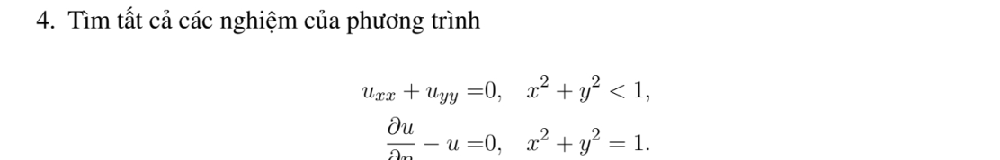

# Bài tập thực hành 4 — Mục 5.3.3

**Mã:** `BT_5_3_3_04` · **Trang sách:** 246–246

[← Mục lục](../MUC_LUC.md) · [Bản PDF của bài](BT_5_3_3_04.pdf)

## Đề bài

## Kiến thức và trình tự giải

**Bước 1 — Viết toán tử theo tọa độ cực.**

$$\Delta u=u_{rr}+\frac1r u_r+\frac1{r^2}u_{\theta\theta}.$$

Với mode $\cos n\theta,\sin n\theta$, phương trình xuyên tâm thuần nhất có hai nghiệm $r^n,r^{-n}$; mode 0 có $1,\log r$. Trên đĩa chứa tâm, tính chính quy loại $r^{-n}$ và $\log r$; trên vành khuyên giữ cả hai.

**Bước 2 — Dùng dữ liệu.** Khai triển Fourier dữ liệu trên đường tròn để tìm hệ số; mỗi mode trên đĩa nhân $(r/R)^n$. Trên hình quạt, điều kiện ở hai cạnh góc xác định tần số $n\pi/\alpha$. Với Neumann, $\partial_\nu=\partial_r$ trên cung ngoài, còn trên cạnh góc là $\pm r^{-1}\partial_\theta$.

**Bước 3 — Nguồn và tương thích.** Tách một nghiệm riêng của $\Delta P=F$, rồi giải bài điều hòa cho $u-P$. Tổng thông lượng ngoài phải bằng tích phân nguồn đối với Neumann; mode hằng thể hiện đúng điều kiện này.

## Lời giải áp dụng cho bài

Nghiệm điều hòa trơn tại tâm có dạng $a_0+\sum r^n(a_n\cos n\theta+b_n\sin n\theta)$. Biên $u_r-u=0$ tại $r=1$ cho $a_0=0$, $(n-1)a_n=(n-1)b_n=0$. Chỉ mode $n=1$ còn lại. Tất cả nghiệm là $u=Ax+By$; đây là Robin với dấu âm, nên khác bài Robin có dấu dương cho duy nhất.

## Đối chiếu kết quả

Khi sử dụng kết quả, kiểm tra đồng thời phương trình, dữ liệu ban đầu/biên và miền được nêu trong lời giải. Các điều kiện về tính trơn, nghiệm thực, tồn tại hoặc duy nhất là một phần của kết luận; không bỏ chúng khi ghi đáp án.
