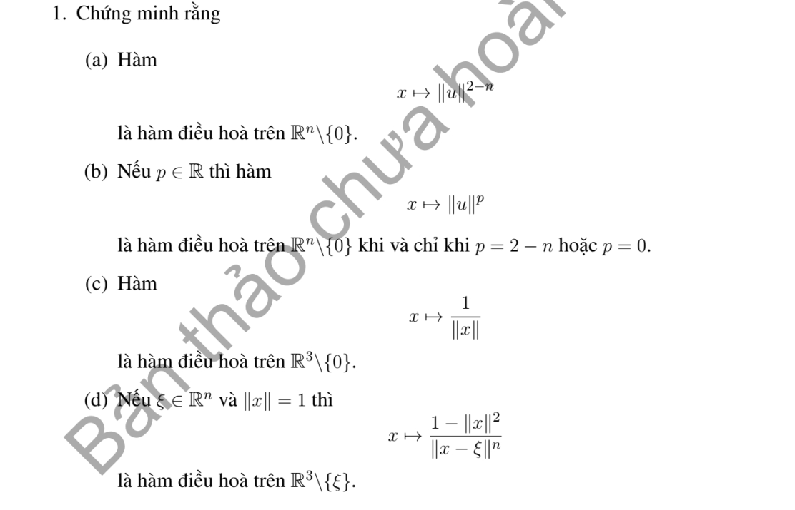

# Bài tập thực hành 1 — Mục 5.4.3

**Mã:** `BT_5_4_3_01` · **Trang sách:** 249–249

[← Mục lục](../MUC_LUC.md) · [Bản PDF của bài](BT_5_4_3_01.pdf)

## Đề bài

## Kiến thức và trình tự giải

**Các công cụ dùng trong chứng minh.** Với hai hàm đủ trơn,

$$\Delta(uv)=u\Delta v+v\Delta u+2\nabla u\cdot\nabla v.$$

Với hàm xuyên tâm $u=f(r)$ trong $\mathbb R^n$,

$$\Delta u=f''(r)+\frac{n-1}{r}f'(r).$$

Tính giá trị trung bình và công thức Poisson cho phép suy cận nội của đạo hàm. Khi dùng liên thông, tính trơn tại tâm hoặc tăng trưởng ở vô cực, phải nêu giả thiết tương ứng; bỏ một giả thiết có thể làm kết luận sai.

## Lời giải áp dụng cho bài

(a)--(c) Với hàm xuyên tâm $r^p$, $\Delta r^p=p(p+n-2)r^{p-2}$. Vì $r>0$, Laplace bằng 0 đúng khi $p=0$ hoặc $p=2-n$. Trong $n=3,p=-1$ cho $1/r$ điều hòa ngoài gốc.

**Ý (d).**  Đặt $v=x-\xi$, $|\xi|=1$, $1-|x|^2=-|v|^2-2v\cdot\xi$. Khi đó nhân Poisson bằng $-|v|^{2-n}-2(v\cdot\xi)|v|^{-n}$. Với $n\ne2$, hạng sau là đạo hàm theo hướng của $|v|^{2-n}$ chia $2-n$; do đó điều hòa. Với $n=2$, dùng $(v\cdot\xi)|v|^{-2}=\partial_\xi\ln|v|$, cũng điều hòa. Miền đúng là $\mathbb R^n\setminus\{\xi\}$; ký hiệu $\mathbb R^3$ ở dòng cuối đề chỉ phù hợp khi $n=3$.

## Đối chiếu kết quả

Khi sử dụng kết quả, kiểm tra đồng thời phương trình, dữ liệu ban đầu/biên và miền được nêu trong lời giải. Các điều kiện về tính trơn, nghiệm thực, tồn tại hoặc duy nhất là một phần của kết luận; không bỏ chúng khi ghi đáp án.
