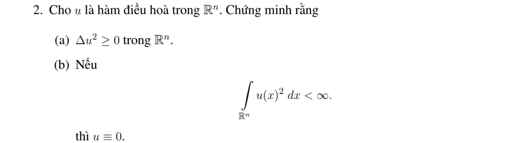

# Bài tập thực hành 2 — Mục 5.4.3

**Mã:** `BT_5_4_3_02` · **Trang sách:** 249–250

[← Mục lục](../MUC_LUC.md) · [Bản PDF của bài](BT_5_4_3_02.pdf)

## Đề bài

## Kiến thức và trình tự giải

**Các công cụ dùng trong chứng minh.** Với hai hàm đủ trơn,

$$\Delta(uv)=u\Delta v+v\Delta u+2\nabla u\cdot\nabla v.$$

Với hàm xuyên tâm $u=f(r)$ trong $\mathbb R^n$,

$$\Delta u=f''(r)+\frac{n-1}{r}f'(r).$$

Tính giá trị trung bình và công thức Poisson cho phép suy cận nội của đạo hàm. Khi dùng liên thông, tính trơn tại tâm hoặc tăng trưởng ở vô cực, phải nêu giả thiết tương ứng; bỏ một giả thiết có thể làm kết luận sai.

## Lời giải áp dụng cho bài

**Ý (a).**  Quy tắc tích cho $\Delta(u^2)=2u\Delta u+2|\nabla u|^2=2|\nabla u|^2\ge0$.

**Ý (b).**  Tính giá trị trung bình và Cauchy--Schwarz trên quả cầu bán kính $R$ cho $|u(x)|^2\le |B_R|^{-1}\int_{B_R(x)}u^2\le |B_R|^{-1}\|u\|_{L^2(\mathbb R^n)}^2$. Cho $R\to\infty$, vế phải về 0, nên $u=0$.

## Đối chiếu kết quả

Khi sử dụng kết quả, kiểm tra đồng thời phương trình, dữ liệu ban đầu/biên và miền được nêu trong lời giải. Các điều kiện về tính trơn, nghiệm thực, tồn tại hoặc duy nhất là một phần của kết luận; không bỏ chúng khi ghi đáp án.
