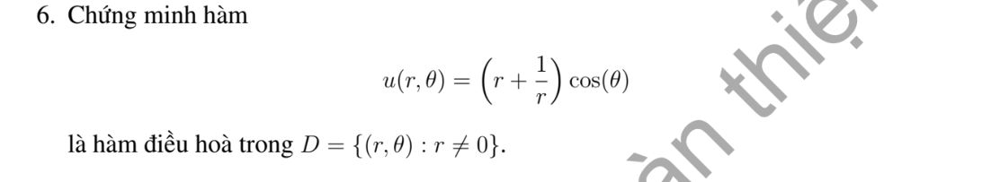

# Bài tập thực hành 6 — Mục 5.4.3

**Mã:** `BT_5_4_3_06` · **Trang sách:** 250–250

[← Mục lục](../MUC_LUC.md) · [Bản PDF của bài](BT_5_4_3_06.pdf)

## Đề bài

## Kiến thức và trình tự giải

**Các công cụ dùng trong chứng minh.** Với hai hàm đủ trơn,

$$\Delta(uv)=u\Delta v+v\Delta u+2\nabla u\cdot\nabla v.$$

Với hàm xuyên tâm $u=f(r)$ trong $\mathbb R^n$,

$$\Delta u=f''(r)+\frac{n-1}{r}f'(r).$$

Tính giá trị trung bình và công thức Poisson cho phép suy cận nội của đạo hàm. Khi dùng liên thông, tính trơn tại tâm hoặc tăng trưởng ở vô cực, phải nêu giả thiết tương ứng; bỏ một giả thiết có thể làm kết luận sai.

## Lời giải áp dụng cho bài

$u_r=(1-r^{-2})\cos\theta,u_{rr}=2r^{-3}\cos\theta,u_{\theta\theta}=-(r+r^{-1})\cos\theta$. Thế vào $u_{rr}+u_r/r+u_{\theta\theta}/r^2$ được 0 với $r>0$.

## Đối chiếu kết quả

Khi sử dụng kết quả, kiểm tra đồng thời phương trình, dữ liệu ban đầu/biên và miền được nêu trong lời giải. Các điều kiện về tính trơn, nghiệm thực, tồn tại hoặc duy nhất là một phần của kết luận; không bỏ chúng khi ghi đáp án.
