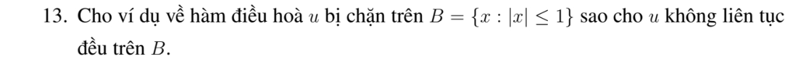

# Bài tập thực hành 13 — Mục 5.4.3

**Mã:** `BT_5_4_3_13` · **Trang sách:** 251–251

[← Mục lục](../MUC_LUC.md) · [Bản PDF của bài](BT_5_4_3_13.pdf)

## Đề bài

## Kiến thức và trình tự giải

**Các công cụ dùng trong chứng minh.** Với hai hàm đủ trơn,

$$\Delta(uv)=u\Delta v+v\Delta u+2\nabla u\cdot\nabla v.$$

Với hàm xuyên tâm $u=f(r)$ trong $\mathbb R^n$,

$$\Delta u=f''(r)+\frac{n-1}{r}f'(r).$$

Tính giá trị trung bình và công thức Poisson cho phép suy cận nội của đạo hàm. Khi dùng liên thông, tính trơn tại tâm hoặc tăng trưởng ở vô cực, phải nêu giả thiết tương ứng; bỏ một giả thiết có thể làm kết luận sai.

## Lời giải áp dụng cho bài

Ký hiệu $B$ trong đề dùng $|x|\le1$: nếu $u$ liên tục trên quả cầu đóng thì Heine--Cantor buộc liên tục đều, nên yêu cầu như vậy không thể thỏa. Với ý định là quả cầu mở, trong đĩa lấy

$$
u(x,y)=\operatorname{Re}\exp\left[-\frac{1+x+iy}{1-x-iy}\right].
$$

Hàm giải tích vì cực $z=1$ nằm ngoài miền; $\operatorname{Re}(1+z)/(1-z)>0$ nên $|u|\le1$. Khi $z\to1$ theo bán kính, $u\to0$; theo các đường có phần thực thương tiến về một hằng và phần ảo thay đổi, $u$ có nhiều giá trị giới hạn. Do đó không liên tục đều. Có thể mở rộng ví dụ sang $n\ge2$ bằng cách không phụ thuộc các tọa độ còn lại.

## Đối chiếu kết quả

Khi sử dụng kết quả, kiểm tra đồng thời phương trình, dữ liệu ban đầu/biên và miền được nêu trong lời giải. Các điều kiện về tính trơn, nghiệm thực, tồn tại hoặc duy nhất là một phần của kết luận; không bỏ chúng khi ghi đáp án.
