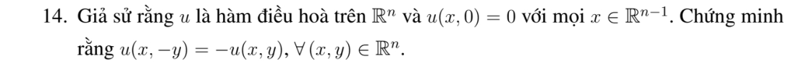

# Bài tập thực hành 14 — Mục 5.4.3

**Mã:** `BT_5_4_3_14` · **Trang sách:** 251–251

[← Mục lục](../MUC_LUC.md) · [Bản PDF của bài](BT_5_4_3_14.pdf)

## Đề bài

## Kiến thức và trình tự giải

**Các công cụ dùng trong chứng minh.** Với hai hàm đủ trơn,

$$\Delta(uv)=u\Delta v+v\Delta u+2\nabla u\cdot\nabla v.$$

Với hàm xuyên tâm $u=f(r)$ trong $\mathbb R^n$,

$$\Delta u=f''(r)+\frac{n-1}{r}f'(r).$$

Tính giá trị trung bình và công thức Poisson cho phép suy cận nội của đạo hàm. Khi dùng liên thông, tính trơn tại tâm hoặc tăng trưởng ở vô cực, phải nêu giả thiết tương ứng; bỏ một giả thiết có thể làm kết luận sai.

## Lời giải áp dụng cho bài

Đặt $v(x,y)=u(x,y)+u(x,-y)$. Đây là hàm điều hòa chẵn theo $y$, và $v(x,0)=0$, $v_y(x,0)=0$. Từ $v_{yy}=-\Delta_xv$, tất cả đạo hàm theo $y$ trên siêu phẳng đều 0 theo quy nạp. Hàm điều hòa giải tích, nên $v=0$ gần siêu phẳng, rồi trên toàn miền nhờ tính duy nhất giải tích. Suy $u(x,-y)=-u(x,y)$.

## Đối chiếu kết quả

Khi sử dụng kết quả, kiểm tra đồng thời phương trình, dữ liệu ban đầu/biên và miền được nêu trong lời giải. Các điều kiện về tính trơn, nghiệm thực, tồn tại hoặc duy nhất là một phần của kết luận; không bỏ chúng khi ghi đáp án.
