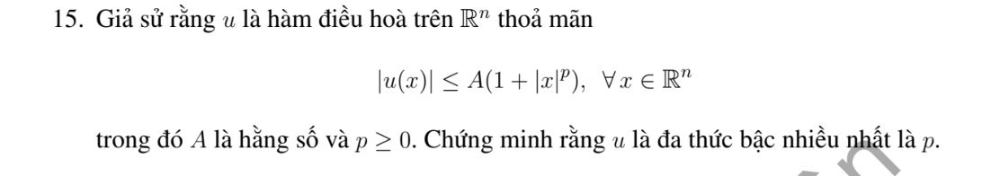

# Bài tập thực hành 15 — Mục 5.4.3

**Mã:** `BT_5_4_3_15` · **Trang sách:** 251–251

[← Mục lục](../MUC_LUC.md) · [Bản PDF của bài](BT_5_4_3_15.pdf)

## Đề bài

## Kiến thức và trình tự giải

**Các công cụ dùng trong chứng minh.** Với hai hàm đủ trơn,

$$\Delta(uv)=u\Delta v+v\Delta u+2\nabla u\cdot\nabla v.$$

Với hàm xuyên tâm $u=f(r)$ trong $\mathbb R^n$,

$$\Delta u=f''(r)+\frac{n-1}{r}f'(r).$$

Tính giá trị trung bình và công thức Poisson cho phép suy cận nội của đạo hàm. Khi dùng liên thông, tính trơn tại tâm hoặc tăng trưởng ở vô cực, phải nêu giả thiết tương ứng; bỏ một giả thiết có thể làm kết luận sai.

## Lời giải áp dụng cho bài

Ước lượng đạo hàm nội suy từ công thức Poisson: $|D^ku(x_0)|\le C_kR^{-k}\sup_{B_R(x_0)}|u|\le C'_kR^{-k}(1+(R+|x_0|)^p)$. Chọn số nguyên $k>p$, cho $R\to\infty$ được $D^ku=0$ với mọi $x_0$. Taylor suy $u$ là đa thức bậc không quá $\lfloor p\rfloor$.

## Đối chiếu kết quả

Khi sử dụng kết quả, kiểm tra đồng thời phương trình, dữ liệu ban đầu/biên và miền được nêu trong lời giải. Các điều kiện về tính trơn, nghiệm thực, tồn tại hoặc duy nhất là một phần của kết luận; không bỏ chúng khi ghi đáp án.
