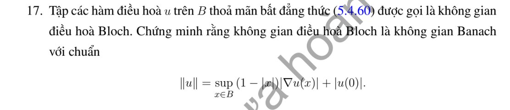

# Bài tập thực hành 17 — Mục 5.4.3

**Mã:** `BT_5_4_3_17` · **Trang sách:** 251–251

[← Mục lục](../MUC_LUC.md) · [Bản PDF của bài](BT_5_4_3_17.pdf)

## Đề bài

## Kiến thức và trình tự giải

**Các công cụ dùng trong chứng minh.** Với hai hàm đủ trơn,

$$\Delta(uv)=u\Delta v+v\Delta u+2\nabla u\cdot\nabla v.$$

Với hàm xuyên tâm $u=f(r)$ trong $\mathbb R^n$,

$$\Delta u=f''(r)+\frac{n-1}{r}f'(r).$$

Tính giá trị trung bình và công thức Poisson cho phép suy cận nội của đạo hàm. Khi dùng liên thông, tính trơn tại tâm hoặc tăng trưởng ở vô cực, phải nêu giả thiết tương ứng; bỏ một giả thiết có thể làm kết luận sai.

## Lời giải áp dụng cho bài

Chuẩn $\|u\|=|u(0)|+\sup_B(1-|x|)|\nabla u|$ có tính đồng nhất và tam giác; chuẩn 0 buộc $\nabla u=0,u(0)=0$, nên $u=0$. Với dãy Cauchy $u_j$, tích phân trên đoạn từ 0 đến $x$ cho

$$
|u_j(x)-u_k(x)|\le\|u_j-u_k\|\left[1+\log\frac1{1-|x|}\right].
$$

Do đó hội tụ đều trên compact đến $u$. Tính giá trị trung bình hoặc ước lượng đạo hàm cho $u$ điều hòa và $\nabla u_j\to\nabla u$ trên compact. Cho $k\to\infty$ trong $\sup(1-|x|)|\nabla(u_j-u_k)|\le\varepsilon$ được cùng cận cho $u_j-u$; giá trị tại 0 cũng hội tụ. Vậy $u_j\to u$ theo chuẩn, chứng minh Banach.

## Đối chiếu kết quả

Khi sử dụng kết quả, kiểm tra đồng thời phương trình, dữ liệu ban đầu/biên và miền được nêu trong lời giải. Các điều kiện về tính trơn, nghiệm thực, tồn tại hoặc duy nhất là một phần của kết luận; không bỏ chúng khi ghi đáp án.
