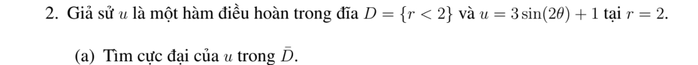

# Bài tập thực hành 2 — Mục 5.5.3

**Mã:** `BT_5_5_3_02` · **Trang sách:** 253–254

[← Mục lục](../MUC_LUC.md) · [Bản PDF của bài](BT_5_5_3_02.pdf)

## Đề bài

## Kiến thức và trình tự giải

**Bước 1 — Xác nhận điều hòa và miền.** Kiểm tra $\Delta u=0$ và tính liên tục trên miền đóng nếu muốn áp dụng nguyên lý cực đại đến biên; một cực nằm trên biên có thể làm hỏng giả thiết.

**Bước 2 — Dùng cực đại hoặc giá trị trung bình.** Hàm điều hòa không hằng trên miền liên thông không đạt cực đại/cực tiểu trong miền. Trên đĩa, giá trị tâm là trung bình dữ liệu trên đường tròn. Với dữ liệu không âm, nhân Poisson dương còn cho tính dương trong miền.

**Bước 3 — Tính các giá trị biên và xét ngoại lệ.** Cực đại yếu cho cận không nghiêm; muốn dấu nghiêm phải dùng nguyên lý mạnh và loại nghiệm hằng. Với Robin, dùng $\int|\nabla w|^2=\int_{\partial\Omega}w\partial_\nu w$ cho hiệu hai nghiệm.

## Lời giải áp dụng cho bài

Biên có cực đại 4 khi $\sin2\theta=1$ và cực tiểu $-2$ khi $\sin2\theta=-1$. Cực đại trên đĩa đóng bằng 4, đạt trên biên tại $\theta=\pi/4,5\pi/4$. Giá trị tâm là trung bình bằng 1. Nghiệm cụ thể $u=1+3r^2\sin2\theta/4=1+3xy/2$.

## Đối chiếu kết quả

Khi sử dụng kết quả, kiểm tra đồng thời phương trình, dữ liệu ban đầu/biên và miền được nêu trong lời giải. Các điều kiện về tính trơn, nghiệm thực, tồn tại hoặc duy nhất là một phần của kết luận; không bỏ chúng khi ghi đáp án.
