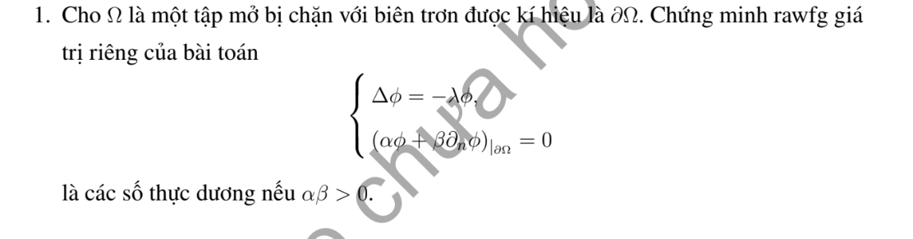

# Bài tập thực hành 1 — Mục 5.6.3

**Mã:** `BT_5_6_3_01` · **Trang sách:** 262–262

[← Mục lục](../MUC_LUC.md) · [Bản PDF của bài](BT_5_6_3_01.pdf)

## Đề bài

## Kiến thức và trình tự giải

**Bước 1 — Chọn bài trị riêng đúng biên.** Giải $-L\phi=\lambda\phi$. Nếu có trôi $Au_x$, phép đổi ẩn mũ đưa về toán tử tự liên hợp nhưng đồng thời đổi điều kiện Neumann thành Robin; cần giữ sự thay đổi này.

**Bước 2 — Trực giao và hệ số.** Nếu toán tử tự liên hợp với trọng số $\sigma$, hệ số của $q$ là $q_n=\int q\phi_n\sigma/\int\phi_n^2\sigma$. Trong hình chữ nhật, hàm riêng thường là tích hai hàm một chiều và trị riêng là tổng hai trị riêng.

**Bước 3 — Giải mode của bài PDE.** Nhiệt cho $T_n'+\lambda_nT_n=H_n$; Poisson cho $-\lambda_nT_n=H_n$ sau khử biên; sóng cho $T_n''+\lambda_nT_n=H_n$. Mode 0, phổ liên tục và dữ liệu đầu dư phải xét riêng, không áp công thức chia cho $\lambda_n$ một cách máy móc.

## Lời giải áp dụng cho bài

Cho hàm riêng phức $\phi\ne0$, nhân $-\Delta\phi=\lambda\phi$ với $\overline\phi$ rồi tích phân:

$$
\lambda\int_\Omega|\phi|^2=\int_\Omega|\nabla\phi|^2+\frac\alpha\beta\int_{\partial\Omega}|\phi|^2.
$$

Vì $\alpha\beta>0$, $\alpha/\beta>0$, vế phải thực và dương: nếu bằng 0 thì $\phi$ hằng và biên buộc 0. Do đó mọi trị riêng thực dương.

## Đối chiếu kết quả

Khi sử dụng kết quả, kiểm tra đồng thời phương trình, dữ liệu ban đầu/biên và miền được nêu trong lời giải. Các điều kiện về tính trơn, nghiệm thực, tồn tại hoặc duy nhất là một phần của kết luận; không bỏ chúng khi ghi đáp án.
