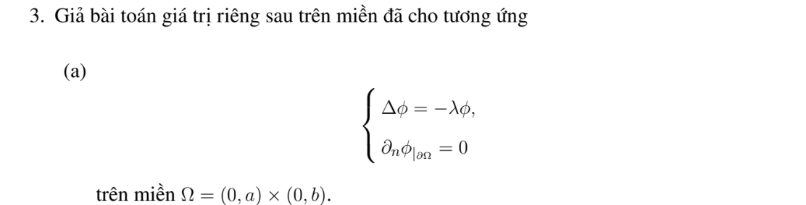
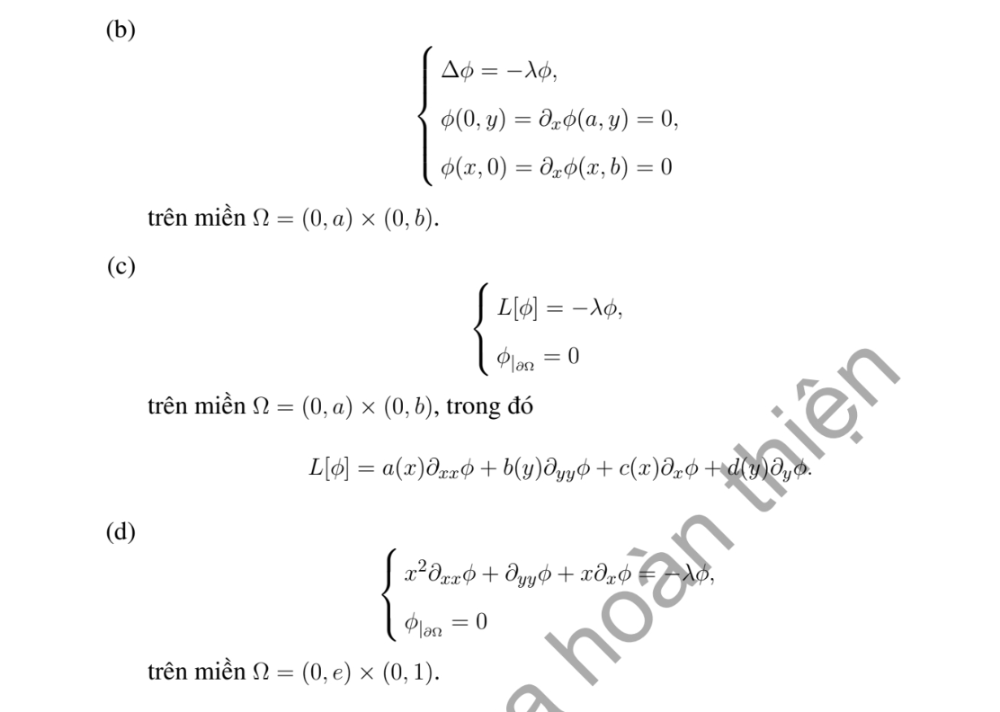

# Bài tập thực hành 3 — Mục 5.6.3

**Mã:** `BT_5_6_3_03` · **Trang sách:** 262–263

[← Mục lục](../MUC_LUC.md) · [Bản PDF của bài](BT_5_6_3_03.pdf)

## Đề bài

## Kiến thức và trình tự giải

**Bước 1 — Chọn bài trị riêng đúng biên.** Giải $-L\phi=\lambda\phi$. Nếu có trôi $Au_x$, phép đổi ẩn mũ đưa về toán tử tự liên hợp nhưng đồng thời đổi điều kiện Neumann thành Robin; cần giữ sự thay đổi này.

**Bước 2 — Trực giao và hệ số.** Nếu toán tử tự liên hợp với trọng số $\sigma$, hệ số của $q$ là $q_n=\int q\phi_n\sigma/\int\phi_n^2\sigma$. Trong hình chữ nhật, hàm riêng thường là tích hai hàm một chiều và trị riêng là tổng hai trị riêng.

**Bước 3 — Giải mode của bài PDE.** Nhiệt cho $T_n'+\lambda_nT_n=H_n$; Poisson cho $-\lambda_nT_n=H_n$ sau khử biên; sóng cho $T_n''+\lambda_nT_n=H_n$. Mode 0, phổ liên tục và dữ liệu đầu dư phải xét riêng, không áp công thức chia cho $\lambda_n$ một cách máy móc.

## Lời giải áp dụng cho bài

**Ý (a).**  Neumann hình chữ nhật: $\phi_{nm}=\cos(n\pi x/a)\cos(m\pi y/b)$, $\lambda_{nm}=(n\pi/a)^2+(m\pi/b)^2$, $n,m\ge0$, có $\lambda_{00}=0$.

**Ý (b).**  Dirichlet trái/dưới, Neumann phải/trên: $\phi_{nm}=\sin((n+1/2)\pi x/a)\sin((m+1/2)\pi y/b)$, $\lambda$ là tổng hai bình phương, $n,m\ge0$. Dòng $\partial_x\phi(x,b)$ của đề phải sửa thành $\partial_y\phi(x,b)$ để là Neumann ở cạnh trên. Giữ $\partial_x$ nguyên văn thì đây là đạo hàm tiếp tuyến, suy $\phi$ hằng trên cạnh trên; cùng Dirichlet ở góc trái buộc cạnh trên bằng 0, tức bài Dirichlet trên, có mode $\sin(m\pi y/b)$, $m\ge1$.

**Ý (c).**  Tách $\phi=XY$: giải hai bài một chiều

$$
aX''+cX'=-\lambda_xX,\ X(0)=X(a_{\rm dom})=0;\quad bY''+dY'=-\lambda_yY,\ Y(0)=Y(b_{\rm dom})=0.
$$

Trị riêng $\lambda=\lambda_x+\lambda_y$, hàm riêng $XY$. Khi $a(x),b(y)>0$, trọng số $\rho_x=a^{-1}e^{\int c/a}$, $\rho_y=b^{-1}e^{\int d/b}$ đưa về Sturm--Liouville; dữ kiện hàm tùy ý chỉ cho kết quả qua hai ODE này, không có danh sách số cụ thể.

**Ý (d).**  Đề có miền $0<x<e$, hệ số $x^2$ suy biến ở 0. Đặt $z=\ln x\in(-\infty,1)$; toán tử thành $\partial_{zz}+\partial_{yy}$. Không có phổ rời rạc như hình chữ nhật hữu hạn. Trong lớp trơn và liên tục bằng 0 ở $x=0,e$, không có hàm riêng tách biến không tầm thường: mode tăng/giảm mũ theo $z$ không thể đồng thời giảm ở $-\infty$ và triệt tiêu ở 1, mode dao động không có giới hạn 0 tại $-\infty$. Với không gian trọng số $dx\,dy/x$, phổ liên tục có hàm riêng suy rộng $\sin(k(1-\ln x))\sin(m\pi y)$, $\lambda=k^2+m^2\pi^2$, $k\ge0,m\ge1$. Nếu miền dự định là $(1,e)$, phổ rời rạc là $\sin(n\pi\ln x)\sin(m\pi y)$ với $\lambda=(n^2+m^2)\pi^2$.

## Đối chiếu kết quả

Khi sử dụng kết quả, kiểm tra đồng thời phương trình, dữ liệu ban đầu/biên và miền được nêu trong lời giải. Các điều kiện về tính trơn, nghiệm thực, tồn tại hoặc duy nhất là một phần của kết luận; không bỏ chúng khi ghi đáp án.
