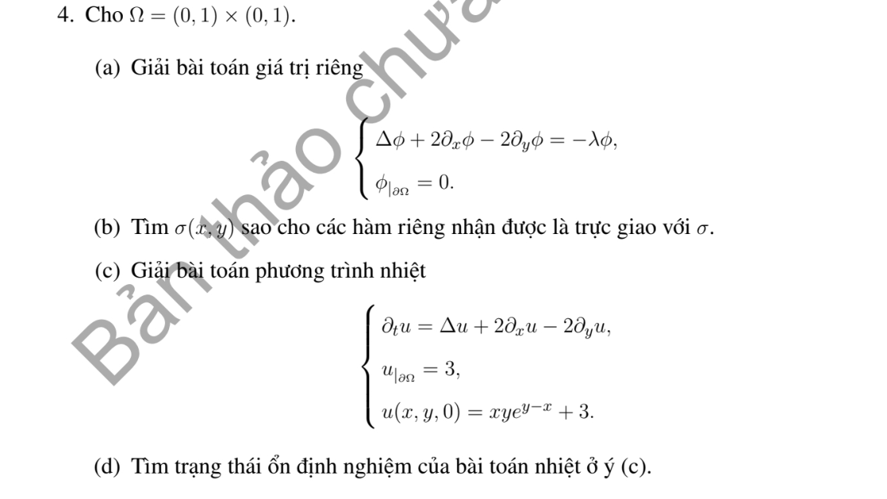

# Bài tập thực hành 4 — Mục 5.6.3

**Mã:** `BT_5_6_3_04` · **Trang sách:** 263–263

[← Mục lục](../MUC_LUC.md) · [Bản PDF của bài](BT_5_6_3_04.pdf)

## Đề bài

## Kiến thức và trình tự giải

**Bước 1 — Chọn bài trị riêng đúng biên.** Giải $-L\phi=\lambda\phi$. Nếu có trôi $Au_x$, phép đổi ẩn mũ đưa về toán tử tự liên hợp nhưng đồng thời đổi điều kiện Neumann thành Robin; cần giữ sự thay đổi này.

**Bước 2 — Trực giao và hệ số.** Nếu toán tử tự liên hợp với trọng số $\sigma$, hệ số của $q$ là $q_n=\int q\phi_n\sigma/\int\phi_n^2\sigma$. Trong hình chữ nhật, hàm riêng thường là tích hai hàm một chiều và trị riêng là tổng hai trị riêng.

**Bước 3 — Giải mode của bài PDE.** Nhiệt cho $T_n'+\lambda_nT_n=H_n$; Poisson cho $-\lambda_nT_n=H_n$ sau khử biên; sóng cho $T_n''+\lambda_nT_n=H_n$. Mode 0, phổ liên tục và dữ liệu đầu dư phải xét riêng, không áp công thức chia cho $\lambda_n$ một cách máy móc.

## Lời giải áp dụng cho bài

**Ý (a).**  Đặt $\phi=e^{y-x}v$. Khi đó $(\Delta+2\partial_x-2\partial_y)\phi=e^{y-x}(\Delta v-2v)$. Do đó $\phi_{nm}=e^{y-x}\sin n\pi x\sin m\pi y$, $\lambda_{nm}=\pi^2(n^2+m^2)+2$, $n,m\ge1$.

**Ý (b).**  Chọn $\sigma=e^{2x-2y}$, tích có trọng số biến thành tích các sine, nên trực giao.

**Ý (c).**  $u=3+e^{y-x}\sum_{n,m\ge1}c_{nm}e^{-\lambda_{nm}t}\sin n\pi x\sin m\pi y$, với $c_{nm}=4(-1)^{n+m}/(nm\pi^2)$ là hệ số sine của $xy$.

**Ý (d).**  Mọi $\lambda_{nm}>0$, nên giới hạn bằng 3. Dữ liệu đầu không khớp biên ở cạnh phải/trên; nghiệm hiểu theo dữ liệu nội và biên cho $t>0$.

## Đối chiếu kết quả

Khi sử dụng kết quả, kiểm tra đồng thời phương trình, dữ liệu ban đầu/biên và miền được nêu trong lời giải. Các điều kiện về tính trơn, nghiệm thực, tồn tại hoặc duy nhất là một phần của kết luận; không bỏ chúng khi ghi đáp án.
